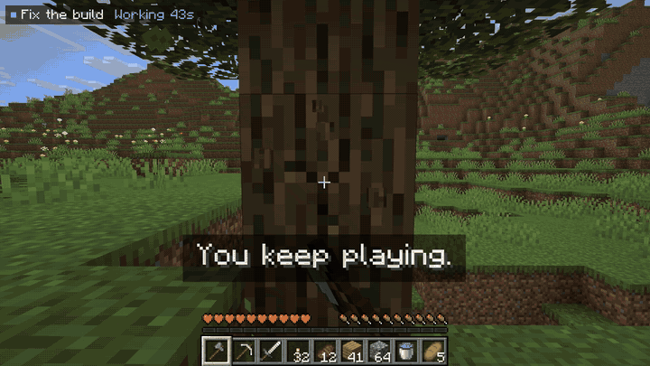
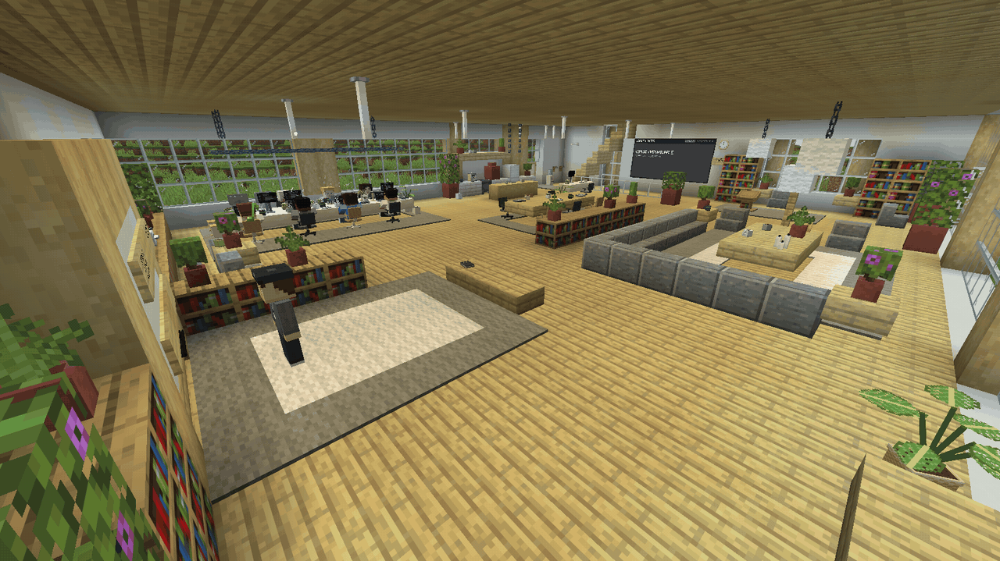
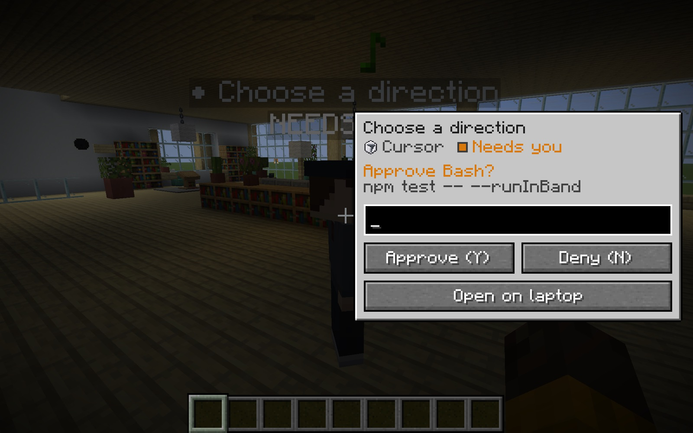
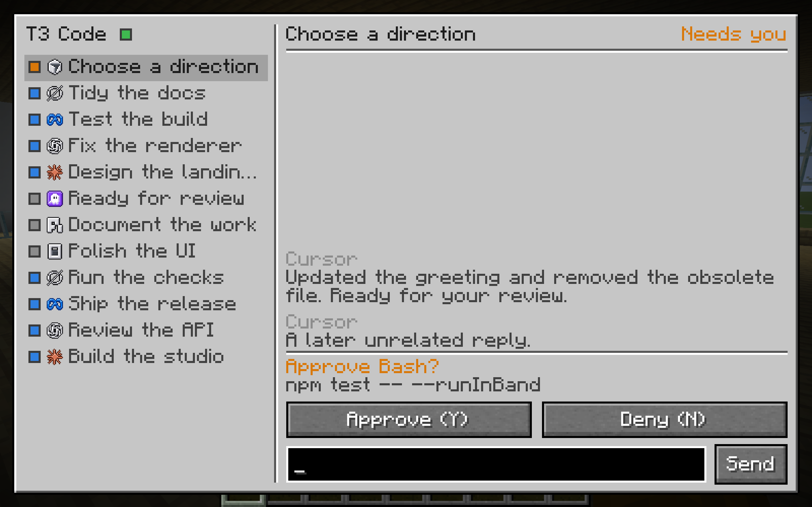
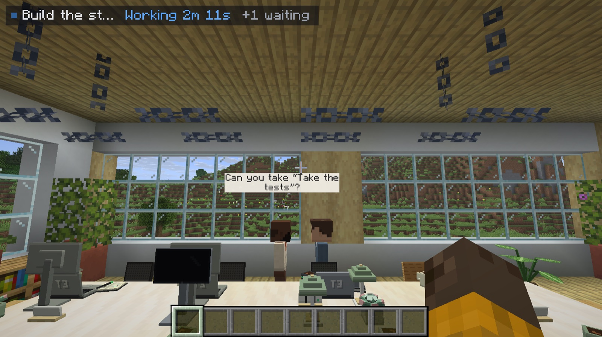
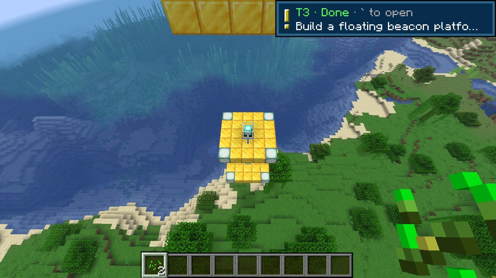
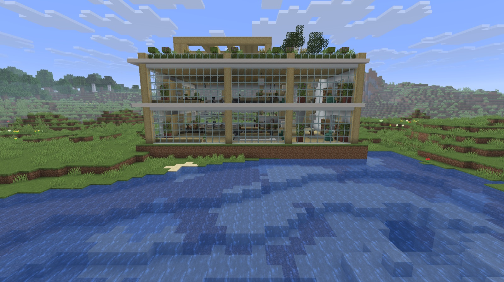
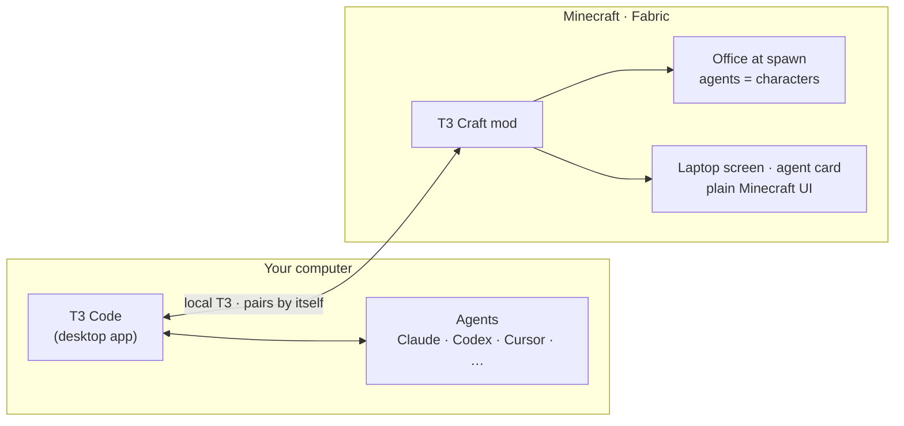

# T3 Craft

### Your coding agents, living in your Minecraft world.

A Fabric mod that turns your [T3 Code](https://t3.codes) agents into characters in an office at spawn. 
Walk up to one, click it, and answer it. No alt-tab, no pairing, no settings screen.

**[⬇ Get it](#-get-it)** · [What you get](#-what-you-get) · [How it works](#-how-it-works) · [FAQ](#-faq) · [Roadmap](docs/ROADMAP.md)

⭐ If you want your agents in your Minecraft world, star the repo. It's how I know to keep building it.

 
Your active T3 Code threads, as characters at their desks. Real in-game capture.

---

<!-- GET-IT:START (self-contained; swap this whole block when the install path changes) -->
## ⬇ Get it

You need **Minecraft Java** (the official launcher, opened and signed in once) and **[T3 Code](https://t3.codes)** on the same computer. The installer brings Fabric and the mods.

1. **Quit the Minecraft Launcher**, then run one command. It adds a *T3 Craft* installation with its own game folder and leaves your other installations and worlds alone.
   - **macOS / Linux** (Terminal): `curl -fsSL https://github.com/alexandros-lekkas/t3craft/releases/latest/download/install.sh | bash`
   - **Windows** (PowerShell): `irm https://github.com/alexandros-lekkas/t3craft/releases/latest/download/install.ps1 | iex`
2. **Open T3 Code**, then open the launcher and press **Play** on *T3 Craft*.
3. **Click _T3 World_** beside Singleplayer.

You spawn facing the office and your agents are already at their desks. T3 Craft finds T3 Code by itself and says one line in chat when it's connected. Already have a world? Run `/t3 office` and the office goes up where you stand.

Modrinth App or Prism? Import `t3craft-<version>.mrpack` from [Releases](https://github.com/alexandros-lekkas/t3craft/releases/latest). Already run Fabric? Put `t3craft-<version>.jar` and [Fabric API](https://modrinth.com/mod/fabric-api) in `mods/` (Minecraft Java 26.3, Fabric Loader 0.19.5+, Java 25+). [All install options](docs/INSTALL.md) · [five-minute first session](docs/FIRST_SESSION.md)
<!-- GET-IT:END -->

## ✨ What you get

<table>
<tr>
<td width="50%" valign="top">

<b>Click an agent to talk.</b> A small card opens beside it: the last message or the request it's waiting on, one input box, and Approve / Deny (<kbd>Y</kbd> / <kbd>N</kbd>) when it needs you. <a href="docs/design/native-ui.md">See the UI →</a>
</td>
<td width="50%" valign="top">

<b>The laptop.</b> Press <kbd>`</kbd> or right-click a desk laptop for all your active threads, in plain Minecraft. Snoozed and finished threads stay out of the way, like in T3 Code.
</td>
</tr>
<tr>
<td valign="top">

<b>The office shows the status.</b> Working agents type at their desks, agents that need you wait at the whiteboard, finished ones head to the lounge. When a thread hands work to a subagent, you see them meet and talk. <a href="docs/design/office.md">The office →</a>
</td>
<td valign="top">

<b>They can build, too.</b> Add the mod's local MCP server to your agent once, ask for a beacon platform, and watch it go up. You get one quiet toast when it's done. <a href="docs/REFERENCE.md#let-agents-use-minecraft">Set it up →</a>
</td>
</tr>
</table>

 
<i>T3 World</i> makes a world on a plains seed with the office already standing by the lake. <a href="docs/design/world.md">How it works →</a>

**Also in the box:** Decisions (<kbd>J</kbd>) for every pending approval · <kbd>1</kbd>–<kbd>9</kbd> to answer an agent's question · a corner timer while an agent works · real checkpoint diffs · report books when work is done · a usage limits board on the office wall · per-provider skins for Claude, Codex, Cursor, OpenCode and more · a shared office on a Fabric server. The full command list is in the [reference](docs/REFERENCE.md#commands).

## 🧠 How it works

T3 Craft talks to the T3 Code already running on your machine. It pairs itself through T3's bundled CLI, shows your threads in plain Minecraft screens and as characters in the office, and pings you when an agent finishes or needs you. Every thread becomes a character, and its state picks where the character stands. Your prompts never go through a Minecraft server. [Architecture →](docs/ARCHITECTURE.md)

## ❓ FAQ

<b>Do I need T3 Code?</b>

Yes. T3 Craft is a window into [T3 Code](https://t3.codes) (free and open source). Your agents and threads live there, and Minecraft shows them.

<b>Which agents work?</b>

Anything T3 Code runs: Claude Code, Codex, Cursor, OpenCode and more. Each provider gets its own skins.

<b>Does it work in multiplayer?</b>

The laptop, the agent card and the pings run in your client and talk only to your own T3. For an office everyone on a server sees, put the mod on the Fabric server too and have an operator pair it once with `/t3office pair`. Everyone there can read thread titles on the name tags. [Shared office →](docs/REFERENCE.md#shared-office-dedicated-server)

<b>Is it safe? Can agents touch my world?</b>

Agents act only through T3 Code, with the permissions you already gave them there. Commands still ask for approval unless you chose full access in T3. The mod's MCP server listens on `127.0.0.1` only, and every command an agent runs in your world shows in your chat. Try it in a fresh world first: building the office replaces terrain where it stands.

<b>Will it slow my game down?</b>

It shouldn't. The office is ordinary blocks and a handful of characters.

<b>Mac, Windows, Linux?</b>

The mod runs wherever Minecraft Java 26.3 runs. Auto-connect is tested on macOS first; Windows and Linux reports are very welcome.

<b>Is this official?</b>

No. It's a fan-made, MIT-licensed project and isn't affiliated with Mojang, Microsoft or T3 Tools / Ping.

## 🤝 Contributing

Bugs, ideas, office builds and skins are all welcome. Start with [CONTRIBUTING.md](CONTRIBUTING.md) (JDK 25, `./gradlew build`) and the [good first issues](https://github.com/alexandros-lekkas/t3craft/labels/good%20first%20issue). Every product decision is written down in [DECISIONS.md](docs/DECISIONS.md), with the reason.

<b>⭐ Star the repo</b> to follow along. Next up: a held laptop you can open anywhere (<a href="docs/ROADMAP.md">roadmap</a>).

## 🙏 Credits

Built and maintained by **[Alexandros Lekkas](https://github.com/alexandros-lekkas)**.
T3 Craft continues **[maxwellyoung/t3craft](https://github.com/maxwellyoung/t3craft)** by Maxwell Young (MIT). Thank you for the foundation.
[T3 Code](https://t3.codes) is made by [Theo](https://github.com/t3dotgg) and the [Ping](https://github.com/pingdotgg) team.
See [Credits](CREDITS.md), [third-party licenses](THIRD_PARTY_LICENSES.md) and the [provider trademark notice](docs/legal/provider-icons-NOTICE.md).

MIT licensed. NOT AN OFFICIAL MINECRAFT PRODUCT. NOT APPROVED BY OR ASSOCIATED WITH MOJANG OR MICROSOFT. Not affiliated with or endorsed by T3 Tools Inc.; "T3 Code" is theirs.
