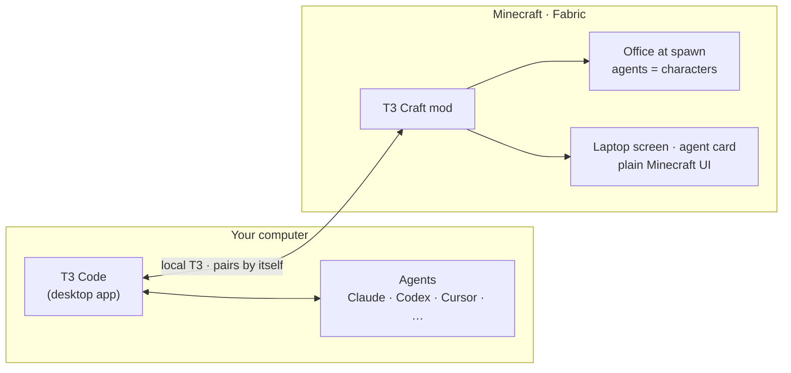

<!--
  Hero: the launch demo, recorded from the real game by scripts/demo/record.sh (see docs/REFERENCE.md,
  "Recording the launch video"). For an inline player with controls, drag docs/images/launch/demo-readme.mp4
  into the GitHub README editor and paste the https://github.com/user-attachments/assets/<id> URL it gives you
  on its own line in place of the image below.
-->

# T3 Craft

**Status: in active development.** The screenshots are real in-game captures unless a caption says otherwise.

### Your coding agents, living in your Minecraft world.

Your [T3 Code](https://t3.codes) agents become characters in an office at spawn. 
Walk up to one, click it, and answer it. You never alt-tab, and there's **nothing to set up.**

<!-- After the Modrinth pages go live, uncomment:

-->

**[⬇ Get it](#-get-it)** · [What you get](#-what-you-get) · [How it works](#-how-it-works) · [FAQ](#-faq) · [Roadmap](docs/ROADMAP.md)

---

## ⬇ Get it

1. **Download the T3 Craft pack** from [**Releases**](https://github.com/alexandros-lekkas/t3craft/releases/latest) or [Modrinth](https://modrinth.com/modpack/t3craft-pack). It adds a *T3 Craft* installation to the official Minecraft Launcher and leaves your other installs alone.
2. **Open T3 Code**, then press **Play** on *T3 Craft*.
3. **Click _T3 World_.** You spawn facing your office, and your agents are already at their desks. <a href="docs/design/world.md">How it works →</a>

No pairing links, no setup commands, no settings screens. T3 Craft finds T3 Code on your computer and connects by itself. Already have a world? Run `/t3 office` and the office goes up in front of you.

Already run Fabric? Drop `t3craft-x.y.z.jar` and Fabric API into `mods/`. Needs Minecraft Java 26.3, Fabric Loader 0.19.5+ and Java 25+.

## ✨ What you get

<table>
<tr>
<td width="50%" valign="top">

<b>Click an agent to talk.</b> A small card opens beside it: the last message or the request it is waiting on, one input box, and Approve / Deny when it needs you. The laptop (or <kbd>`</kbd>) shows your active threads and the selected one, in plain Minecraft. <a href="docs/design/native-ui.md">See the UI →</a>
</td>
<td width="50%" valign="top">

<b>An office that shows the status.</b> Working agents sit and type at their desks. Agents that need you wait at the whiteboard. Finished ones head to the lounge. <a href="docs/design/office.md">The office →</a>
</td>
</tr>
<tr>
<td valign="top">

<b>They can build, too.</b> Ask for a beacon platform and watch it go up block by block. You get one quiet toast when it's done.
</td>
<td valign="top">

<b>One click to a world.</b> <i>T3 World</i> on the title screen makes a world on a plains seed with the office already standing by the lake, turned to face the view. <a href="docs/design/world.md">How it works →</a>
</td>
</tr>
</table>

 
Agents look like players, not villagers. Each provider has its own outfits.

**Also in the box:** desk laptops you right-click for that agent's thread · Decisions (<kbd>J</kbd>) for every pending approval · real checkpoint diffs · report books when work is done · snoozed and finished threads stay out of the way, just like in T3 Code · a light Vanilla+ pack (Sodium, Lithium, AppleSkin, Mouse Tweaks…) with no shaders and no bloat. The full command list is in the [reference](docs/REFERENCE.md#commands).

## 🧠 How it works

T3 Craft talks to the T3 Code already running on your machine: it pairs itself, then shows your threads in plain Minecraft screens and as characters in the office, and pings you when an agent finishes or needs you. (T3's own web app can be streamed in instead, opt-in with `webUi: true`.) Your code, keys and prompts never go through a Minecraft server. Every thread becomes a character, and its state picks where the character stands. [Architecture →](docs/ARCHITECTURE.md)

## ❓ FAQ

<b>Do I need T3 Code?</b>

Yes. T3 Craft is a window into [T3 Code](https://t3.codes) (free and open source). Your agents and threads live there, and Minecraft shows them.

<b>Which agents work?</b>

Anything T3 Code runs: Claude Code, Codex, Cursor, OpenCode and more. Each provider gets its own look.

<b>Does it work in multiplayer?</b>

The mod is client-side, so you can use it on any server and your prompts stay private. Install it on the server too to get a shared office that everyone sees.

<b>Is it safe? Can agents touch my world?</b>

Agents act only through T3 Code, with the permissions you already gave them there. Commands still ask for approval unless you chose full access in T3. Building in the world uses ordinary game commands and stays inside your world.

<b>Will it slow my game down?</b>

It shouldn't. The pack ships Sodium and Lithium, and the office is ordinary blocks and a handful of characters.

<b>Mac, Windows, Linux?</b>

The mod runs wherever Minecraft Java 26.3 runs. Auto-connect is tested on macOS first; Windows and Linux reports are very welcome.

<b>Is this official?</b>

No. It's a fan-made, MIT-licensed project and isn't affiliated with Mojang, Microsoft or T3 Tools / Ping. It's just made with love for both.

## 🤝 Contributing

Bugs, ideas, office builds and skins are all welcome. Read [CONTRIBUTING.md](CONTRIBUTING.md) (JDK 25, `./gradlew build`), then [open an issue](https://github.com/alexandros-lekkas/t3craft/issues/new/choose). Every product decision is written down in [DECISIONS.md](docs/DECISIONS.md), with the reason.

## ⭐ Star history

<a href="https://star-history.com/#alexandros-lekkas/t3craft&Date">
  <picture>
    <source media="(prefers-color-scheme: dark)" srcset="https://api.star-history.com/svg?repos=alexandros-lekkas/t3craft&type=Date&theme=dark">
    
  </picture>
</a>

## 🙏 Credits

Built and maintained by **[Alexandros Lekkas](https://github.com/alexandros-lekkas)**.
T3 Craft continues **[maxwellyoung/t3craft](https://github.com/maxwellyoung/t3craft)** by Maxwell Young (MIT). Thank you for the foundation.
[T3 Code](https://t3.codes) is made by [Theo](https://github.com/t3dotgg) and the [Ping](https://github.com/pingdotgg) team.
Modpack mods belong to their authors. See [Credits](CREDITS.md), [third-party licenses](THIRD_PARTY_LICENSES.md) and the [provider trademark notice](docs/legal/provider-icons-NOTICE.md).

MIT licensed. NOT AN OFFICIAL MINECRAFT PRODUCT. NOT APPROVED BY OR ASSOCIATED WITH MOJANG OR MICROSOFT. Not affiliated with or endorsed by T3 Tools Inc.; "T3 Code" is theirs.

