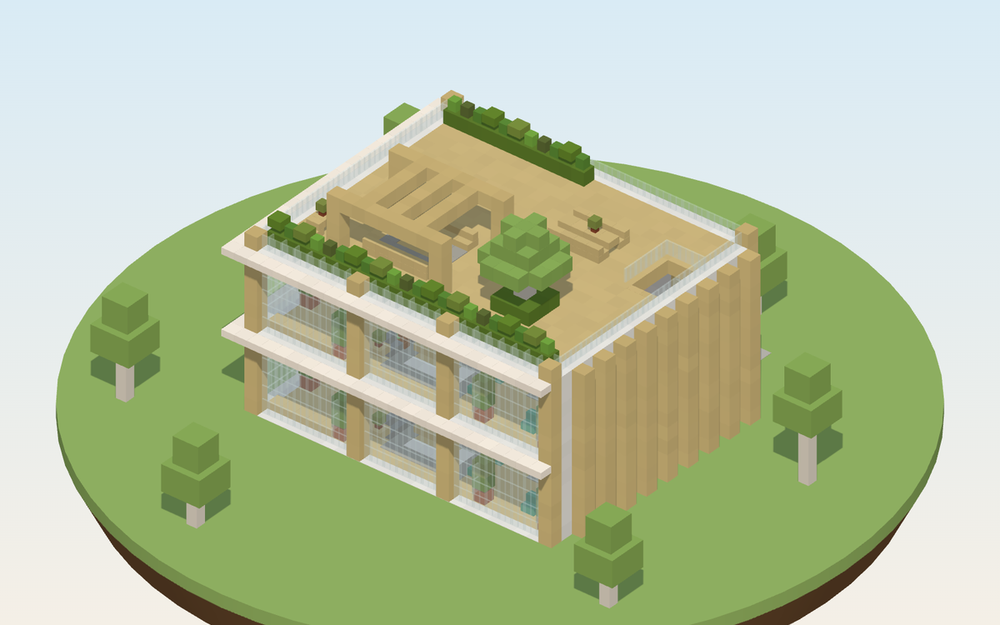
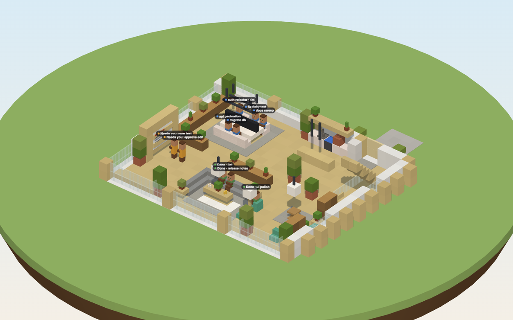
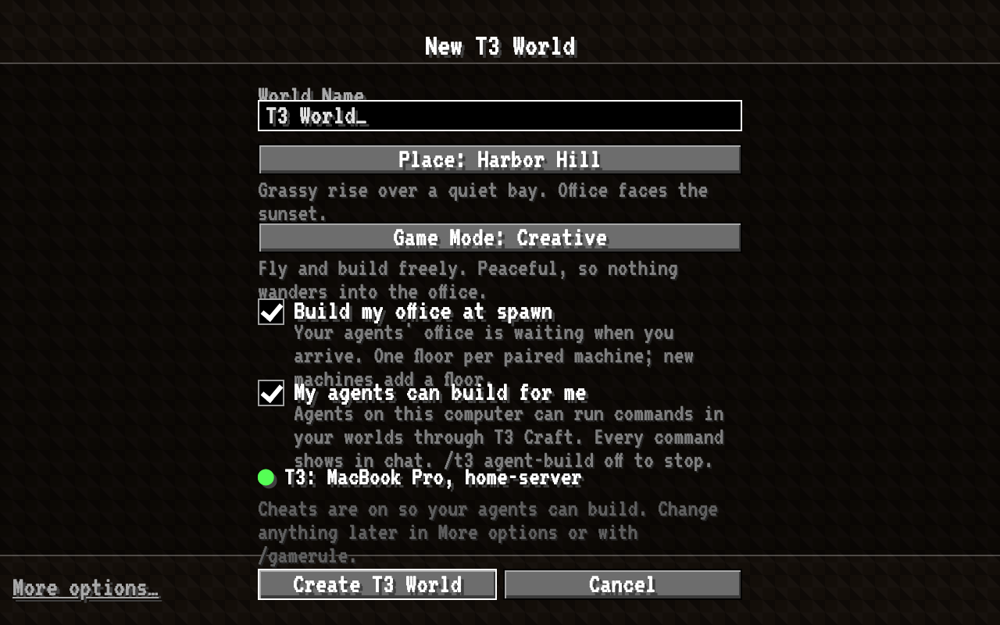
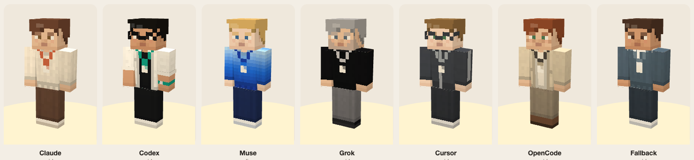
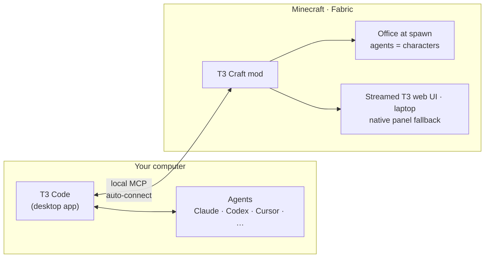

<!--
  ╔══════════════════════════════════════════════════════════════════════╗
  ║  HERO DEMO SLOT: swap the poster below for the real demo before launch ║
  ╚══════════════════════════════════════════════════════════════════════╝

  WHAT TO CAPTURE (10 s, one continuous take, no cuts if possible):
    0.0–2.0  First person on the spawn path, walking toward the office door (daylight, default seed).
    2.0–3.5  Inside: three agents type at the bench. One waits at the whiteboard with an orange "needs you" tag.
    3.5–5.0  Look at that agent and right-click. Its real T3 thread opens in a floating window.
    5.0–6.5  The card reads "Run command? ./gradlew test". Press Y, and the status flips to Working.
    6.5–9.0  Cut (or turn) to the window: blocks appear one by one as the agent builds (2× speed).
    9.0–10.0 A "Done" toast slides in. Hold for 1 s.

  CAPTURE SETTINGS: 1920×1080 at 60 fps, GUI scale 3, FOV 70, HUD on (we want the UI), muted test client,
  separate game dir. Staged demo threads only, no real thread titles. Smooth camera off for first person.

  EXPORT:
    • demo.mp4: H.264, ≤ 10 MB, no audio. Drag it into the GitHub README editor (or an issue). GitHub
      uploads it and gives you a https://github.com/user-attachments/assets/<id> URL. Paste that URL alone
      on its own line here; GitHub renders it as an inline autoplay-on-click player.
    • demo.gif: 960 px wide, 15 fps, ≤ 8 MB (gifski: `gifski --fps 15 --width 960 -o docs/images/launch/demo.gif frames/*.png`).
      Use it in place of the poster img below if you want it to loop with no click.
-->

# T3 Craft

**Status: in active development — some features shown are in progress.** The office images are design renders; a real demo will replace them.

### Your coding agents, living in your Minecraft world.

Your [T3 Code](https://t3.codes) agents become characters in an office at spawn. 
Walk up to one, click it, and answer it. You never alt-tab, and there's **nothing to set up.**

<!-- After the Modrinth pages go live, uncomment:

-->

**[⬇ Get it](#-get-it)** · [What you get](#-what-you-get) · [How it works](#-how-it-works) · [FAQ](#-faq) · [Roadmap](docs/ROADMAP.md)

---

## ⬇ Get it

1. **Download the T3 Craft pack** from [**Releases**](https://github.com/alexandros-lekkas/t3craft/releases/latest) or [Modrinth](https://modrinth.com/modpack/t3craft-pack). It adds a *T3 Craft* installation to the official Minecraft Launcher and leaves your other installs alone.
2. **Open T3 Code**, then press **Play** on *T3 Craft*.
3. **Click _T3 World_.** You spawn facing your office, and your agents are already at their desks.

No pairing links, no commands, no settings screens. T3 Craft finds T3 Code on your computer and connects by itself.

Already run Fabric? Drop `t3craft-x.y.z.jar` and Fabric API into `mods/`. Needs Minecraft Java 26.3, Fabric Loader 0.19.5+ and Java 25+.

## ✨ What you get

<table>
<tr>
<td width="50%" valign="top">

<b>Click an agent to talk.</b> The planned experience streams its real T3 thread into a floating window. The laptop opens the full T3 web app; the native panel remains the fallback.
</td>
<td width="50%" valign="top">

<b>An office that shows the status.</b> Working agents sit at the bench. Agents that need you wait at the whiteboard. Finished ones head to the lounge.
</td>
</tr>
<tr>
<td valign="top">

<b>They can build, too.</b> Ask for a beacon platform and watch it go up block by block. You get one quiet toast when it's done.
</td>
<td valign="top">

<b>One click to a world.</b> A plains seed, chosen so the office sits flat and dry by a lake, 13 blocks from spawn.
</td>
</tr>
</table>

 
Agents look like players, not villagers. Each provider has its own outfits.

**Also in the box:** a T3 laptop you right-click for the full T3 web app · real checkpoint diffs · report books when work is done · snoozed and finished threads stay out of the way, just like in T3 Code · a light Vanilla+ pack (Sodium, Lithium, AppleSkin, Mouse Tweaks…) with no shaders and no bloat.

## 🧠 How it works

T3 Craft talks to the T3 Code already running on your machine over T3's public MCP. Your code, keys and prompts never go through a Minecraft server. Every thread becomes a character, and its state picks where the character stands. [Architecture →](docs/ARCHITECTURE.md)

## ❓ FAQ

<b>Do I need T3 Code?</b>

Yes. T3 Craft is a window into [T3 Code](https://t3.codes) (free and open source). Your agents and threads live there, and Minecraft shows them.

<b>Which agents work?</b>

Anything T3 Code runs: Claude Code, Codex, Cursor, OpenCode and more. Each provider gets its own look.

<b>Does it work in multiplayer?</b>

The mod is client-side, so you can use it on any server and your prompts stay private. Install it on the server too to get a shared village that everyone sees.

<b>Is it safe? Can agents touch my world?</b>

Agents act only through T3 Code, with the permissions you already gave them there. Commands still ask for approval unless you chose full access in T3. Building in the world uses ordinary game commands and stays inside your world.

<b>Will it slow my game down?</b>

It shouldn't. The pack ships Sodium and Lithium and no shaders, and the office is ordinary blocks and a handful of characters.

<b>Mac, Windows, Linux?</b>

The mod runs wherever Minecraft Java 26.3 runs. Auto-connect is tested on macOS first; Windows and Linux reports are very welcome.

<b>Is this official?</b>

No. It's a fan-made, MIT-licensed project and isn't affiliated with Mojang, Microsoft or T3 Tools / Ping. It's just made with love for both.

## 🤝 Contributing

Bugs, ideas, office builds and skins are all welcome. Read [CONTRIBUTING.md](CONTRIBUTING.md) (JDK 25, `./gradlew build`), then [open an issue](https://github.com/alexandros-lekkas/t3craft/issues/new/choose). Every product decision is written down in [DECISIONS.md](docs/DECISIONS.md), with the reason.

## ⭐ Star history

<a href="https://star-history.com/#alexandros-lekkas/t3craft&Date">
  <picture>
    <source media="(prefers-color-scheme: dark)" srcset="https://api.star-history.com/svg?repos=alexandros-lekkas/t3craft&type=Date&theme=dark">
    
  </picture>
</a>

## 🙏 Credits

Built and maintained by **[Alexandros Lekkas](https://github.com/alexandros-lekkas)**.
T3 Craft continues **[maxwellyoung/t3craft](https://github.com/maxwellyoung/t3craft)** by Maxwell Young (MIT). Thank you for the foundation.
[T3 Code](https://t3.codes) is made by [Theo](https://github.com/t3dotgg) and the [Ping](https://github.com/pingdotgg) team.
Modpack mods belong to their authors. See [Credits](CREDITS.md), [third-party licenses](THIRD_PARTY_LICENSES.md) and the [provider trademark notice](docs/legal/provider-icons-NOTICE.md).

MIT licensed. NOT AN OFFICIAL MINECRAFT PRODUCT. NOT APPROVED BY OR ASSOCIATED WITH MOJANG OR MICROSOFT. Not affiliated with or endorsed by T3 Tools Inc.; "T3 Code" is theirs.

