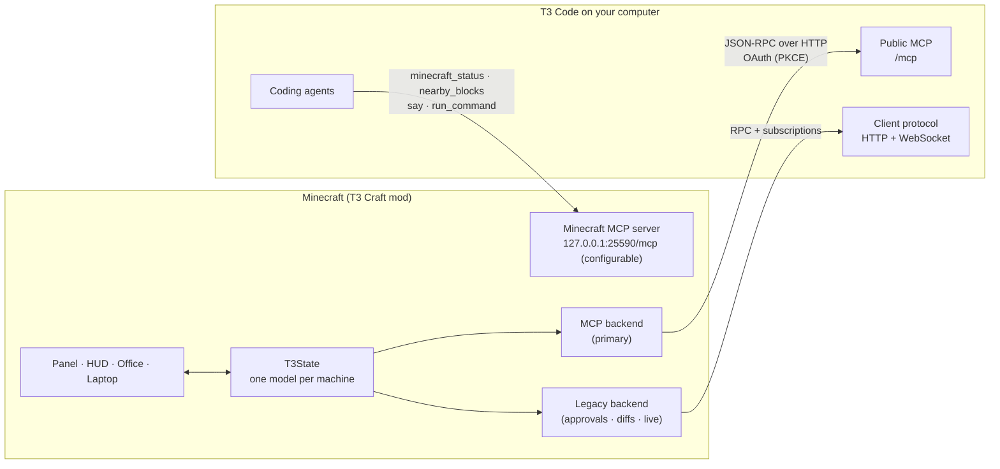
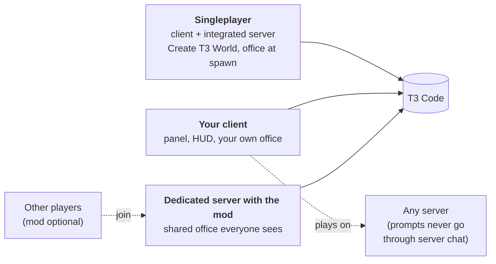
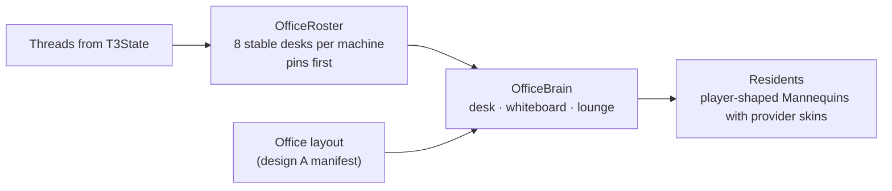

# Architecture

How T3 Craft talks to T3 Code, and where each piece runs. This page is kept short. The code is the detail.

## UI direction

The in-game UI is plain Minecraft ([the simple native UI](design/native-ui.md)): the laptop screen lists active threads and shows the selected one with one input box, and clicking an agent opens a small card beside it. Both read `T3State` and act through `T3Backend`. The streamed web app ([how it works](design/real-t3-ui.md)) stays behind `webUi: true` in the config file and is off by default; Chrome never starts while it is off.

## The big picture

There are two connections, and they point in opposite directions:

- **Minecraft → T3.** The mod reads your threads and acts on them. This is the main path.
- **Agents → Minecraft.** The mod runs a small MCP server so agents can look around your world and build.

## Minecraft → T3: MCP first, legacy as fallback

Since [#1](https://github.com/alexandros-lekkas/t3craft/pull/1), every operation goes through a shared backend interface with two implementations:

| | **Public MCP** (primary) | **Legacy client protocol** |
|:--|:--|:--|
| Used for | Listing threads and activity, sending prompts and queued sends, starting and stopping threads, answering questions, models | Permission approvals, checkpoint diffs and patches, live push updates |
| Transport | JSON-RPC over HTTP (`/mcp`), JSON or SSE replies, `Mcp-Session-Id`, pagination | HTTP snapshots and RPC dispatch, plus a WebSocket subscribing to `orchestration.subscribeShell` and `orchestration.subscribeThread` |
| Auth | OAuth with dynamic client registration, PKCE S256 and a temporary `127.0.0.1` callback | Pairing token exchanged at `/oauth/token` |
| Why | Documented and stable across T3 updates | The only way to get these features today |

**Each leg has its own health.** An MCP failure never disables the legacy leg, and a legacy failure never disables MCP. When there's no live socket, the mod polls.

**Zero setup.** `T3AutoConnect` finds the T3 Code running on the same computer (`T3Web.find`), checks its protocol, mints a one-time least-privilege link with T3's bundled CLI and exchanges it for the legacy bearer token on a background thread; the result is applied on the game thread, so the player never sees a pairing link. When the local T3 stops accepting that token, the client forgets it and auto-connect runs again. Self-tests and dev captures never auto-connect. The opt-in streamed UI pairs its own Chrome profile the same way. There is no Connections screen and no `/t3 pair`; a power-user override lives only in `config/t3craft.json`. See [Decisions](DECISIONS.md#2026-11-05--zero-setup-auto-connect-to-the-local-t3).

**What the game shows** mirrors T3's sidebar: active threads, a collapsed snoozed section, and settled threads hidden. Notifications fire for the focused thread and for threads you started in Minecraft, and each new approval or question pings once.

## Agents → Minecraft: the built-in MCP server

The mod serves `http://127.0.0.1:25590/mcp` on loopback while the game runs (`mcpPort` in the config or `-Dt3craft.mcpPort` changes it; a taken port moves it to the next free one, and the log says which). Malformed requests get JSON-RPC errors; the request half lives in `McpJsonRpc` so it is checked without Minecraft.

| Tool | What it does |
|:--|:--|
| `minecraft_status` | Where you are, what you're looking at, time and game mode |
| `minecraft_nearby_blocks` | Block counts around you |
| `minecraft_say` | Posts a message only you can see |
| `minecraft_run_command` | Runs a command as you and returns the reply. Every command shows in chat. |

## Where the mod runs

| Mode | Entrypoint | Who connects to T3 | Office and residents |
|:--|:--|:--|:--|
| **Singleplayer** | `client` + `main` (`T3CraftCommon`) | Your client | A T3 World gets its office from the integrated server during world load (`T3WorldSetup`); any other world builds one with `/t3 office` (`OfficePlacement`). Residents are client-side Mannequins (`OfficeResidents`). |
| **Client on a vanilla server** | `client` | Your client | Built with commands where you have op. Residents only you can see. |
| **Dedicated server with the mod** | `server` | The server, paired once by an operator with `/t3office pair` | Shared office with residents everyone sees, with or without the mod (`ServerOffice`) |

**The common entrypoint** (`T3CraftCommon`) runs on every server, including the integrated one, which is how a [T3 World](design/world.md) stands finished before you arrive.

## Office data flow

Working agents sit at their desk. Agents that need you walk to the whiteboard. Finished agents go to the lounge and leave a [report book](DECISIONS.md#2026-11-05--keep-report-books). Desks stay the same across reconnects and restarts.

## Build and checks

JDK 25 compiles the mod (Gradle and the checks also run on 27 since [#2](https://github.com/alexandros-lekkas/t3craft/pull/2)). `./gradlew build` runs the fixture-free checks (`uiCheck`, `worldCheck`). CI runs `scripts/verify-ci.sh`, which starts both fixture pairs on free ports and runs `officeCheck`, `connectionCheck`, `featureCheck`, `reliabilityCheck`, `firstRunCheck` and `mcpCheck` against them. The full list is in the [reference](REFERENCE.md#build-and-develop).
