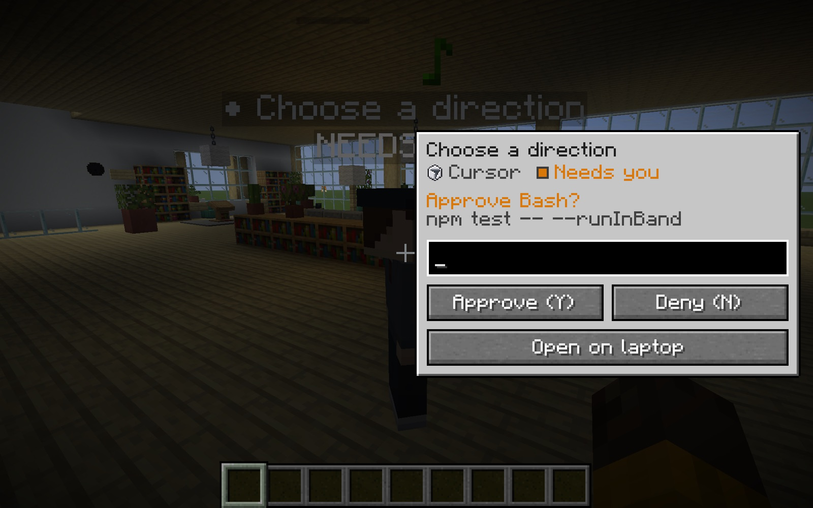
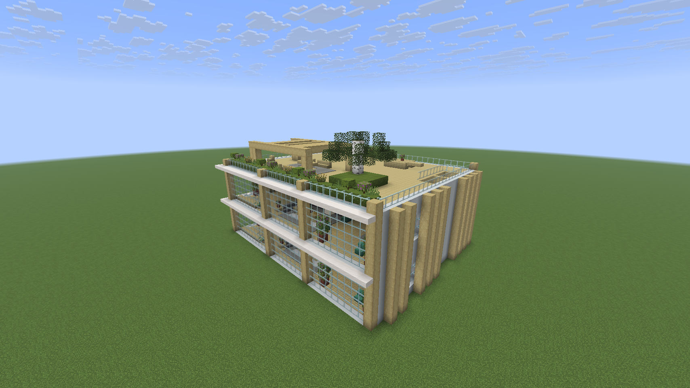
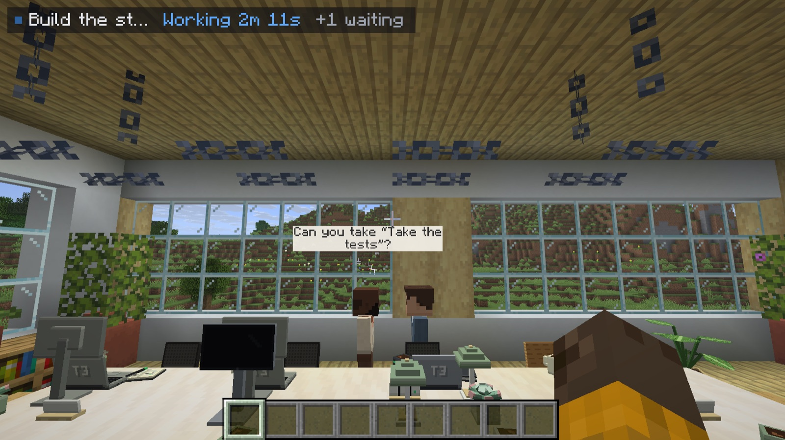
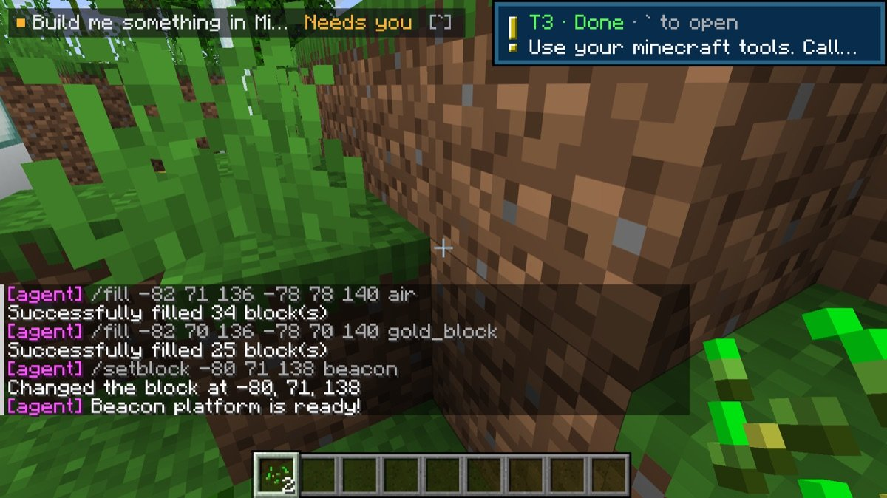

# T3 Craft reference

> The full reference for what is on `main` today: T3 World, the office, the native laptop and agent card, the `/t3` commands, the agent MCP server, the shared server office, and the build and test workflow. For the product overview, see the [README](../README.md); for the plan, the [roadmap](ROADMAP.md); for the reasons, [DECISIONS.md](DECISIONS.md).

Maintained by [alexandros-lekkas](https://github.com/alexandros-lekkas), continued from [maxwellyoung/t3craft](https://github.com/maxwellyoung/t3craft).

[T3 Code](https://t3.codes) inside Minecraft Java 26.3 (Fabric). Your agents are player-shaped characters in an office, a plain Minecraft laptop screen shows your threads, and agents can see and build in your world when you let them.



> **Early project.** The laptop, the agent card and the office use T3's client protocol, which is not a documented public API and may change. The opt-in streamed UI was captured against T3 Code nightly `0.1.7-nightly.20261103.4119`.

[Start with a five-minute first session](FIRST_SESSION.md) if you are trying it for the first time.

## Zero setup

There is nothing to pair and nothing to configure:

- **The laptop, the agent card, the office and the HUD** talk to the T3 Code running on this computer (`http://127.0.0.1:3773`, or the port in T3's `server-runtime.json`) with a bearer token. The mod gets that token by itself: while it isn't paired, it looks for T3 every 15 seconds, checks T3's protocol with one request, mints a one-time link with T3's bundled CLI that grants only `orchestration:read` and `orchestration:operate`, and exchanges it for a token saved in `config/t3craft.json` (owner-only). A T3 that refuses backs the retries off to at most five minutes. When the local T3 stops accepting its token (revoked, expired, reinstalled), the mod forgets it and pairs again the same way.
- **One line in chat per game**, once T3 is connected and you are in a world: *T3 connected · press ` to open*. Reconnects and office bounds go to the log only.
- **No Connections screen, no `/t3 pair`.** Those were removed. Power users can still edit `config/t3craft.json` by hand: another machine's `environments` entry, `"mcpPort"`, `"webUi"`, `"debug"`. Nothing in game adds machines.
- **The streamed web UI** is off by default. With `"webUi": true` the laptop and the card load T3 Code's own web app in a hidden Chrome instead; if T3 asks that browser to pair, the mod mints a separate one-time link and redeems it, and the session cookie stays in the mod's own Chrome profile. ([how it works](design/real-t3-ui.md#zero-step-pairing))

If T3 Code is not running, pressing **`** says so in chat. Start T3 and the mod connects on its own.

## What it does

- **T3 World.** *T3 World* beside Singleplayer on the title screen: name, place (Lakeside, Cherry Plains, River Bend, Surprise me or a seed), Creative or Survival, Create. You arrive on the plaza facing the finished office, agent build already on. Coming back: *T3 World* → *Continue*. ([design](design/world.md))
- **The laptop.** Press **`** (rebindable) or right-click the laptop on any desk. Your active threads are on the left (status dot, provider icon, title; snoozed folded, settled hidden) and the selected thread on the right as plain wrapped text with bold and inline code; the agent's tool activity folds into one *… N steps* line. **Enter** sends and puts you back in the game; **Shift+Enter** sends and keeps the laptop open. Unsent text is kept per thread. ([design](design/native-ui.md))
- **The agent card.** Click an agent. A small card opens beside it over the lightly dimmed world: its last message or the request it is waiting on, one input box, Approve / Deny when needed, and *Open on laptop*. Esc, **`** or a click outside closes it.
- **No thread to pick.** Sending without a chosen thread goes to the thread that needs you, else the most recently active one; with no threads at all, T3 opens.
- **Approvals and questions.** A big **Approve (Y)** / **Deny (N)** row appears above the input. When an agent asks something, press **1–9** or click an answer, or type your own.
- **Pings.** While an agent works or waits on you, the top-left corner shows `Thread · Working 1m 12s · step`. When it finishes, fails, or needs you, you get one toast and a note-block sound. Press **`** within a minute to open the thread that pinged.
- **The office.** `/t3 office` builds a two-floor Scandinavian studio just south of you (door facing you) and your agents walk in. Working agents sit and type at their desks, agents that need you wait at the whiteboard, finished ones head to the lounge, and an agent turns to face you when you come close. Right-click the whiteboard for Decisions and the lectern for Review. Each desk has a laptop that opens its agent's thread. ([design](design/office.md))
- **Thread visibility mirrors T3.** Active threads show. Snoozed threads are grouped and collapsed. Settled threads are hidden, except pinned ones. Subagent and side-chat threads are hidden, but their approvals still reach Decisions.
- **Decisions.** Press **J** for every pending approval and question across your machines. Opening a row targets that exact request.
- **Several machines.** Pair more than one T3 environment (a laptop and a home server, for example) and every active thread from each shares one list. Actions go to the machine that owns the thread, and each machine gets its own office floors.
- **Report books.** When a thread you started or opened in Minecraft finishes, you get a written book with the agent's reply and the files it changed. Needs command permission (op, or cheats on).
- **Live.** Updates stream over T3's RPC socket. If the socket drops, the mod polls until it reconnects.
- **The streamed web UI (opt-in).** With `"webUi": true`, the laptop and the card stream T3 Code's own web app from a hidden Chrome, Edge, Brave or Chromium, pixel-exact at every GUI scale. Chrome never starts while it is off. ([design](design/real-t3-ui.md))

## Commands

A player sees three commands. No command asks you to pick a thread first.

| Command | What it does |
| --- | --- |
| `/t3` | Two lines of help, each clickable: open T3, and the office |
| `/t3 open` | Open the laptop |
| `/t3 office` | Go to this world's office (a T3 World's is adopted on arrival); builds one where you stand if the world has none |
| `/t3 office go` | Teleport to the office entrance, even from another dimension |
| `/t3 office build` | Build or rebuild the office just south of you (adds floors for newly paired machines) |

Debug and admin commands exist only with `"debug": true` in `config/t3craft.json`; otherwise they are hidden from tab-complete and usage:

| Command | What it does |
| --- | --- |
| `/t3 open <id>` | Focus a thread by id and open the laptop |
| `/t3 office off` | Hide the residents; the building stays |
| `/t3 threads` · `/t3 use <n>` | List recent threads in chat; focus thread `n` from that list |
| `/t3 ask <prompt>` · `/t3 new <prompt>` | Send to the target thread; start a new thread beside it |
| `/t3 approve` · `/t3 deny` | Answer the first pending approval on the target thread |
| `/t3 stop` | Interrupt the target thread |
| `/t3 decisions` · `/t3 review` | Open Decisions; open checkpoint review |
| `/t3 pin` · `/t3 pins` | Toggle the focused thread's desk pin; list saved pins, including unavailable or archived ones |
| `/t3 books on\|off` | Report books (on by default) |
| `/t3 agent-build on\|off` | Let agents on this machine run commands in your world (on by default) |
| `/t3 unpair` | Forget every paired machine; the local T3 pairs again by itself |

Keys: **`** opens the laptop, **J** opens Decisions. Both are rebindable under *T3 Craft* in Controls.

## Office

`/t3 office` takes you to this world's office, or builds design A where you stand: one two-floor suite per paired machine, with no confirmation step. Terrain, trees and water at the site are replaced and the exact bounds go to the game log, while a chest with items, a lectern with a book, any other block entity or a crafted block of yours makes it refuse with one line naming the spot. The whole site must be loaded, and rebuilding needs command permission.

Each machine has sixteen stable desk slots: eight downstairs, eight upstairs. Pins take priority, then waiting threads, working threads and recent conversations. Residents keep their desk when activity reorders the list; pinned identity survives reconnect and client restart. Offline residents are labelled Offline and stop typing. An archived or unavailable pin is shown in **Pins** and can be removed there.

Each world and dimension remembers its own office in `config/t3craft.json` under `offices`. Floor ownership is saved when building; rebuild after a new machine pairs to give it floors.



### Agents talk in person

When a thread hands work to a subagent, sends it more, or gets its result back, you see it happen: the parent gets up, walks a few steps toward the entry, and a grey-tagged **Helper** (the subagent, normally hidden from the office) walks in from the door or the stair landing to meet it. They face each other, trade two short lines in speech bubbles (about three seconds each) — *Can you take “Write the tests”?* / *On it!*, or *Done — “Write the tests”!* / *Thanks!* — and both go back: the parent to its seat (or to its new spot if the thread changed status meanwhile), the helper out the way it came. Right-clicking a Helper opens the subagent.

- **Triggers**, from consecutive thread snapshots: a new subagent of a thread in the office (hand-off), a finished or failed subagent (report back), an idle subagent starting a new turn (follow-up). Forks and side chats don't count. Joining a world never replays old ones.
- **Calm by design:** at most two conversations at once, one per parent, a 20-second cooldown per parent–helper pair, and a short queue where the newest talk for a pair wins and anything older than 90 seconds is dropped.
- **Walks stay on open floor**, the same 8-way route the agents use (no corner cutting), so nobody passes through desks; everything turns with the office. Client office only; the shared server office doesn't show talks yet.



### Shared office (dedicated server)

Put the same jar (and Fabric API) in a dedicated server's `mods/` folder. A server has no local T3 to find, so an operator pairs it once with a legacy pairing link from T3's **Settings → Environments**, then builds:

```text
/t3office pair <link>        # pair the server (token saved to the server's config/t3craft.json)
/t3office build [confirm]    # build the shared office just south of you
/t3office status             # connection, thread count, where the office is
/t3office pin <thread-id>    # operator-owned pins, independent of client pins
/t3office unpin <thread-id>
/t3office off                # send the agents home; the building stays
```

The server's threads become real Mannequins that everyone sees, with or without the mod (skins and furniture need the mod's resources). Agents left behind by the old shared village (`/t3village`, before 0.6) are discarded as their chunks load. Players with the mod who are paired with the same T3 can right-click one to open its thread. Everyone on the server can read thread titles on the name tags, so only pair a server you share with people you'd show them to.

## Let agents use Minecraft

The mod runs an MCP server at `http://127.0.0.1:<port>/mcp` while the game runs. The port is **25590** unless `mcpPort` in `config/t3craft.json` says otherwise; if that port is taken (a second game, a dev client), the next free port is used and the log says which: `Minecraft MCP server on http://127.0.0.1:25591/mcp`. Dev runs can pass `-Dt3craft.mcpPort=<n>`.

Tools don't have to read the log: while the game runs, the bound address is in `config/t3craft-mcp.json` beside `t3craft.json`, removed when that game quits:

```json
{"url":"http://127.0.0.1:25591/mcp","port":25591,"pid":12345}
```

With two games open, the file belongs to the one started last. When that one quits (or crashes), the one still running writes its own address back within about ten seconds. If you read the file while a game may have just crashed, check that its `pid` is still running.

It listens on `127.0.0.1` only and refuses requests that carry an `Origin` header or a Host that isn't the exact loopback host and port. Requests over 1 MiB are refused. Malformed requests get JSON-RPC errors (`-32700` parse error, `-32600` invalid request, `-32601` method not found, `-32602` invalid params); tool failures come back as tool results with `isError`. It offers four tools:

| Tool | What it does |
| --- | --- |
| `minecraft_status` | Where you are, what you're looking at, time, game mode |
| `minecraft_nearby_blocks` | Block counts around you |
| `minecraft_say` | Posts a message in your chat (only you see it) |
| `minecraft_run_command` | Runs a command as you, e.g. `/fill`, and returns the server's reply. On by default; `/t3 agent-build off` (debug) turns it off. Every command appears in your chat. |

```sh
claude mcp add --transport http -s user minecraft http://127.0.0.1:25590/mcp
```

Agents pick this up in new sessions, so start a new thread after adding it. Only agents on the machine running Minecraft can reach it.



## Mac launcher (dev setup)

```sh
./scripts/install-macos-app.sh      # installs "T3 Craft.app" into /Applications
```

Double-clicking **T3 Craft** starts the local test world if it isn't running, opens the Fabric dev client straight into it, and sends `stop` to save and shut down only the world it started when you quit. It needs no Minecraft account (offline dev client). An existing `JAVA_HOME` is respected; otherwise the launcher locates Java 25+. Logs go to `~/Library/Logs/T3Craft/`. If a remote T3 server only answers on its own loopback, list SSH tunnels in `scripts/tunnels.local` (`local-port ssh-host remote-host:port`, one per line, not committed).

The dev client plays as `Player` unless you set a name in `scripts/launcher.local` (not committed), which also lets the app open a different local world:

```sh
# scripts/launcher.local
T3CRAFT_USERNAME=Steve              # offline name; keeps your op status and inventory on the local world
T3CRAFT_SERVER_DIR=run-server       # which local world (its server.properties sets the port)
# T3CRAFT_LOG_DIR=<folder>          # optional separate logs for this profile
```

For a second world with its own app, give it its own profile and server folder (with a different `server-port`), then run `./scripts/install-macos-app.sh --name "My World" --profile scripts/my-world.local`.

## Build and develop

Requires JDK 25 as `JAVA_HOME` to compile (Minecraft 26.x targets Java 25). Gradle and the smoke checks can run on 25 or 27.

```sh
./gradlew build                     # → build/libs/t3craft-<version>.jar (runs uiCheck too)
./gradlew runServer --args=nogui    # local offline test server in run-server/
./gradlew runClient                 # dev client (offline, no account)
```

Dev-client options, all through `-P` properties:

```sh
./gradlew smoke -Pt3url='<pairing link>' [-Pt3prompt='…'] [-Pt3new=true]   # protocol round trip, no Minecraft
./gradlew runClient -Pjoin=localhost:25565             # straight into a server
./gradlew runClient -PwebShowcase=<threadId> [-PwebPing=<threadId>] [-PwebPair=<link>]   # read-only capture of the streamed UI; never binds the MCP port
./gradlew runClient -Pselftest=<prompt> [-Pworld=<save>] [-Pconfig=<path>] [-Pfocus=<title>] [-PfixturePort=<n>] [-Pwidth=1000 -Pheight=625]
./gradlew runClient -Pworldtest=<place> [-Pconfig=<path>]       # title screen → New T3 World → Create, screenshots the arrival, desks and an interior tour
./gradlew runClient -Pworldtest=<place> -Pworldtalk=<seconds>[:<parent title>]   # … then waits for a real agent conversation and photographs it (-Pworldtalk=stage starts one)
./gradlew runClient -Pdemo=<output dir> -Pconfig=<path> -PfixturePort=<n>   # record the launch video shots (use scripts/demo/record.sh)
./gradlew runClient -PmcpPort=<n> …                             # keep a dev client off the port your real game uses
./gradlew runClient … -Pshow=true | -Phidden=true               # self-tests, captures and demo recordings run without a window; show one, or hide a plain run
./gradlew runClient … -PclientDir=<dir> -PnoPair=true           # its own game directory; never look for the local T3
./gradlew runClientGameTest                                     # Fabric client game tests in src/gametest (hidden)
```

`scripts/mc` wraps all of this for people and coding agents: hidden, muted, unpaired, in `run-harness/`, with a PASS/FAIL exit code and the screenshot paths printed (`scripts/mc world`, `test <scenario>`, `gametest`, `run`, `cmd`, `shot`, `stop`, `logs`). See [Running the game without a window](AGENTS-GUIDE.md).

`-PmcpPort` (or `mcpPort` in that `-Pconfig` file) keeps a dev client off a real game's 25590; the server also moves to the next free port by itself.

### Self-tests

`-Pselftest=<prompt>` drives the real client, without showing its window unless you add `-Pshow=true`. Each scenario saves framebuffer screenshots to `run/screenshots/` (`run-harness/screenshots/` through `scripts/mc test <prompt>`) and logs `SELFTEST RESULT PASS` or `FAIL`:

| Prompt | What it checks |
| --- | --- |
| `look` | Opens the laptop, captures it, hands the game back |
| `nativeui` | Captures the native laptop and agent card against the office fixture (`-Pworld=<office save> -Pconfig=config/office-fixture.json -Pwidth=1000 -Pheight=625`, `scripts/office/fixture.py` running) |
| `threads` | Sidebar machine filter, scrolling, focused row revealed on open |
| `watch` | Lets the agent under test build; screenshots every 15 s |
| `office` · `officeflow:<prompt>` · `sharedoffice:<link>` | Build the office; run a prompt from it (whiteboard detail, approve by right-clicking the agent, report book); pair the dev server and check the shared office |
| `office-a` | Design A: structure, residents per floor, laptop click, `/t3 office go` from far away (fixture: `scripts/office/fixture.py`) |
| `silkworld` | One-time showcase world with the office at spawn |
| `desk-review` · `release-review` | Whiteboard → Decisions, exact approval, lectern → Review, patch clicks, preserved feedback draft |
| `stable-office` · `stable-office-restore` · `stable-shared` | Pinned desk identity through churn, reconnect and restart; operator pins |
| `connection-errors` | Per-machine auth and protocol guidance, reconnect, preserved draft |
| `hidden-decisions` | Hidden subagent requests still reach Decisions |
| `ask: …` · `new: …` · `<prompt>` | Answer a question with the number keys; a new thread; an ordinary prompt with approval |
| `anchor` · `skin-spike` | Print this world's office origin; render two bundled skins |

`-Pworldtest=<place> -Pworldlife` (with the office fixture paired) also photographs the characters as short frame sequences in `run/screenshots/life-<scene>-<n>.png`: typing, the glance as you walk up, name tags near and far, the waiting agent, the lounge and each desk idle.

Fixture-backed scenarios use the protocol 2 fixtures on 25682/25683 (`-Dt3craft.fixturePort` moves the control calls).

### Recording the launch video

`docs/images/launch/demo.mp4`, `demo-readme.mp4`, `demo.gif` and `demo-poster.png` come from the real game, and one command retakes them:

```sh
export JAVA_HOME=<JDK 25>
bash scripts/demo/record.sh     # about ten minutes: fixture, dev client, encode; prints the output paths
bash scripts/demo/edit.sh       # only re-cut the last recording (build/demo/raw)
T3CRAFT_DEMO_SHOTS=card,ship T3CRAFT_DEMO_NO_EDIT=1 bash scripts/demo/record.sh   # retake some shots only, without cutting
```

`record.sh` starts the office fixture in its staging mode (`scripts/office/fixture.py --demo --port 0`, a free port, staged thread titles only; the usage board shows the fixture's invented figures), writes a muted `run/options.txt`, and runs the dev client with `-Pdemo`. `DemoRecorder` then creates a Lakeside T3 World from the title screen and plays fourteen shots, in this order:

| Shot | View | What happens |
| --- | --- | --- |
| `hook` | camera | Across the bench at the first row from the front: three agents, their name tags apart, the middle one stretching; the opening caption is up on the first frame |
| `chop` | third person | The player walks up to an oak outside the office and chops it |
| `ping` | first person | Still chopping; the staged thread asks for its approval (`/_qa/ask`) and the Needs-you toast slides in mid-log, grows to the middle of the frame while it is read and goes back to its corner; the player finishes the log, turns round in two swipes and runs |
| `dash` | third person, chase | Sprinting across the lawn, a jump, both door leaves opened on the run |
| `burst` | third person, fixed camera | In through the door past the usage board on the wall, a vault over the end of the front desk |
| `floor` | third person, held wide | The whole bench from its end, every agent at work on both sides of it, the player sprinting through |
| `row` | third person, tracking | Along the second row from the front, over the bench: faces, name tags with their dots, a different desk each, the player passing behind |
| `arrive` | third person, two-shot | The agent waves at its whiteboard; the player comes up already turned to it and crouches a few times to say hello |
| `card` | first person | The agent waves; a right-click, its card; the pointer rests where the game put it, goes to Approve and clicks; what it says now; the card closes and the agent turns to go |
| `desk` | third person | Over the agent's shoulder as it sits back down and types, hands and screen in view; the player comes up beside it and ducks in to look |
| `talk` | camera | A Helper walks up to the agent that spawned it (`/_qa/delegate`) and is handed work; both speech bubbles |
| `ship` | first person | The player walks up to a finished agent; its card, then Open on laptop: the list of every agent and this one's report; `ship it` typed there and sent with Shift+Enter, so the message is seen arriving |
| `cheer` | third person, locked off | The agent throws its arms up, the player jumps for it a beat later, and it goes back to work |
| `end` | camera | A pull-back from the lit office at dusk under the title; its last frame is the poster |

Each shot goes to `build/demo/raw/seg-<name>.mp4`; `marks.txt` beside them records the frame of every beat for `edit.sh`, `look.csv` the player's view and position in every recorded frame, and `camera.csv` the camera's in the filmed shots (for checking the motion). `T3CRAFT_DEMO_SHOTS=<names>` records only those shots: each one stages what it films through the fixture (`/_qa/ask`, `/_qa/approve`, `/_qa/work`), so a shot can be retaken on its own. `T3CRAFT_DEMO_SEED=<n>` varies the hand (see below); the same seed gives the same take.

It never uses the mouse, the keyboard or the screen, so it can run while you work:

- Frames are read from the game's own framebuffer and piped to an ffmpeg child process. A 960 × 540 window gives 1920 × 1080 on a Retina Mac, where the game's largest GUI scale is 4.
- The game clock advances exactly 1/60 s per captured frame (`DemoClockMixin`, inert without `-Dt3craft.demo`), so the video is steady even when a frame takes long to capture.
- The client runs without a window, like every `-Pdemo` run. If you show it (`-Pshow=true` on the Gradle line in `record.sh`), it still opens without taking focus (`SDL_WINDOW_ACTIVATE_WHEN_SHOWN=0`, `SDL_MAC_BACKGROUND_APP=1`); set `T3CRAFT_DEMO_BACKGROUND_APP=0` if the client fails to start that way.
- The dev client never pairs with a real T3 Code and keeps its MCP server on 25611 (`T3CRAFT_DEMO_MCP_PORT`).

**The player is played, not animated.** It is a survival player throughout (a yellow jacket and the stone axe tell it from the agents, who are player-shaped too):

- It moves through the game's own movement input: forward, sprint, jump and sneak are held and released as keys, so acceleration, sliding to a stop, view bobbing, the sprint field-of-view kick and the walk animation are the game's. A walk follows a route by looking a few blocks ahead along it, which cuts corners the way a person does; sprint is let go before forward, and the last stretch is a slide. Doors and agents are opened with the use key on whatever the crosshair is on; logs are mined by holding attack.
- Its view is turned every frame by `DemoHand`, a model of a hand on a mouse: a turn is one fast movement whose length follows its size (about 0.3 s for 5°, 0.4 s for 90°; big turns are flicked), with a skewed bell-shaped speed (the peak comes early), landing a few percent short or over, then one or two small corrections that begin before the first movement has ended. A turn of more than 110° is two swipes with the mouse lifted for about a tenth of a second between them. Yaw and pitch are not in step, so the path curves. Between turns the view drifts by a fraction of a degree (smoothed noise). A moving target (the route ahead, an agent walking off) is followed in small catch-up movements every 0.1–0.3 s.
- A walk that ends in front of something is finished looking at it: a few blocks out the head turns to it and the last steps are taken sideways or backwards as needed, so the player arrives facing it instead of stopping and then swivelling. A desk in the way of a sprint is jumped before reaching it; a door never is, and a take in which the player is held up in the doorway (under 3 blocks a second) fails.
- While a card or the laptop is open the game shows a mouse pointer and holds the view still. A hidden window has no pointer, so the recorder draws one, on whole GUI pixels. It behaves like a mouse, not like a gaze: it appears in the middle of the screen and stays exactly there (a mouse at rest reports nothing) until the hand needs a control, then goes to it in one movement of the same hand model and clicks; it does not move while both hands type, and never rests on text. Its position is given to the game as the mouse position, so the button under it lights up and the click is a real one. The agent in front keeps moving: it waves before the click and talks with its hands while its card is read (the office's own poses, held through its dev hook). Keys that are pressed (Shift+Enter to send) pop up as a keycap.
- Waits are human latencies drawn with spread (about 0.45 s to notice a toast, 2 s to read a request, 0.17 s between landing on a target and clicking), and keys and clicks happen on the frame they fall in, not on a tick grid. `ship it` is typed with per-key gaps that are shorter inside common letter pairs and longer at the start of a word.

**The camera is operated, not bolted on.** In the `camera` shots the player is an unseen spectator parked above the roof; in the third-person shots it stays the camera entity (the game's own F5, so the game draws and moves it), with view bobbing off (the game would apply it to the filmed view; it stays on through the player's own eyes), and `DemoCameraMixin` (inert without `-Dt3craft.demo`) places the camera where the shot's rig wants it, every frame. A rig follows where the player is on the ground through a damped spring, so it trails and settles like an operator and stays level: a jump or a crouch moves the player in the frame, not the camera, and a step up or down is taken slowly. No shot eases to a stop before a cut.

**The text is drawn by the game** in its own font, over the HUD and over an open card (`DemoOverlay`), because the stock Homebrew ffmpeg has no `drawtext`: captions whose words pop in one after another with the key word in yellow, keycaps, the pointer, the toast and the title card. Captions never share the screen with a toast, a card or a speech bubble. The hotbar and hearts show only through the player's own eyes (and not while a card or the laptop is open, where the push-in would cut them in half), and the corner status line not at all. The Needs-you toast is the game's own, handed to the overlay to draw: it slides in at its corner as usual, grows 1.8× to the middle of the frame over dimmed gameplay while it is read, and returns to the corner as the player turns, as one object.

Camera and stand positions come from the office itself, not from world coordinates: the door and footprint anchors, the seats the agents are actually at, where the waiting agent stands, and a line-of-sight test in the world for the spot the player clicks from. If a staged beat does not happen (the agent never reaches the whiteboard, the player ends a walk off its mark, the crosshair is not on the agent, a card does not open, the approval or the message does not go through, a toast never shows, there is no level ground outside the door) the client stops with `DEMO RESULT FAIL <reason>`, `record.sh` prints that reason and exits 1, and nothing is cut from the broken take.

`edit.sh` joins the shots in story order (only `talk` is trimmed, from the helper walking in to its answer) and pushes in 1.5× on the small UI so it reads on a phone; the held part of a push-in is an exact crop scaled with nearest neighbour, so the pixel font stays crisp. A card is shown in a window that starts just under the agent's name tag (the recorder notes where the tag is), so the tag is out of frame rather than cut by it. The laptop fills the screen, so it gets two windows: first its list of every agent, then a move across to the thread and the reply box, and back out to the whole laptop once the message has been sent. `T3CRAFT_DEMO_DROP=<shots>` leaves shots out of the cut and `T3CRAFT_DEMO_TRIM=<shot>:<head>:<tail>` takes frames off one. The GIF is the `ping` shot and the approval from the `card` shot.

The soundtrack is mixed in by `edit.sh`, not recorded: it is the game's own music (`wet_hands` by default, from 13.4 s in, because the track opens with ten seconds of near silence), found through the asset index in the local Minecraft asset cache that the dev client downloads (`~/.gradle/caches/fabric-loom/assets`), levelled to about -16 LUFS with a short fade in and a fade out under the title. That music is Mojang's: it is read from the local game assets at export time and must never be committed to this repository. `T3CRAFT_DEMO_MUSIC=<track or audio file>` and `T3CRAFT_DEMO_MUSIC_START=<seconds>` choose another track or starting point; if the asset is missing `edit.sh` says which file it looked for and stops, and `--silent` (or `T3CRAFT_DEMO_SILENT=1`) exports without music. The GIF is always silent.

To change a shot, edit its method in `DemoRecorder.java` (framing numbers are in design coordinates and blocks, times in seconds); to reorder or drop shots, edit the list in `DemoRecorder.hooks()` and the one in `scripts/demo/edit.sh`; to change the cut, the push-ins or the mix, edit `edit.sh`.

### Fixture-backed checks

The checks never use a real pairing or dispatch to an agent. `scripts/verify-ci.sh` is what CI runs; it allocates **free ports** for both fixture pairs (`--port 0`), so several checkouts can verify at once:

```sh
bash scripts/verify-ci.sh            # build, verifyAll, both protocols, mcpCheck ×2, launcher/installer/jar/doc-link checks
```

By hand, pick ports that nobody else is using and pass them everywhere:

```sh
python3 scripts/feature-fixture.py --port 0 --port-file build/fixture-logs/legacy.port &   # prints the chosen pair
./gradlew officeCheck connectionCheck featureCheck reliabilityCheck -PfixturePort=$(cat build/fixture-logs/legacy.port)
python3 scripts/feature-fixture.py --protocol2 --port 0 --port-file build/fixture-logs/v2.port &
./gradlew connectionCheck featureCheck reliabilityCheck mcpCheck -PfixturePort=$(cat build/fixture-logs/v2.port)
```

`T3CRAFT_FIXTURE_PORT` (and `T3CRAFT_FIXTURE_V2_PORT`) pin the ports instead; Gradle reads the first as its default when `-PfixturePort` is absent.

| Check | What it covers |
| --- | --- |
| `uiCheck` (part of `build`) | Diff headers, table cells, ellipsize, composer drafts, viewport math, CDP messages including modifier keys |
| `worldCheck` (part of `build`) | The T3 World seed list, save-marker round-trip and office placement math for all four facings |
| `talkCheck` (part of `build`) | Agents talking in person: hand-off, follow-up and report detection from synthetic snapshots, every walk on open cells for all four office turns, the rate limits, and whole conversations played through the brain |
| `officeCheck` | Stable desks, pin priority, config save/load and the pre-0.6 village → office migration, leftover village agents discarded, owner isolation, placement protection, lighting |
| `connectionCheck` | Pairing link parsing without leaks, token exchange, per-machine health changes |
| `firstRunCheck` | Default thread, one connect line per game, player-only help, agent-build migration, auto-connect with the local T3 through the fixture (probe before mint, least-privilege scopes, no credential in errors) |
| `featureCheck` | Decision routing, checkpoint review, two-machine routing, patches |
| `reliabilityCheck` | MCP Host/Origin policy, JSON-RPC error conformance, port fallback and the port file, auth and protocol recovery |
| `mcpCheck` | Public T3 MCP transport, OAuth, incremental history, visibility, per-leg fallback |
| `python3 scripts/check-mcp.py [--port N]` | Against a running dev client: the real HTTP endpoint, read-only |
| `./gradlew runClientGameTest` (`scripts/mc gametest`) | Fabric client game tests in a real, hidden client: the title screen offers T3 World, creating one builds the office ([guide](AGENTS-GUIDE.md#fabric-client-game-tests)) |
| `python3 scripts/check-launcher.py` · `check-installer.py` · `check-jar.py` · `check-doc-links.py` | Launcher lifecycle, installer, packaged jar contract, local doc links |

`./gradlew reviewProbe -Pconfig=<existing-local-config>` is a read-only compatibility probe against a saved pairing. `./gradlew liveCheck -Pconfig=… -PqaProject=<descriptor>` is opt-in and calls a real agent in a disposable project you supply. `./gradlew webProbe -Pthread=<id>` loads the real local T3 in the hidden Chrome without Minecraft and saves frames.

## How it works

- **Native UI:** the laptop and the agent card are vanilla Minecraft screens drawn from the mod's thread state; nothing outside the game renders them. ([details](design/native-ui.md))
- **Streamed UI (opt-in, `webUi: true`):** a hidden Chrome renders T3's web app at exactly the framebuffer size; frames arrive over the DevTools Protocol and are drawn 1:1. Mouse, wheel and keys (including Shift/Ctrl/Alt/⌘ transitions) go back to the page. ([details](design/real-t3-ui.md))
- **T3 World:** the client writes a `SavedData` marker before the world starts; on `SERVER_STARTED` the integrated server sets gamerules, places design A at the seed's recorded site (or a flat, dry spot it finds), sets spawn on the plaza and marks setup done. Entering the world adopts that office as the save's office. ([details](design/world.md#how-it-works))
- **Pairing:** auto-connect probes the local T3, mints a `t3 auth pairing create` link with the two orchestration scopes and exchanges it at `/oauth/token` for a bearer token; the public MCP leg (OAuth with PKCE) is used when an environment carries an `mcpUrl`.
- **Live updates:** a WebSocket (one-time ticket) subscribes to `orchestration.subscribeShell` for thread status. Events on the focused thread trigger a refetch of its recent turns, at most four times a second. Without a socket, the mod polls.
- **Notifications:** only the focused thread and threads you prompted from Minecraft notify you. Each new approval or question pings once.

## License and disclaimer

MIT. See [LICENSE](../LICENSE).

NOT AN OFFICIAL MINECRAFT PRODUCT. NOT APPROVED BY OR ASSOCIATED WITH MOJANG OR MICROSOFT.

T3 Craft is an independent community project and is not affiliated with or endorsed by T3 Tools Inc. "T3 Code" is theirs; this mod only talks to it over its local server and client protocol. The jar contains no Minecraft, Fabric, or T3 code.
