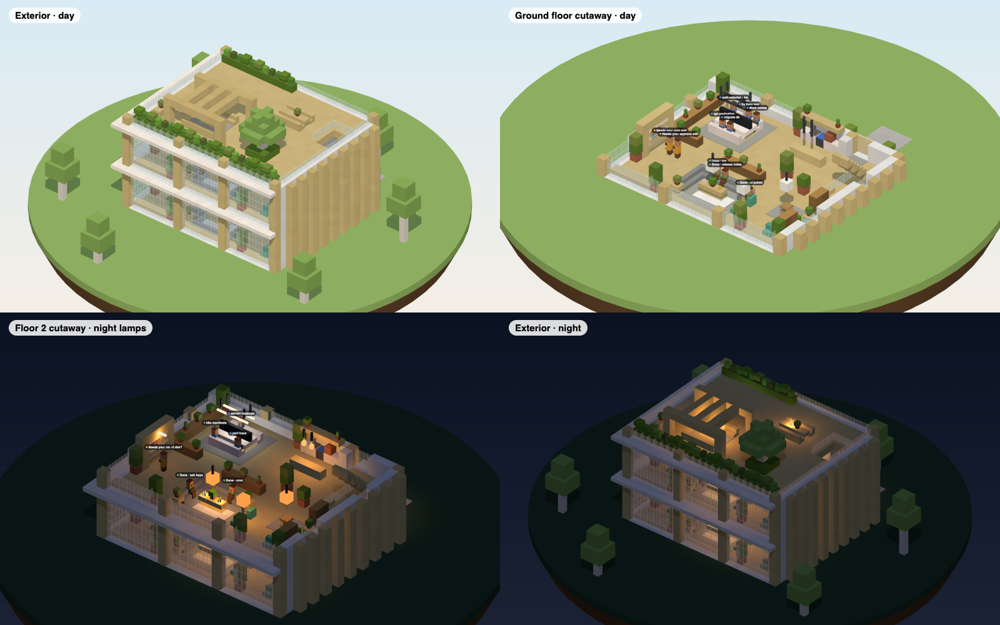

# Roadmap

The owner-facing plan for T3 Craft. Scope is the office and its arrival plaza only. This page is updated whenever a PR lands. The reasons behind each call are in [DECISIONS.md](DECISIONS.md).

## ✅ Shipped: 0.5.0

What's in the current release, inherited from the original mod and hardened since:

- **In-game panel.** Threads on the left and the conversation on the right, with Markdown. Drafts are kept per thread.
- **Approvals and questions.** Approve with <kbd>Y</kbd>/<kbd>N</kbd>, answer with <kbd>1</kbd>–<kbd>9</kbd>, or type your own answer.
- **Checkpoint review.** Real Git patches with line numbers and hunk navigation.
- **Several machines** in one sidebar, plus a model picker.
- **Office and village.** Residents work at desks, wait at the whiteboard and relax in the lounge, with stable desks and pins.
- **Report books** and one completion toast when an agent finishes.
- **Agents can build.** The mod's local MCP server lets agents look around and run commands in your world.
- **Modpack 0.5.0:** a curated Fabric 26.3 Vanilla+ pack.

## 🔨 Merged since 0.5.0

| PR | What it does | Status |
|:--|:--|:--|
| [#1 Public T3 MCP backend](https://github.com/alexandros-lekkas/t3craft/pull/1) | Routes everything T3's public MCP supports through it, with OAuth. The legacy protocol stays for approvals, checkpoint diffs and live updates. | Merged; MCP-primary with independent health per leg. |
| [#2 Build/CI and world fixes](https://github.com/alexandros-lekkas/t3craft/pull/2) | Release workflow runs the full checks. Gradle 9.8.2 works on JDK 27. Fixes office and village bugs: floor ownership, queues across world changes, residents after reconnect. | Merged |
| [#3 In-game UI fixes](https://github.com/alexandros-lekkas/t3craft/pull/3) | 17 UI bugs: drafts, failed sends, approvals, scrolling, review, Markdown links, rebindable keys. Adds `uiCheck`. | Merged. |
| [#6 PR #1 regressions](https://github.com/alexandros-lekkas/t3craft/pull/6) | Decisions shows hidden threads' approvals, MCP history refreshes, errors are per thread, and `T3Mcp` dispatches carry tokens. | Merged. |
| [#7 The real T3 UI](https://github.com/alexandros-lekkas/t3craft/pull/7) | Streams T3 Code's own web app into the laptop and the agent card through a hidden Chrome over CDP, pixel-exact at every GUI scale, with zero-step pairing. ([how it works](design/real-t3-ui.md)) | Merged; now opt-in behind `webUi: true`. |
| Simple native Minecraft UI | The laptop and the agent card are plain Minecraft screens again, sized for GUI scale 5: thread list + selected thread + one input box; a small card beside a clicked agent. ([design](design/native-ui.md)) | In review. |

**Reliability follow-up.** Continue checking: bounded per-machine workers, coalesced UI updates, off-thread config saves, socket backoff and clean shutdown. The game stays smooth even when a machine is slow.

## ⏭️ Next

In rough order. Each item ships with its docs and real screenshots ([checklist](SCREENSHOTS.md)).

1. **Auto-connect.** Find the local T3 Code and connect silently. This removes the pairing form and the Connections screen.
2. **Thread visibility.** Active threads show, snoozed ones collapse, settled ones hide, everywhere.
3. **Create T3 World.** A *T3 World* button on the title screen, the plains seed and design A placed at spawn. You load in facing the door. ([design](design/world.md))
4. **Office design A in the game.** Modular lobby, floor and roof. A new machine adds a floor and nothing else is rebuilt. ([design](design/office.md))
5. **Agents as player characters.** A player model with skins replaces villagers. ([design](design/characters-and-laptop.md))
6. **The T3 laptop.** A craftable item you right-click to open the laptop screen.
7. **The in-game UI.** Simple native Minecraft screens: the laptop and the agent card ([design](design/native-ui.md)). The streamed web app from [#7](https://github.com/alexandros-lekkas/t3craft/pull/7) stays behind `webUi: true`.
8. **Modpack 0.6.** No Iris or Miniature shaders, official-launcher install, no `options.txt` in the pack.

## 🔭 Later and exploring

- **Browser and images.** Show thread images and web previews inside the game. ([design](design/browser-and-images.md))
- **LAN guests** seeing your agents, not just you.

## Open questions

- PR #2 asks for `/t3 office confirm` before an office replaces existing blocks. Decide whether that stays under the [no-confirmations rule](DECISIONS.md#2026-11-05--no-protections-or-confirmations), since it guards against losing your builds.
- When the office grows, the roof moves up and any roof edits are lost. Accept that, or snapshot the roof first.
