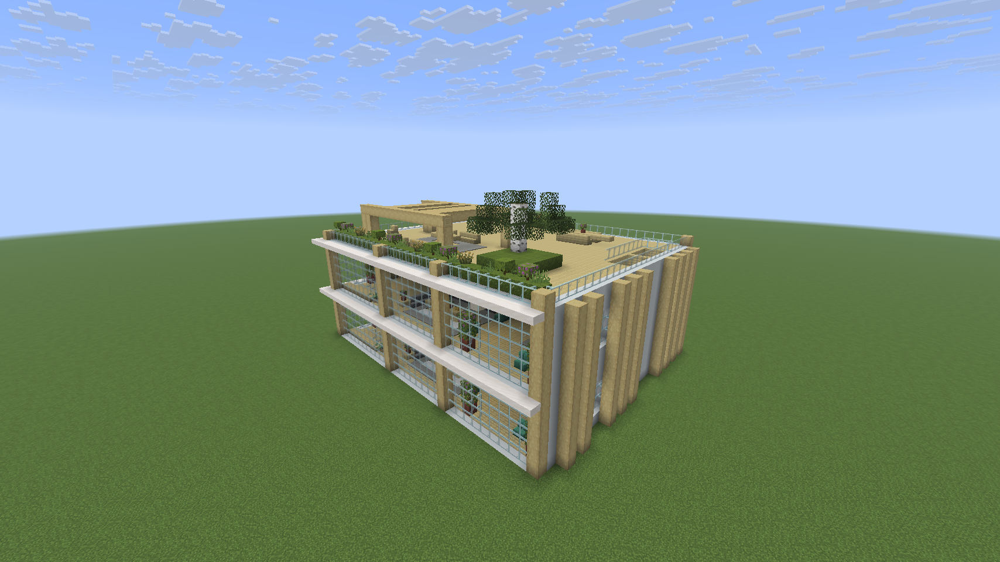

# Roadmap

The owner-facing plan for T3 Craft. Scope is the office only. This page is updated whenever a PR lands. The reasons behind each call are in [DECISIONS.md](DECISIONS.md).

## ✅ On main now

- **Create T3 World** ([#9](https://github.com/alexandros-lekkas/t3craft/pull/9)). A *T3 World* button beside Singleplayer: pick a place and a mode, press Create, and you arrive on the plaza facing the finished office, turned to face the view.
- **Simple native Minecraft UI** ([#14](https://github.com/alexandros-lekkas/t3craft/pull/14)). <kbd>`</kbd> and the desk laptops open a plain Minecraft laptop screen (your active threads, the selected one, one input box); clicking an agent opens a small card beside it. ([design](design/native-ui.md))
- **The streamed T3 web app, opt-in** ([#7](https://github.com/alexandros-lekkas/t3craft/pull/7)). With `webUi: true` in the config file the laptop and the card stream T3 Code's own web app instead. Chrome never starts while it is off.
- **Office A with player agents** ([#8](https://github.com/alexandros-lekkas/t3craft/pull/8)). A two-floor Scandinavian studio, Mannequin agents with per-provider skins, desk laptops, props, `/t3 office` go/build/off.
- **Zero setup** ([#11](https://github.com/alexandros-lekkas/t3craft/pull/11)). The mod finds the T3 Code on this computer and pairs by itself. No Connections screen, no pairing commands, no settings UI, no thread to pick. One line in chat per game; `/t3` is two lines of help.
- **Thread visibility mirrors T3.** Active threads show, snoozed collapse, settled hide (except pins); subagent approvals still reach Decisions.
- **Approvals and questions.** <kbd>Y</kbd>/<kbd>N</kbd>, <kbd>1</kbd>–<kbd>9</kbd>, Decisions (<kbd>J</kbd>) and checkpoint review.
- **Report books** and one completion toast when an agent finishes.
- **Agents can build.** The mod's local MCP server (configurable port, proper JSON-RPC errors) lets agents look around and run commands in your world.
- **Agents talk in person** ([#19](https://github.com/alexandros-lekkas/t3craft/pull/19)). When a thread hands work to a subagent or gets its result back, the parent walks over to a *Helper* and they trade two lines in speech bubbles.
- **Usage limits board** ([#18](https://github.com/alexandros-lekkas/t3craft/pull/18)). A board on the ground-floor wall shows each provider's session and weekly limits with reset countdowns.

## 🗑️ Removed

- **The village** (`/t3 village`, the server's `/t3village`) and the villager residents. Only the office remains; the server pairs with `/t3office pair`.
- **The Connections screen** and `/t3 connections`, `/t3 pair`. Pairing is automatic; `config/t3craft.json` is the only override.

## 🔨 Merged since 0.5.0

| PR | What it does | Status |
|:--|:--|:--|
| [#1 Public T3 MCP backend](https://github.com/alexandros-lekkas/t3craft/pull/1) | Routes everything T3's public MCP supports through it, with OAuth. The legacy protocol stays for approvals, checkpoint diffs and live updates. | Merged; MCP-primary with independent health per leg. |
| [#2 Build/CI and world fixes](https://github.com/alexandros-lekkas/t3craft/pull/2) | Release workflow runs the full checks. Gradle 9.8.2 works on JDK 27. Fixes office and village bugs: floor ownership, queues across world changes, residents after reconnect. | Merged |
| [#3 In-game UI fixes](https://github.com/alexandros-lekkas/t3craft/pull/3) | 17 UI bugs: drafts, failed sends, approvals, scrolling, review, Markdown links, rebindable keys. Adds `uiCheck`. | Merged. |
| [#6 PR #1 regressions](https://github.com/alexandros-lekkas/t3craft/pull/6) | Decisions shows hidden threads' approvals, MCP history refreshes, errors are per thread, and `T3Mcp` dispatches carry tokens. | Merged. |
| [#7 The real T3 UI](https://github.com/alexandros-lekkas/t3craft/pull/7) | Streams T3 Code's own web app into the laptop and the agent card through a hidden Chrome over CDP, pixel-exact at every GUI scale, with zero-step pairing. ([how it works](design/real-t3-ui.md)) | Merged; now opt-in behind `webUi: true`. |
| [#8 Office A with player agents](https://github.com/alexandros-lekkas/t3craft/pull/8) | The two-floor Scandinavian office, Mannequin agents with provider skins, desk laptops and props, `/t3 office` teleport/build. ([design](design/office.md)) | Merged. |
| [#9 Create T3 World](https://github.com/alexandros-lekkas/t3craft/pull/9) | One click from the title screen to a world with the office already at spawn, on a curated plains seed or a found flat spot. ([design](design/world.md)) | Merged. |
| [#11 Zero setup](https://github.com/alexandros-lekkas/t3craft/pull/11) | Pairs with the local T3 by itself, no thread to pick, one line in chat per game, player-only `/t3` with everything else behind `"debug": true`, office builds without a confirmation. | Merged. |
| [#12 A lit office](https://github.com/alexandros-lekkas/t3craft/pull/12) | Hidden light grid, downlights and lanterns; `officeCheck` fails on any dim walkable cell. | Merged. |
| [#14 Simple native Minecraft UI](https://github.com/alexandros-lekkas/t3craft/pull/14) | The laptop and the agent card are plain Minecraft screens again, sized for GUI scale 5: thread list + selected thread + one input box; a small card beside a clicked agent. ([design](design/native-ui.md)) | Merged. |
| [#15 Office furniture without a pairing](https://github.com/alexandros-lekkas/t3craft/pull/15) | Props and lamps sync whenever the office exists, even unpaired; only agents and desk laptops need a pairing. `officeCheck` covers every prop for all four turns. | Merged. |
| [#13 Review cleanup](https://github.com/alexandros-lekkas/t3craft/pull/13) | Office only (the village and the Connections screen are gone), configurable MCP port with a free-port fallback and `config/t3craft-mcp.json`, proper JSON-RPC errors, free fixture ports, modifier keys in the streamed UI. | Merged. |
| [#16 Agents in an office seen before pairing](https://github.com/alexandros-lekkas/t3craft/pull/16) | An office built before T3 paired gets its agents once it does. | Merged. |
| [#17 Review follow-ups](https://github.com/alexandros-lekkas/t3craft/pull/17) | A recreated T3 World gets its new office, turned rebuilds see their own blocks, and the card and laptop guard against double answers. | Merged. |
| [#18 Usage limits board](https://github.com/alexandros-lekkas/t3craft/pull/18) | Session and weekly limits per provider on the office wall, lit at night; `usageBoardCheck` covers every rotation. | Merged. |
| [#19 Agents talk in person](https://github.com/alexandros-lekkas/t3craft/pull/19) | Parents walk over to their subagents and trade two lines in speech bubbles; `talkCheck` runs on every build. | Merged. |
| [#20 In-game QA pass](https://github.com/alexandros-lekkas/t3craft/pull/20) | Lakeside spawn, the stair landing, Y/N focus, **+ New thread** on the laptop, and agents that walk. | Merged. |
| [#21 Server thread out of the walk set](https://github.com/alexandros-lekkas/t3craft/pull/21) | Keeps the integrated server thread out of the agent walk set. | Merged. |
| [#22 No replayed talks](https://github.com/alexandros-lekkas/t3craft/pull/22) | Joining a world, or T3 connecting late, never replays old agent talks. | Merged. |

**Reliability follow-up.** Continue checking: bounded per-machine workers, coalesced UI updates, off-thread config saves, socket backoff and clean shutdown. The game stays smooth even when a machine is slow.

## ⏭️ Next

In rough order. Each item ships with its docs and real screenshots ([checklist](SCREENSHOTS.md)).

1. **The held T3 laptop.** A craftable item you right-click anywhere to open the laptop screen; today the laptops live on the desks and <kbd>`</kbd> opens it. ([design](design/characters-and-laptop.md))
2. **Real screenshots everywhere.** The remaining mockups in the docs get replaced by in-game captures ([checklist](SCREENSHOTS.md)).
3. **Modpack 0.6.** No Iris or Miniature shaders, official-launcher install, no `options.txt` in the pack, released on Modrinth with the current feature set in its listing.

## 🔭 Later and exploring

- **Browser and images.** Show thread images and web previews inside the game. ([design](design/browser-and-images.md))
- **LAN guests** seeing your agents, not just you.

## Open questions

- When the office grows, the roof moves up and any roof edits are lost. Accept that, or snapshot the roof first.
