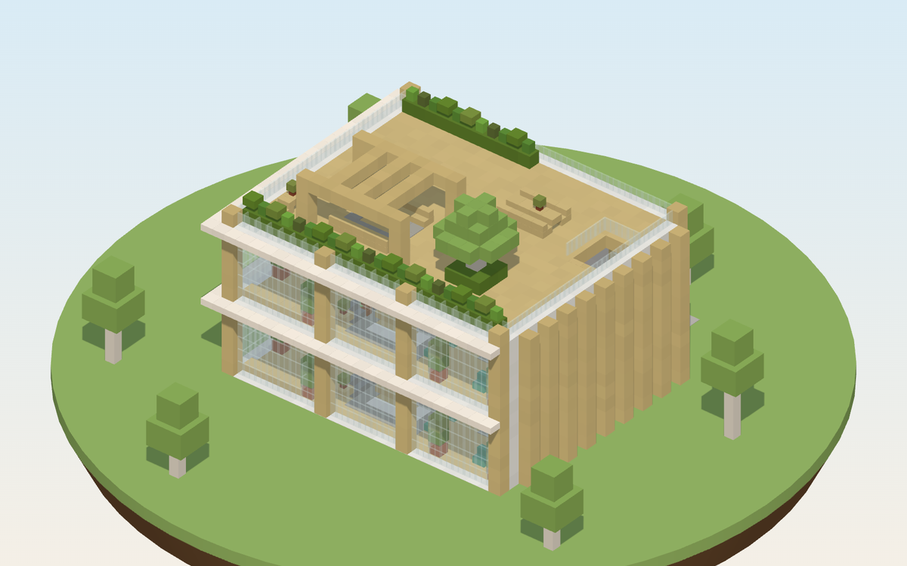
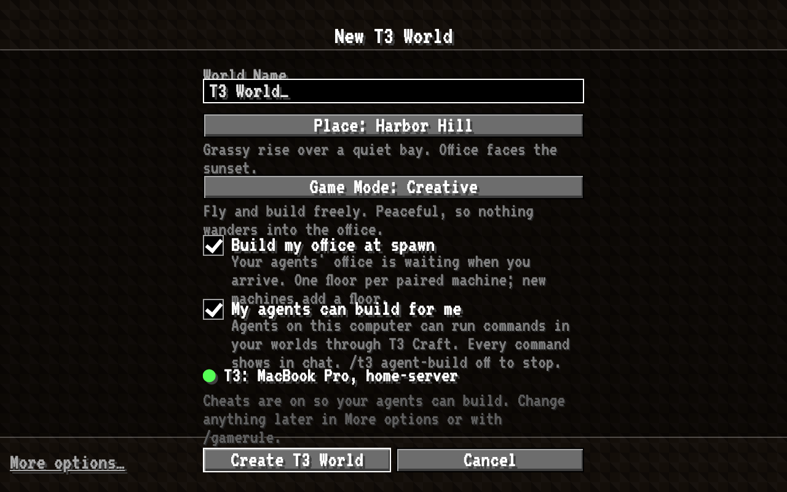
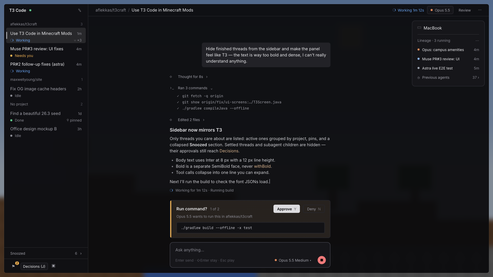
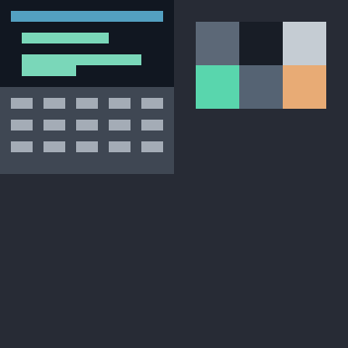
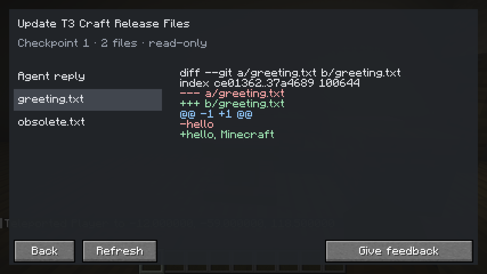

# Design

Short, picture-first pages. Each one links to its full spec in [`docs/specs/`](../specs/).

<table>
  <tr>
    <td width="33%"></td>
    <td width="33%"></td>
    <td width="33%"></td>
  </tr>
  <tr>
    <td><a href="office.md"><b>Office</b></a> Design A, Scandi Studio. Chosen.</td>
    <td><a href="world.md"><b>World & seeds</b></a> Create T3 World and the plains seeds</td>
    <td><a href="ui.md"><b>UI</b></a> Real T3 web UI streamed in-game; image shows an earlier native fallback exploration</td>
  </tr>
  <tr>
    <td></td>
    <td></td>
  </tr>
  <tr>
    <td><a href="characters-and-laptop.md"><b>Characters & laptop</b></a> Agents as players, plus the T3 laptop</td>
    <td><a href="browser-and-images.md"><b>Browser & images</b></a> See what your agent sees</td>
  </tr>
</table>
