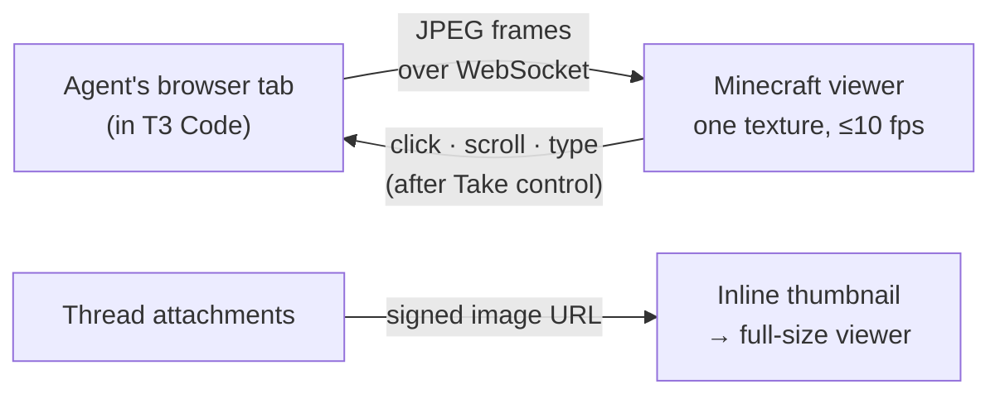

# Thread images and the agent's browser

> **Current UI direction:** stream the real T3 web app in-game. The laptop opens the full app and agent clicks open floating thread windows. The custom rendering work below is exploratory fallback work.

> **Status:** researched and prototyped 2026-11-05 · later · [full spec](../specs/images-and-browser.md)

Two ways to *see* what an agent sees, without leaving Minecraft:

1. **Images in threads.** Screenshots, attachments and tool images show inline in the conversation. Click one to view it full size.
2. **The agent's browser.** Watch the live browser tab an agent is using in T3, and take control when you want to.

<!-- TODO(screenshot): `thread-image-inline` and `agent-browser-live` once built (docs/SCREENSHOTS.md) -->

## How it works

- **Mirror, don't duplicate.** The viewer streams T3's *own* tab, with the same page, cookies and agent state. It never opens a second browser and never asks you to install Chromium.
- **Observe first.** Watching is the default. *Take control* forwards your clicks and typing.
- **Gentle on the game.** Images are fetched only when visible, decoded off the game thread and capped in memory.

## What the prototype showed

An outside client listed an agent's tab, received real 1280 × 800 frames at about 90 fps on loopback, with about 8 ms from page to frame, and clicked and typed into the same tab. It works today through T3's environment connection, with no T3 change needed.

## What it needs

| | Status |
|:--|:--|
| Thread images | Feasible now through the legacy connection |
| Live browser mirror | Feasible now for tabs T3 can stream |
| Public MCP only | Not yet. T3 would need to expose media and browser viewing over MCP ([upstream asks](../specs/images-and-browser.md#5-upstream-requests)). |
| Embedded Chromium (MCEF) | Ruled out for now: no 26.3 build, a large download, and it would be a separate browser anyway |
