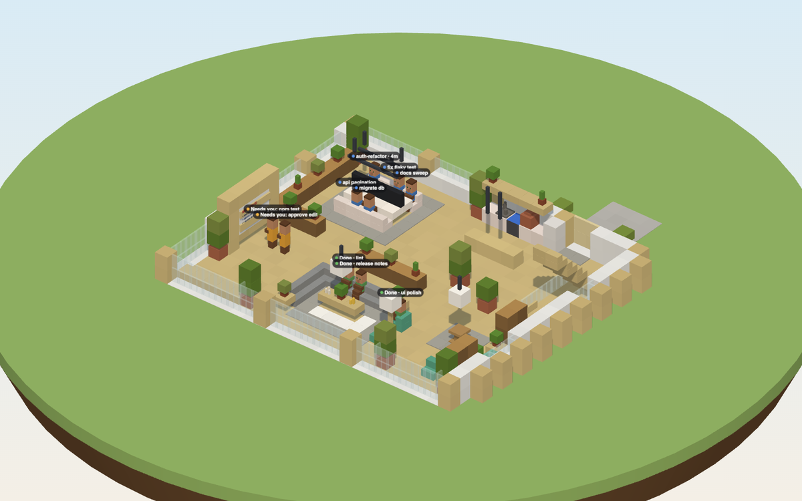

# Agents as people, and the T3 laptop

> **Status:** designed 2026-11-05 · next for 0.6 · [full spec](../specs/characters-and-laptop/spec.md)

Two small changes make the office feel like a real place. Agents look like **players**, and you open T3 from a **laptop** you can hold or click on any desk.

Today's residents are villager stand-ins. They become player-shaped characters at the same desks.

<!-- TODO(screenshot): `agents-at-desks` and `agent-needs-you` once characters land (docs/SCREENSHOTS.md) -->

## Agents look like players

- Built on vanilla **Mannequin** entities: player-shaped, but not logged-in players. They work in singleplayer and on servers, and vanilla clients can see them too.
- **One skin per provider.** Claude is terracotta and cream, Codex is graphite and mint, Muse is violet and sky, and anything else is slate.
- **Body language shows status:**

| Status | Where | Pose |
|:--|:--|:--|
| Working | At their desk | Seated and typing, each agent slightly out of sync with the others |
| Needs you | At the whiteboard | Standing, hand raised, small amber **?** bubble |
| Done | In the lounge | Seated on the sofa, relaxed |
| Walking | Between zones | Normal walk |
| Offline | Wherever they were | Greyed out, still |

Right-click an agent to open its real T3 thread in a streamed floating window. The name tag shows the thread title and a short status.

## The T3 laptop

- **You get one automatically** the first time you join a T3 world, so there's nothing to craft or type. You can also craft it: three glass panes on top, iron + redstone + iron in the middle, and three iron ingots on the bottom.
- **Right-click it** anywhere to open the full real T3 web app streamed in-game ([see the UI](ui.md)). <kbd>`</kbd> still works.
- **Every desk has a laptop.** Clicking one opens the thread of the agent sitting there. An empty desk starts a new thread.
- It's a vanilla paper item with a custom model, so T3 Craft can still join vanilla servers.

Assets: [model](../specs/characters-and-laptop/laptop.model.json) · [texture](../specs/characters-and-laptop/laptop.png) · [recipe](../specs/characters-and-laptop/laptop.recipe.json) · [item](../specs/characters-and-laptop/laptop.item.json)

## Why

[No villagers](../DECISIONS.md#2026-11-05--no-villagers-agents-are-player-characters): agents are coworkers. [The laptop](../DECISIONS.md#2026-11-05--the-t3-laptop): opening T3 should be something you do in the world.
