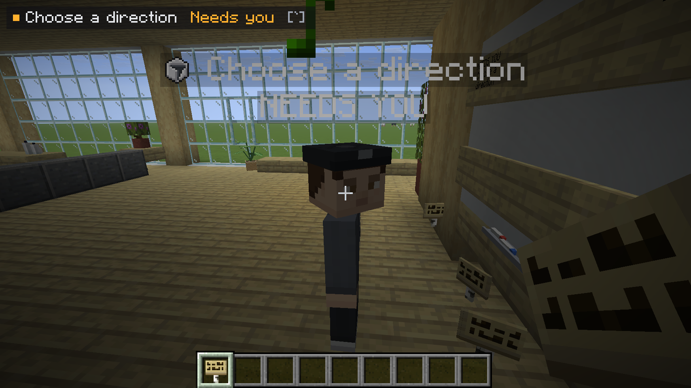
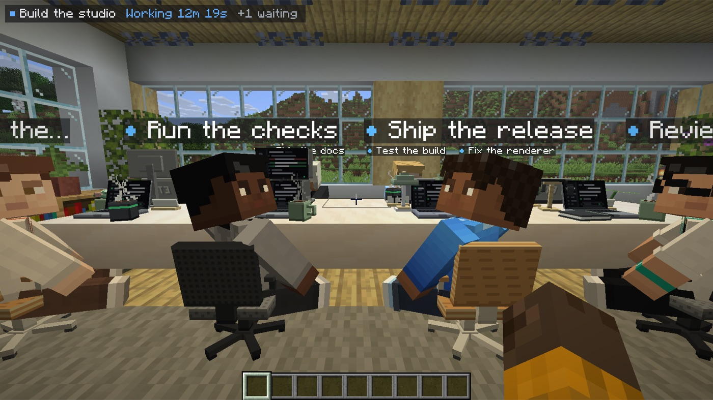
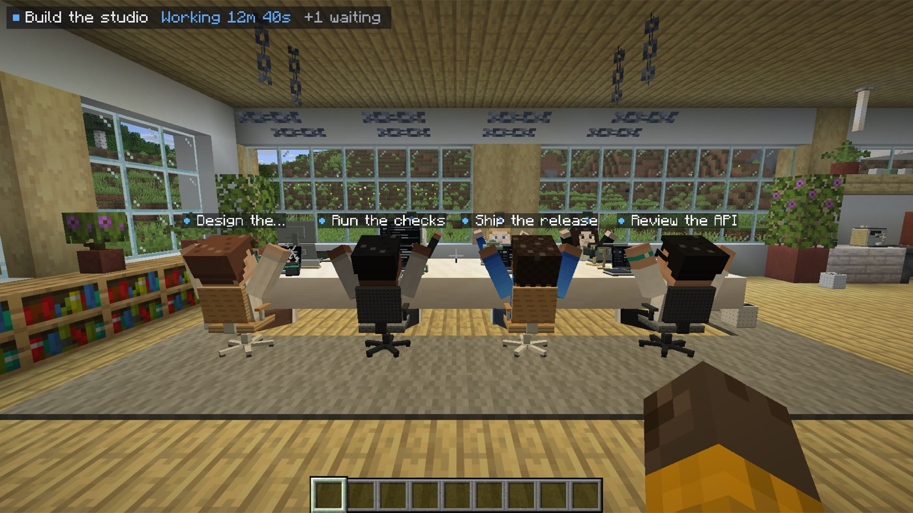
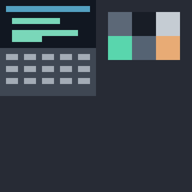

# Agents as people, and the T3 laptop

> **Status:** designed 2026-11-05. Player-shaped agents and desk laptops shipped in #8; the held, craftable laptop is still to come. · [full spec](../specs/characters-and-laptop/spec.md)

Two small changes make the office feel like a real place. Agents look like **players**, and you open T3 from a **laptop** on any desk (and, later, one you can hold).

Shipped: residents are player-shaped Mannequins with per-provider skins. Villagers are gone.

## Agents look like players

- Built on vanilla **Mannequin** entities: player-shaped, but not logged-in players. They work in singleplayer and on servers, and vanilla clients can see them too.
- **One skin per provider.** Claude is terracotta and cream, Codex is graphite and mint, Muse is violet and sky, and anything else is slate.
- **Body language shows status:**

| Status | Where | Pose |
|:--|:--|:--|
| Working | At their desk | Seated and typing, each agent slightly out of sync with the others |
| Needs you | At the whiteboard | Standing, hand raised, small amber **?** bubble |
| Done | In the lounge | Seated on the sofa, relaxed |
| Walking | Between zones | Normal walk |
| Offline | Wherever they were | Greyed out, still |

Agents are not statues. A worker types in bursts, and now and then leans back to think, stretches or sips from its mug, each on its own rhythm. Walk up and it glances at you a beat later (hands off the keys, over the shoulder if its back is to you), then goes back to work; only the agent that needs you keeps watching, hand up, with a wave. Finished agents sink into the sofa.

 

The name tag is one line: a dot in the status colour (blue working, amber needs you, green done) and the short title. Across the room it is only the dot; the agent under your crosshair shows its whole title and status; the one that needs you is always named, larger, on amber.

Right-click an agent to open a small card beside it ([the simple native UI](native-ui.md)). 

## The T3 laptop

- **Every desk has a laptop** (shipped). Clicking one opens the thread of the agent sitting there; its screen shows idle, working or needs-you.
- **A laptop you hold** (later): you'd get one automatically the first time you join a T3 world, or craft it (three glass panes on top, iron + redstone + iron in the middle, three iron ingots on the bottom), and right-click it anywhere to open the laptop screen ([see the UI](native-ui.md)). <kbd>`</kbd> does that today.
- It's a vanilla paper item with a custom model, so T3 Craft can still join vanilla servers.

Assets: [model](../specs/characters-and-laptop/laptop.model.json) · [texture](../specs/characters-and-laptop/laptop.png) · [recipe](../specs/characters-and-laptop/laptop.recipe.json) · [item](../specs/characters-and-laptop/laptop.item.json)

## Why

[No villagers](../DECISIONS.md#2026-11-05--no-villagers-agents-are-player-characters): agents are coworkers. [The laptop](../DECISIONS.md#2026-11-05--the-t3-laptop): opening T3 should be something you do in the world.
