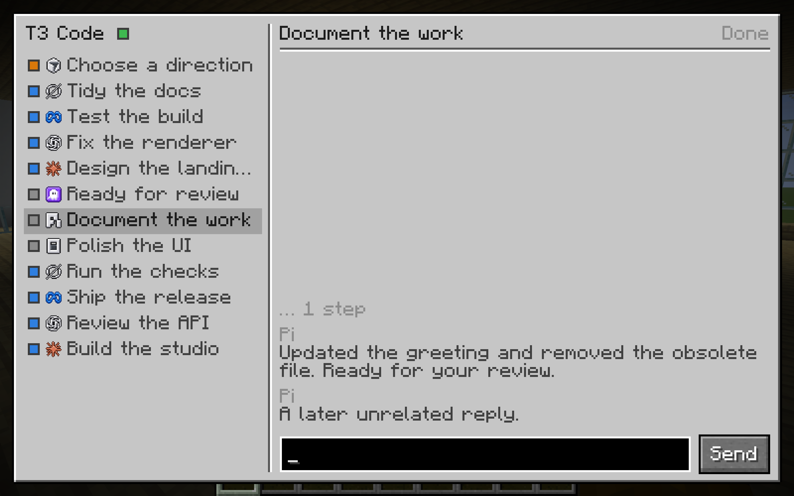
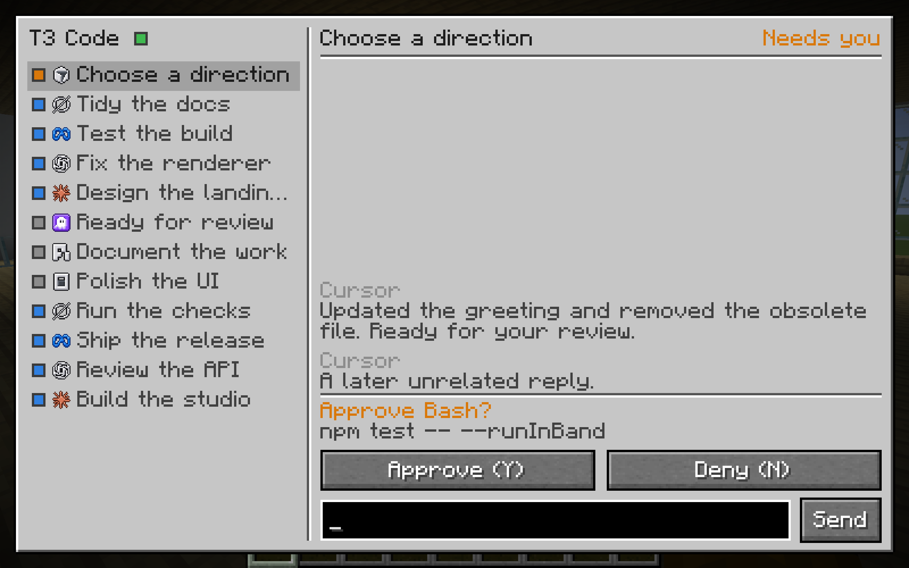
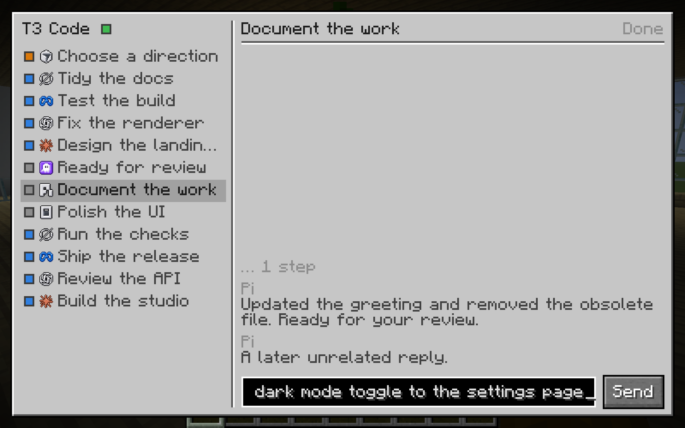
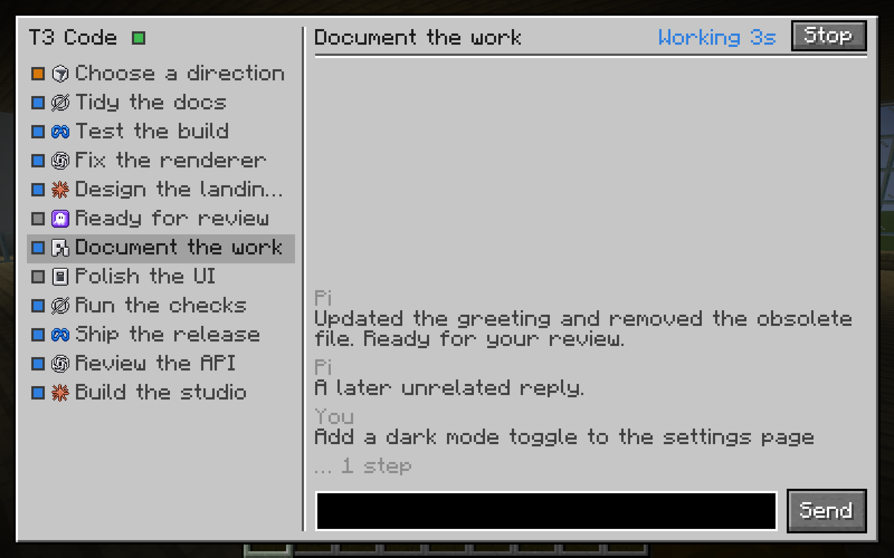
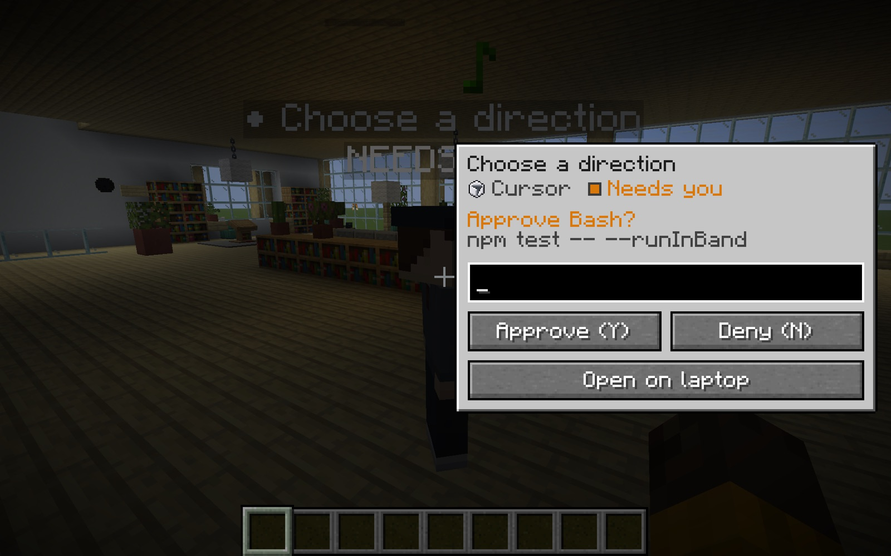
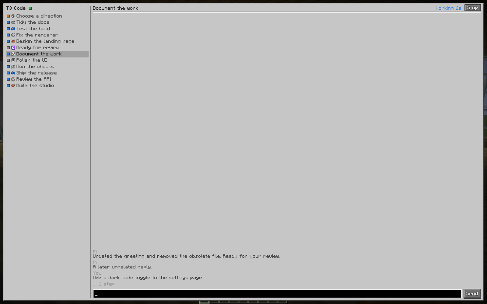
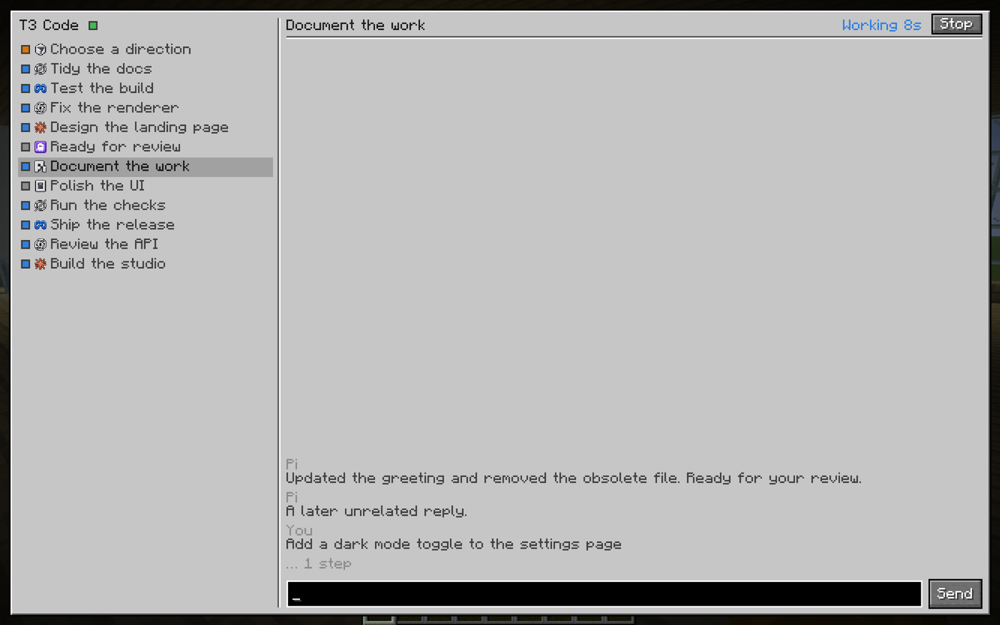
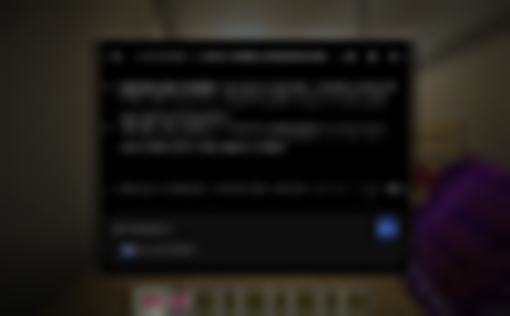

# The simple native UI

> **Status:** shipped. This is the in-game UI. The [streamed web UI](real-t3-ui.md) stays in the code behind `webUi: true` in `config/t3craft.json` and is off by default.

The owner tried the streamed T3 web app in game and said: *"idk why we switched to full js ui, it was better when it was mc, but just very simple."* So the UI is plain Minecraft again, with fewer things on it: the default font, a vanilla container-style window, vanilla buttons and edit boxes, and lots of space.

Every screenshot on this page is a real, unedited Minecraft screenshot from the dev client at **GUI scale 5** in a 2000 × 1250 window (the owner's setup, about 400 × 250 GUI pixels), against the office fixture. Nothing was sent to a real thread.

## The laptop

Press <kbd>`</kbd> or use a laptop. Two parts, nothing else.

**Left: your active threads.** Each row is a status dot (blue working, orange needs you, grey idle or done), the provider's icon and the title. Snoozed threads fold into one *Snoozed* row. Settled threads are hidden, pinned ones excepted. Click a row to switch; the wheel scrolls.

**Right: the selected thread.** The title, the status in its colour (and a *Stop* button while the agent works), then the last messages as plain wrapped text. Formatting is only bold and inline code. Tool and command activity is folded into one muted *… 5 steps* line before the agent's reply. At the bottom there is one input box and *Send*. Enter sends and drops you back into the world; Shift+Enter sends and keeps the laptop open.

### When the agent needs you

A thread that needs you shows what it is asking and a big *Approve (Y)* / *Deny (N)* row above the input. A question shows its text and one vanilla button per answer; the number keys pick one, and you can type your own answer when the agent allows it.

### Sending a message

<table>
  <tr>
    <td width="50%"></td>
    <td width="50%"></td>
  </tr>
  <tr>
    <td>Type into the one box.</td>
    <td>After sending: your message is in the conversation under <i>You</i>, the status turns to <i>Working</i>, and <i>Stop</i> appears.</td>
  </tr>
</table>

## The agent card

Click an agent in the office. It turns to face you, the world dims a little (no blur), and a small card opens beside it.

The card shows the agent's name and provider, its status, the last message (or the request it is waiting on), one input box, *Approve (Y)* / *Deny (N)* when needed, and *Open on laptop* for the whole thread. Enter sends and closes the card. Esc, <kbd>`</kbd> or a click outside closes it.

## Other GUI scales

Everything is in GUI pixels, so the layout follows the GUI scale like vanilla screens do. The thread list widens a little on wider screens.

<table>
  <tr>
    <td width="50%"></td>
    <td width="50%"></td>
  </tr>
  <tr>
    <td>GUI scale 2.</td>
    <td>GUI scale 3.</td>
  </tr>
</table>

## Before and after

<table>
  <tr>
    <td width="50%"></td>
    <td width="50%"></td>
  </tr>
  <tr>
    <td><b>Before.</b> The streamed web app ([#7](https://github.com/alexandros-lekkas/t3craft/pull/7)): T3's whole interface through a hidden Chrome.</td>
    <td><b>After.</b> The native laptop: the thread list, the thread, one input box.</td>
  </tr>
  <tr>
    <td></td>
    <td></td>
  </tr>
  <tr>
    <td><b>Before.</b> The streamed agent card over the blurred world.</td>
    <td><b>After.</b> A small native card beside the agent, over the lightly dimmed world.</td>
  </tr>
</table>

## What was left out on purpose

No tabs for activity, review, diff, pins or connections on the laptop. No model picker, no machine or project filters, no *+ New* button. The code for Decisions, Review, Activity and Pins is still there behind the `/t3` commands, and the streamed web UI is still there behind `webUi: true`, but none of it is on the screen.

## How it is built

- `T3Screen` is the laptop and `T3AgentCardScreen` the card. Both are plain `Screen`s with vanilla `Button` and `EditBox` widgets; `T3Ui` draws the container-style window, the dots and the provider glyphs (the bundled `provider_icons` font, U+E000–E00B).
- Data and actions come from `T3State` and `T3Backend` as before: send, approve, answer, interrupt. Drafts survive switching threads and closing the screen (`ComposerDraft`).
- `T3Markdown` is reduced to wrapped text with bold and inline code; headings become bold lines and lists keep a bullet.
- `webUi: false` is the default in `config/t3craft.json`. While it is off, `ChromeHost` is never started. The dev `webShowcase` run turns it on for that run only.
- The shots on this page come from `./gradlew runClient -Pselftest=nativeui -Pworld=<office save> -Pconfig=config/office-fixture.json -Pwidth=1000 -Pheight=625 -PmcpPort=25591` with `scripts/office/fixture.py` running; the flow clicks the waiting agent, opens the laptop, switches threads, sends a message and switches GUI scale.
