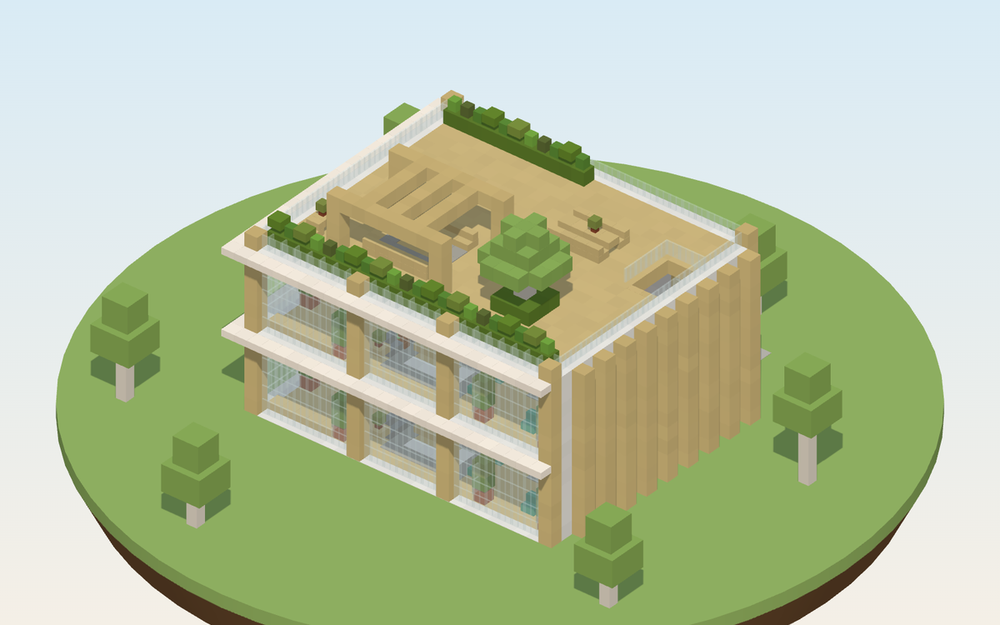
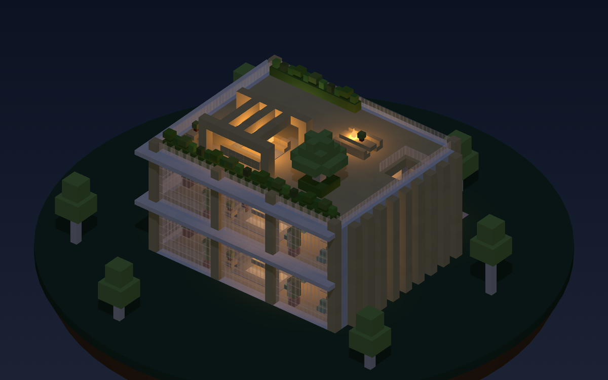
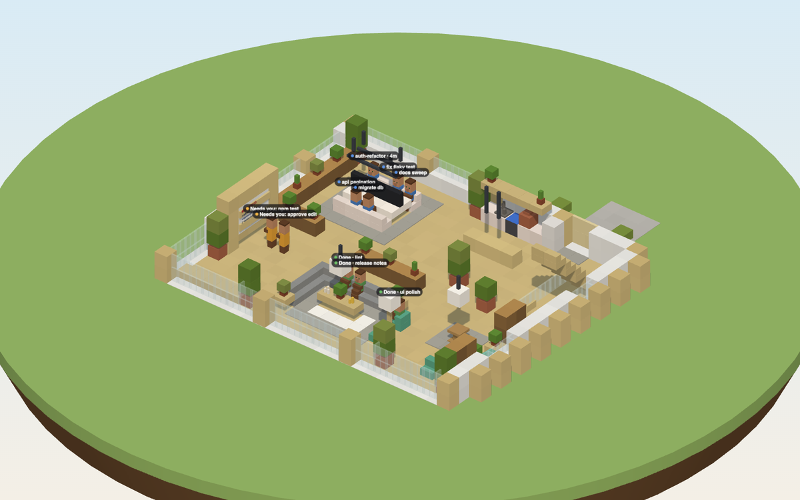
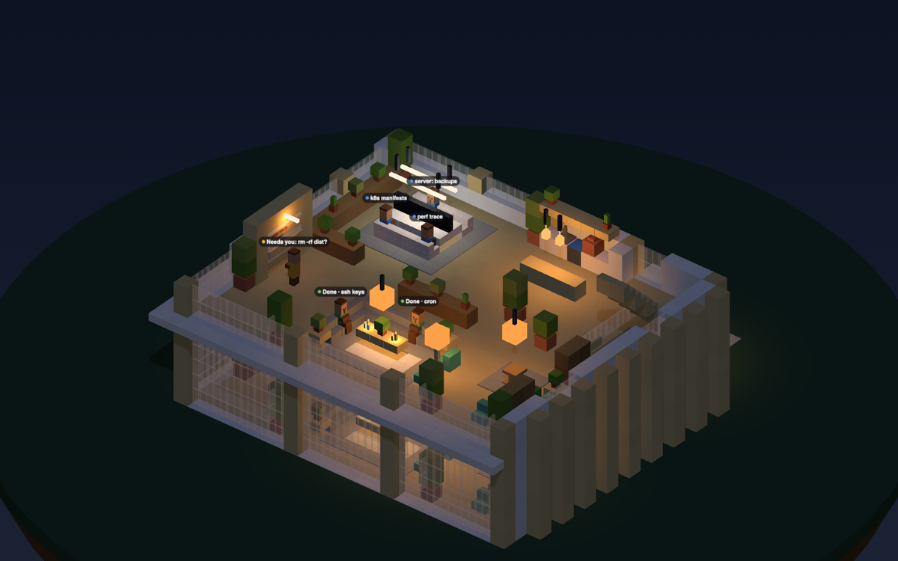

# The office: design A, Scandi Studio

> **Status:** chosen 2026-11-05 · being built for 0.6 · [full spec](../specs/office-design-a/spec.md)

A warm Scandinavian studio: white concrete, birch everywhere, floor-to-ceiling glass on the south side and a planted roof terrace. Every machine you connect gets one identical floor.

<p align="center">
  
  
</p>

<!-- TODO(screenshot): add real in-game shots `office-exterior-day` and `office-interior-desks` (docs/SCREENSHOTS.md) -->

## Inside one floor

<p align="center"></p>

Each zone tells you what an agent is doing at a glance:

| Zone | Who's there |
|:--|:--|
| 🪑 **Desk bench**: 8 desks under linear pendants | Agents that are **working** |
| 📋 **Whiteboard**: the west wall | Agents that **need you**. Right-click it for Decisions. |
| 🛋️ **Lounge**: L-sofa, rug, candles, facing the glass | Agents that are **finished** |
| 📚 **Review nook**: lectern and window seat | Right-click the lectern to review checkpoints |
| ☕ **Kitchenette and island** | Atmosphere |

<p align="center"></p>

At night the pendants, floor lamps and candles switch on. Hidden light blocks stop mobs from spawning inside.

## Floor plan

```
GROUND FLOOR · 1–8 desk chairs (stable slot order) · N/n whiteboard waiting spots
        x→ 901234567890123456789012
  z= -1 I=====I=====I####IDD###I
  z=  0 #P.........PkkKkkF::...#
  z=  1 =B.::::::..............#
  z=  2 =B.:1234:...........=>>#
  z=  3 =B.:dddd:....wwww...=..#
  z=  4 IB.:dddd:...........=..=
  z=  5 =B.:5678:...........=..=
  z=  6 =B.::::::...........=..#
  z=  7 =B.............P....=..#
  z=  8 #BBBB.............P....#
  z=  9 #w.......BBBBB.........#
  z= 10 #t.nn.................B#
  z= 11 #t.Nnn............:::.B#
  z= 12 #t.nnn..sssssst...:L:.t=
  z= 13 #w......s::::::a..:::.a=
  z= 14 =P......s:ttt':o......t=
  z= 15 =.......s:'''':a......B#
  z= 16 =.......t::::::.....a.B#
  z= 17 =bbbbbP..........P....P#
  z= 18 I=======I======I=======I

# white concrete  = glass  I birch column  D door  d desk  s sofa  a armchair
B bookshelf  L lectern  k/K/F kitchen  w whiteboard frame / island  > stairs
: ' rugs  P potted tree  b window bench  t table/shelf      south (z=18) is the glass side
```

<sub>Upper floors are identical apart from the stairwell. See the full plans, elevation and section in the [spec](../specs/office-design-a/spec.md#3-floor-plans).</sub>

## Key numbers

| | |
|:--|:--|
| Footprint | 24 × 20 walls (26 × 21 with fins and sun lip) |
| Floor height | 6 blocks, with 5 clear |
| Floors | 1 per connected machine. A new machine adds a floor and moves the roof up, and nothing else changes. |
| Desks | 8 per floor, the same stable slots as today |
| Palette | `birch_planks`, `white_concrete`, `glass_pane`, `stripped_birch_log`, quartz, pale oak, sage copper accents. All vanilla 26.3 blocks. |
| Build | 3,305 blocks for 2 floors. The [generator](../specs/office-design-a/preview.html) is the source of truth. |

## Files

- [spec.md](../specs/office-design-a/spec.md): coordinates, palette, plans, anchors, lamps, roof and build notes
- [anchors.json](../specs/office-design-a/anchors.json): every desk, waiting spot, lounge seat and lamp
- [blocks-2floors-day.mcfunction](../specs/office-design-a/blocks-2floors-day.mcfunction): the exact setblock list
- [preview.html](../specs/office-design-a/preview.html): interactive three.js preview. Download it and open it locally.

## Designs we didn't pick

<p align="center">
  
  
</p>
<p align="center"><sub>B, Japanese (left) · C, Glasshouse (right). Design A was chosen for warmth and readability (<a href="../DECISIONS.md#2026-11-05--office-design-a-scandi-studio">decision</a>).</sub></p>
