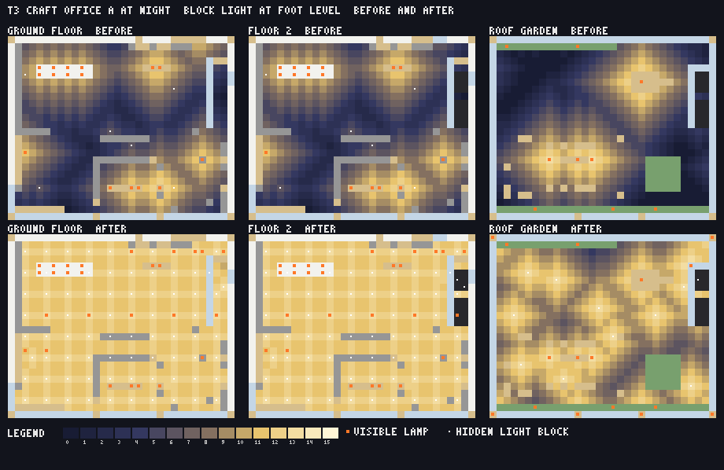
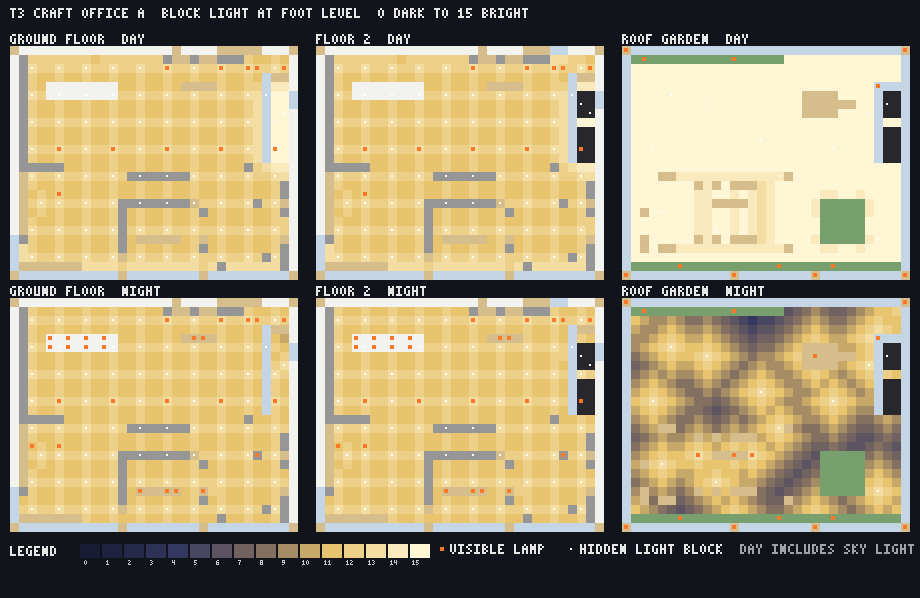
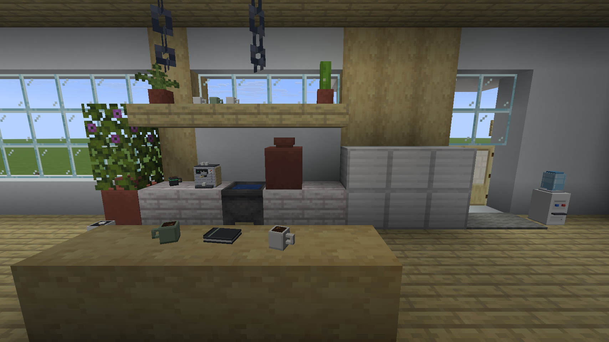
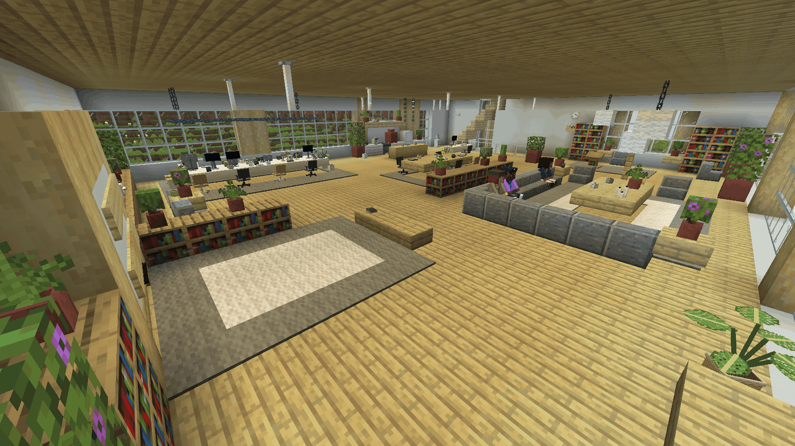
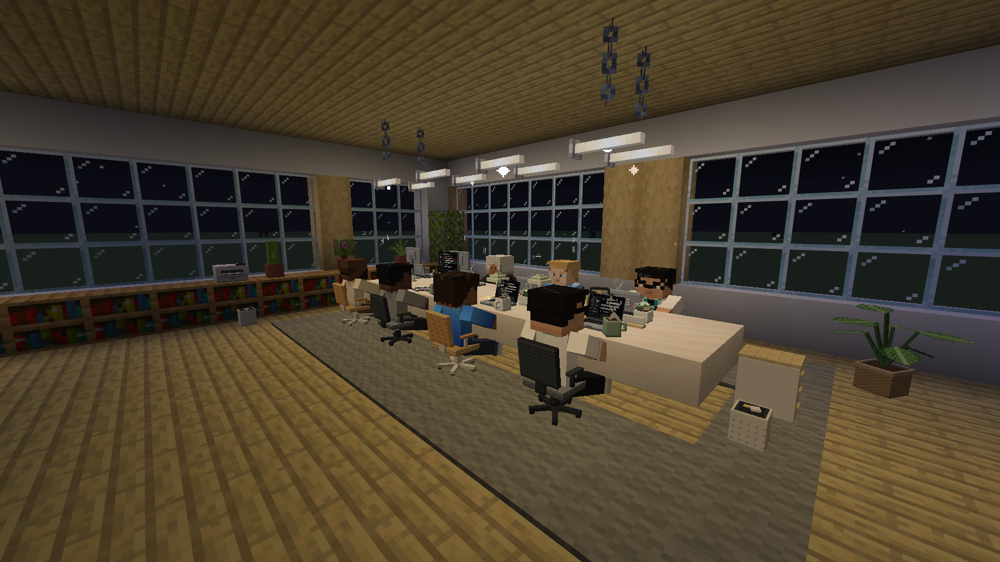
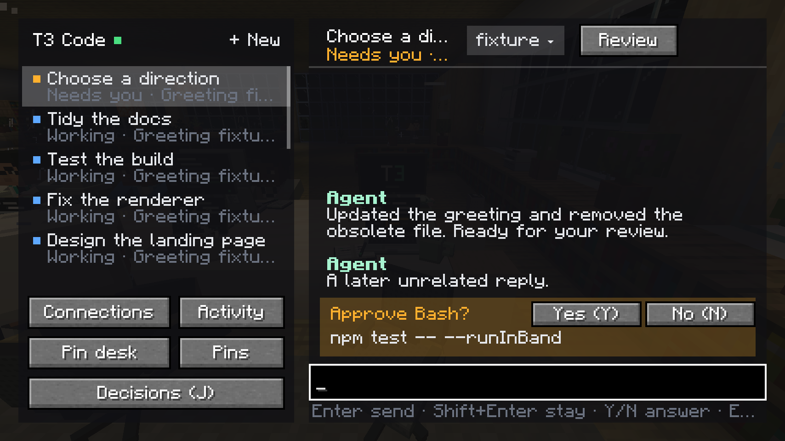
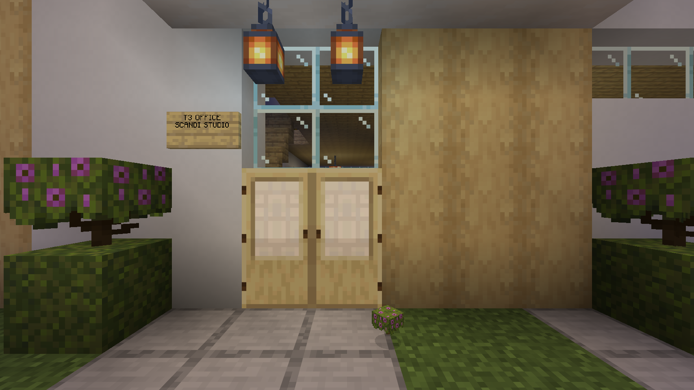
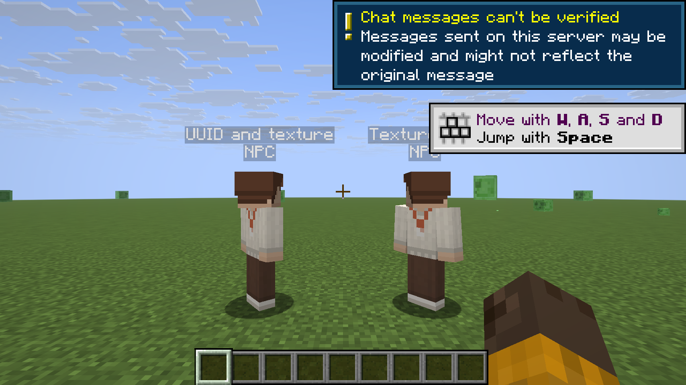
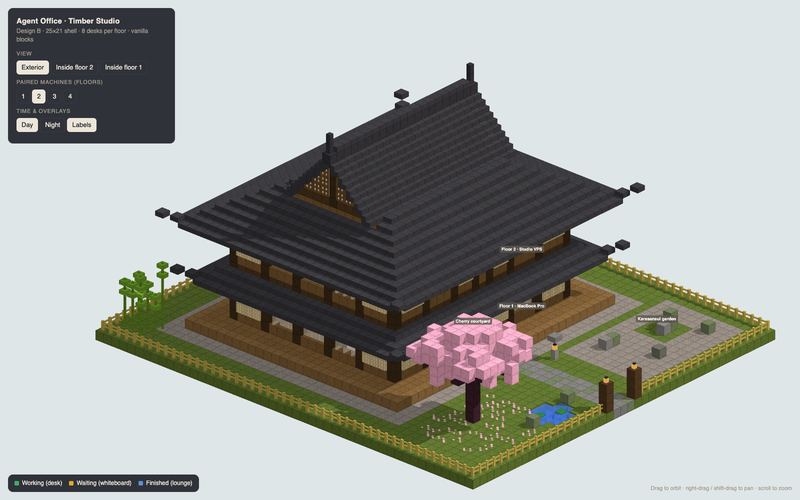
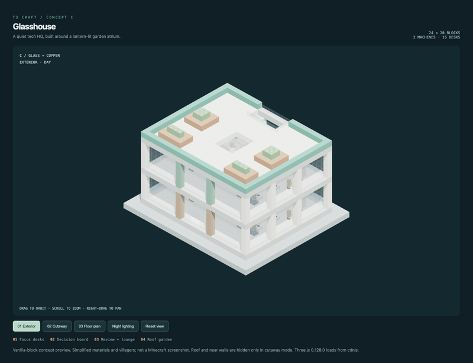

# Office A: Scandinavian studio

The office has a **30 × 24 block interior and at least two occupied-capable floors**, plus a roof terrace. Birch, white concrete, quartz desks, glass, a larger kitchenette, an open lounge and generous circulation retain design A's palette. Each machine has sixteen stable desk slots: eight downstairs, then eight upstairs. Further machines append two-floor suites; existing owners keep their saved suite positions.

The building is generated template data, not a preview. `scripts/office/scandi.cjs` is the original design generator; `generate.cjs` expands its footprint, removes trapdoor monitors and block chairs, and writes the block/anchor and prop manifests. `OfficeDesign` repeats the upper-floor module and moves the roof when extending the building. Regenerate with `node scripts/office/generate.cjs`.

In singleplayer, `OfficeQueue` schedules `OfficePlacement` on the integrated server thread. It places real block states and sign text directly, without chat commands or client block illusions. The existing site-loading, world/session binding and occupied-site checks remain. On a remote server the existing shared command budget throttles placement. The dedicated-server office uses the same template data.

Agents use vanilla Mannequins created through the entity factory, including its client override. A skin-rendering spike proved texture-only bundled profiles work in Minecraft 26.3. Provider driver IDs select the skin family; thread identity selects an alternate. Unknown providers have bundled fallback skins. A provider glyph precedes the thread title; only the description carries the status word, with no ticking elapsed time.

The brain owns movement and stable desk identity. Workers sit and type at their own laptops; waiting agents stand at the whiteboard; finished agents visit the fridge and lounge. Sitting uses a synced crouching pose interpreted as a seated pose by the T3 renderer. No walk-animation values are driven manually. T3-tagged Mannequins are non-pushable. Heads ease toward the player within ±50° while the brain holds movement, triggered by needs-you/done, opening the card, or coming within three blocks.

Each desk has a paper-backed ItemDisplay using FIXED transform and a separate Interaction hitbox. UUIDs encode thread identity and entity role, so display and hitbox identities are distinct and stable. States map to `idle`, `working`, or `needs_you`; the laptop faces the same direction as its user. Clicks retain the existing use-key drain and focus/open-panel route. The complete original props pack places 59 displays on each floor: every desk has its own chair and mug plus a distinct mix of monitor, succulent, lamp, headphones, nameplate and notebook. The kitchenette has an espresso machine and mugs; shared areas add a water cooler, wall clock, printer, pinboard, filing cabinets and monsteras. The generated manifest removes the old block monitors/chairs and replaced plants/appliance. Chair seats are 0.508 blocks above the floor. Working mugs steam, monitors follow status, desk lamps illuminate at night, and waiting agents' chairs swivel toward the player. Small props use the pack's shorter tracking visibility ranges.

## Lighting

The office is lit in two layers, so it reads as a working studio by day and a warm one by night without a cluttered ceiling.

- **Always on, cool white.** A hidden `light[level=15]` grid sits one block above head height, every third block, on every floor. It is invisible, has no hitbox, and keeps every walkable cell at block light 11 or more at foot level, day and night, so there is no dark corner and nothing can spawn inside. White end-rod downlights hang from the ceiling over the circulation routes: a row across the open floor between the bench and the lounge, a pair inside the entry, a pair over the kitchen aisle and one over the whiteboard where waiting agents stand. A sconce at the foot of each stair and a hidden light in the well keep the run soft but clear.
- **Warm at dusk.** The design's own lamps still switch with the Minecraft clock: the linear bars over the desks, the island and canopy lanterns, the candles and the picture light. The three fabric shades (lounge pendant, floor lamp, lectern pendant) now glow as `ochre_froglight` instead of shroomlight, a cream light that matches the white wool they are by day.
- **Outside.** Lanterns sit on the four corner posts and the two south mullions of the roof parapet, on the stair-head guard, and on a birch bollard at each far corner of the entry path, so the garden and the way to the door are lit all night. A few hidden lights over the terrace walks fill in between them.

The maps are computed from the template (`scripts/office/lighting.cjs` adds the layer after `generate.cjs` expands the plan). Before: night light averaged 6 on each floor with cells at 0, and 68 roof cells were dark enough to spawn mobs. After: every interior cell is at 11 or more, the roof is never below 4, and the entry path never below 10. `officeCheck` proves the same numbers headlessly on every build with the real block emission and dampening values (`OfficeLighting`), and `/t3 office build` rebuilds an existing office with the new layer, clearing the old hidden lights first. In-game screenshots of the lit office are still to be captured.

## Going to the office

Use `/t3 office build` to place or explicitly rebuild the office. Once this world has an office, `/t3 office` and `/t3 office go` return you to its entrance plaza, facing the door, even from an unloaded area or another dimension. Singleplayer teleports run directly on the integrated server; remote servers use the existing throttled `/tp` command path and require server permission. With no saved office, bare `/t3 office` builds one.

## Actual Minecraft captures

## Verification

The dev client uses Java 25, Minecraft 26.3, `guiScale:5`, muted master volume, and a disposable flat singleplayer world. The loopback T3 fixture in `scripts/office/fixture.py` supplies twelve threads in mixed states without calling real agents. The `office-a` self-test captures Minecraft's framebuffer and checks the upper floor exists, eight residents occupy the lower floor, four occupy the upper floor, twelve laptop pairs have unique UUIDs, an actual use-key click on a laptop opens its matching thread, and both teleport commands return from a distant area to the entrance facing the door.

The captured needs-you head turn measured 49.99997°. The client also passed both teleport checks and shut itself down. The reported blank T3 panel was investigated: that earlier test world had failed to load its 26.3 world-generation settings, and the log contained no T3Screen render exception. After using a complete flat-world save, the laptop screenshot above proves the unchanged T3Screen renders at GUI scale 5.

Smoke checks cover generated anchors, minimum floors, extension modules, provider mapping and bundled files, laptop states, deterministic identities, head-turn movement holds, stable allocation, rebuild protection and reconnect behavior. `T3CRAFT_FIXTURE_PORT=25730 scripts/verify-ci.sh` uses isolated ports for the full CI suite; the default CI ports are unchanged.

To repeat: start `python3 scripts/office/fixture.py`, create a disposable creative flat world, set the options above plus `pauseOnLostFocus:false`, and run `./gradlew runClient -Pselftest=office-a -Pworld=<save-name> -Pconfig=config/office-fixture.json`. Screenshots appear in `run/screenshots`.

Vanilla Mannequin server tracking is limited to 32 blocks. Custom skins, item art and seated/typing presentation require the bundled client resources/mod; this is not a claim of vanilla-client resource-pack interoperability. Remote command placement is intentionally slow under the existing spam budget. Rebuilding extends the office in place; automatic growth on pairing is not introduced.

## Original art credits

The office generator, original provider character skins, laptop model/textures, and furniture/prop models were supplied by the T3 Craft office-design and art workstreams and integrated here. Provider glyphs are original pixel renditions of their respective providers' marks. Asset groups are registered in the central [credits manifest](../../credits/credits.json), with integration details in [office-credits.json](office-credits.json). No third-party building schematic was used. Minecraft block textures shown in the screenshots are Mojang's game assets.

## Original design references

The [original design A spec](../specs/office-design-a/spec.md), [anchors](../specs/office-design-a/anchors.json) and [preview generator](../specs/office-design-a/preview.html) document the smaller design this implementation expands. Runtime dimensions and minimum floor count are defined above.

## Designs we didn't pick

  
  

B, Japanese (left) · C, Glasshouse (right). Design A was chosen for warmth and readability (<a href="../DECISIONS.md#2026-11-05--office-design-a-scandi-studio">decision</a>).

