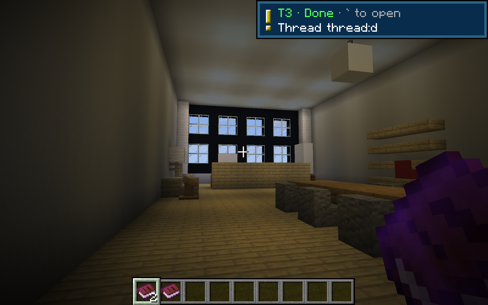
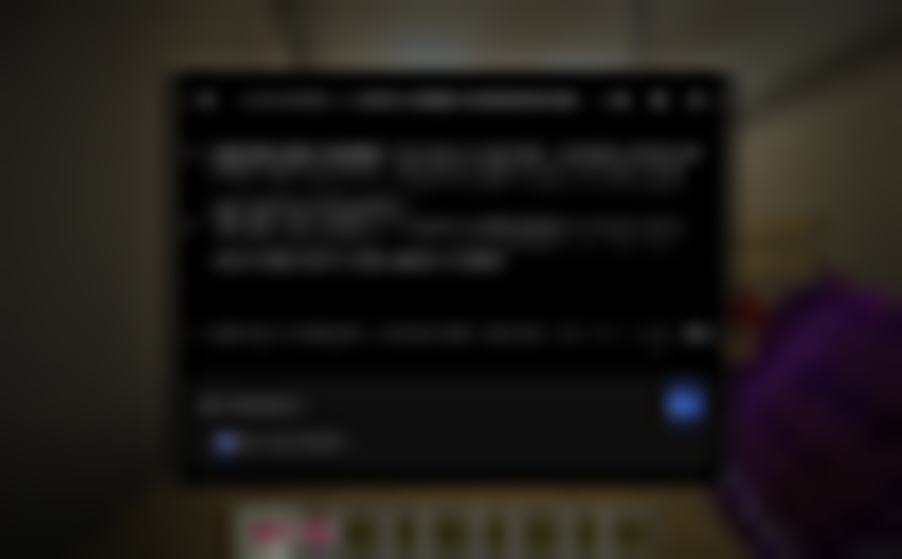

# The real T3 Code UI in Minecraft

> **Status:** opt-in. The in-game UI is now the [simple native UI](native-ui.md). Set `"webUi": true` in `config/t3craft.json` to stream the web app instead; while it is off, Chrome is never started.

T3 Craft shows **T3 Code's own web app**, not a redrawn copy. T3 already serves its UI locally at `http://127.0.0.1:3773`. The mod opens that page in a hidden Chrome and streams it into a Minecraft screen over the Chrome DevTools Protocol. Mouse, wheel and keyboard go back to the page. Every T3 feature (sidebar, diffs, review, model picker, settings) shows up in game the day T3 ships it.

All screenshots below are real, unedited Minecraft screenshots (F2 equivalent). They were taken in the dev client at **GUI scale 5** in a **2000 × 1250** window, against the real local T3 (nightly `0.1.7-nightly.20261103.4119`). The capture was read-only: nothing was sent to any thread.

## Laptop: the whole app

Press **`** (the panel key). T3 Code fills the screen.


It is fully interactive. In the capture below, `minecraft` was typed from Minecraft into T3's sidebar search (every character went through the mod's `charTyped` → `Input.insertText` path), and T3 filtered its own thread list. The showcase checks the page really holds the query before taking the shot.


**Known gap:** in this capture the forwarded *click* on the search box did not move T3's focus to it (the same click over plain CDP outside the game does), so the showcase focused the input through the DOM before typing. Clicks elsewhere (buttons, links, the composer) work; the search-box focus is still being chased.

- **Esc** always returns to the game. It is never sent to the page.
- **F1–F12** (F2 screenshot, F3 debug, F11 fullscreen) stay with Minecraft.
- Everything else goes to T3. Typing uses `Input.insertText`, so any keyboard layout and Unicode work. Named keys (Enter, Backspace, arrows, Home/End, Page Up/Down, Delete, Tab) and Ctrl/⌘ shortcuts are sent as key events. Shift, Ctrl, Alt and ⌘ are sent as their own keydown/keyup transitions too (with left/right location), so held-Shift range selection and chords that watch the modifier keys work. ⌘/Ctrl+V pastes Minecraft's clipboard. ⌘/Ctrl+C and X copy the page selection to the real clipboard.
- The laptop opens on the focused thread the first time, and again whenever the focused thread changed since the last open. Otherwise it keeps its own place, so drafts and scroll survive closing it.
- **Answering a ping** (` within a minute of a *Done* / *Needs you* toast) always jumps to the thread that pinged, even if the laptop was open on something else:




## Agent card: one agent's thread

Right-click an agent (the use-key route in `OfficeResidents`). That thread opens in a centred floating window, about 60% of the screen. The world behind it is blurred, never covered with the menu dirt texture. It's T3's own thread page, deep-linked to `/<environmentId>/<threadId>`, at a narrow viewport, so T3 uses its compact layout with the sidebar hidden.



Esc or a click outside the card closes it. The game keeps running behind it (it does not pause).

## Crisp text, no warping

The rule is **one frame pixel per framebuffer pixel**:

1. The destination is a rectangle in GUI pixels. It covers exactly `gui size × GUI scale` real framebuffer pixels: 2000 × 1250 for the laptop above, 1240 × 925 for the card.
2. Chrome renders exactly that many pixels: `Emulation.setDeviceMetricsOverride(cssWidth, cssHeight, deviceScaleFactor)` with `css × dpr = destination`.
3. The texture is drawn under a `1 / guiScale` pose, so it lands 1:1 with Minecraft's nearest filtering. A frame of any other size (for example, mid-resize) is dropped, never stretched.

The device scale factor starts at the GUI scale, so one CSS pixel is one GUI pixel. GUI scale 5 on a 2000-pixel window leaves only 400 CSS pixels, though, and T3's desktop layout needs about 1100. So the scale is divided by the smallest whole number `n` that gives T3 enough room (`WebViewport.fit`). Because `n` is whole, the CSS size (`gui × n`) stays an integer and the physical size stays exactly `gui × scale`. At scale 5 that gives:

| Surface | GUI px | Real px | CSS px | DPR |
|---|---|---|---|---|
| Laptop | 400 × 250 | 2000 × 1250 | 1200 × 750 | 5 ÷ 3 |
| Agent card | 248 × 185 | 1240 × 925 | 496 × 370 | 5 ÷ 2 |
| Laptop, 1280 × 720 GUI at scale 2 | 1280 × 720 | 2560 × 1440 | 1280 × 720 | 2 (= GUI scale) |

The agent card stays under 768 CSS px, T3's compact breakpoint, at every GUI scale: its GUI width is capped at 767 px, so at scale 1 on a wide window it is a compact card, not the whole desktop app.

Frames are JPEG quality 92 while the page moves. 250 ms after the page goes still, a lossless PNG of the same pixels replaces it, so text you're reading has no JPEG ringing. Chrome caps screencast frames at about 7 megapixels. Above that (for example, fullscreen 3840 × 2036 at scale 5), the first undersized frame switches the tab to exact-size screenshots: the screencast is restarted at 32 × 32 and used only as a "something changed" trigger, so nothing is encoded twice at full size.

On a window or GUI-scale change, `Screen.init` re-fits the rectangle and resizes the page. The stream restarts at the new size. Minecraft rounds the GUI size up (2036 / 5 → 408), so the rectangle uses only whole GUI pixels inside the framebuffer.

## Lifecycle

- **Lazy.** Chrome starts the first time the laptop or a card opens. It's headless, with `--remote-debugging-port=0` on loopback only, and the port is read from `DevToolsActivePort`.
- **Own profile.** `--user-data-dir=<game>/config/t3craft/chrome`, never your normal browser profile.
- **Reused.** One browser and two tabs (laptop and card), so each keeps its place. Page operations for a screen (open, resize) run in order on one thread, so a stale resize can never land after a newer one.
- **Adopted, never duplicated.** If a browser is already serving the profile (`DevToolsActivePort` answers `/json/version`, say after a crash of the game), it is adopted. The mod records its own browser in `t3craft-chrome.pid` (pid and start time); the only process it ever ends is one that file names *and* that is verifiably a browser on this profile. Any other Chrome is never touched.
- **Streams only while visible**, capped at **30 fps** by delaying the screencast ack. Closing the screen stops the stream.
- **Closes** after **10 minutes** with nothing on screen, and when the game exits (`CLIENT_STOPPING` plus a JVM shutdown hook). It closes with `Browser.close` first, so Chrome saves its cookie store, then kills only its own process tree.

## Zero-step pairing

If T3 shows its **Pair with this environment** screen (`/pair`), the mod mints a one-time link with **T3's bundled CLI**:

```
<T3 home>/bin/t3 auth pairing create --label "T3 Craft laptop" --ttl 2m --base-url <origin> --json
```

- `<T3 home>` is `T3CODE_HOME` or `~/.t3`.
- The launcher must contain T3's own marker (`Written by T3 Code`). A random `t3` on PATH is never run. `--base-dir` is not passed.
- The CLI is never killed. If it has not answered after 20 s the laptop falls back to the native panel and the CLI is left to finish on its own (its output is drained on a daemon thread).
- The link (`/pair#token=…`) is loaded once in a fresh document; T3 redeems the token itself. The credential is never written to disk by the mod.
- T3's session cookie then lives in the mod's Chrome profile, so later launches skip pairing. Verified: a second launch did not pair again.
- The office, HUD and native screens need a bearer token rather than a cookie. `T3AutoConnect` mints a separate least-privilege link (`orchestration:read`, `orchestration:operate`) and exchanges it at `/oauth/token`, saving the token to `config/t3craft.json`; it retries every 15 s while T3 isn't running (backing off when T3 refuses) and pairs again when the local T3 stops accepting the token. The player never sees a link.

## Fallback

The native panel (`T3Screen`) opens unchanged when:

- no Chrome, Chromium, Edge or Brave is found (`T3CRAFT_CHROME` can point at another Chromium binary);
- T3 isn't running, or the page fails to load or pair;
- T3's page hasn't loaded within 25 s;
- the tab crashes or closes while open (Chrome restarts on the next open).

## Code map

| File | Role |
|---|---|
| `WebViewport` | Pure sizing math: destination, CSS size, DPR, mouse mapping |
| `Cdp` | Minimal CDP WebSocket client and message builders (mouse, wheel, keys, metrics, screencast) |
| `ChromeHost` | Browser discovery, launch, tabs, idle close, shutdown |
| `WebPage` | One tab: resize, 30 fps screencast, PNG settle frame, navigation, auto-pairing |
| `T3Web` | Finds the local T3 and its environment id; mints the pairing link with the bundled CLI |
| `T3WebScreen` | The Minecraft screen: laptop and card layouts, blur, 1:1 drawing, input forwarding, fallback. Threads owned by another paired machine go to the native panel, since only the local T3 can be streamed |

## Checks

- `./gradlew uiCheck` (part of `build`) covers:
  - viewport math: dest = gui × scale for scales 1–6 and many widths; CSS × DPR equals the destination exactly; DPR ≥ 1; card stays compact; mouse mapping;
  - CDP messages: metrics, screencast size and quality, request envelope, modifier bits, clicks, wheel, Enter, ⌘A, F-keys and Esc never forwarded, `insertText`;
  - the JPEG header parser and deep-link encoding.
- `./gradlew webProbe -Pthread=<id>` (opt-in, read-only) loads the real local T3 without Minecraft. It saves a laptop frame, a card frame and a 4K-resize frame, and checks each is exactly the expected size.
- `./gradlew runClient -PwebShowcase=<threadId> [-PwebPing=<threadId>] [-PwebPair=<link>]` (dev only, read-only) produced the screenshots above. It checks the page state over CDP (the search box holds the query; the laptop and card are on the expected route) and logs every rejected CDP command. It does not start the Minecraft MCP server, so it can run beside a real game. `-PwebPair` pairs the dev client first so the office has agents (a dev-only path; players are paired by `T3AutoConnect`); with an agent in the office it right-clicks its character for the card capture, otherwise it opens the card the way the right-click handler does.
