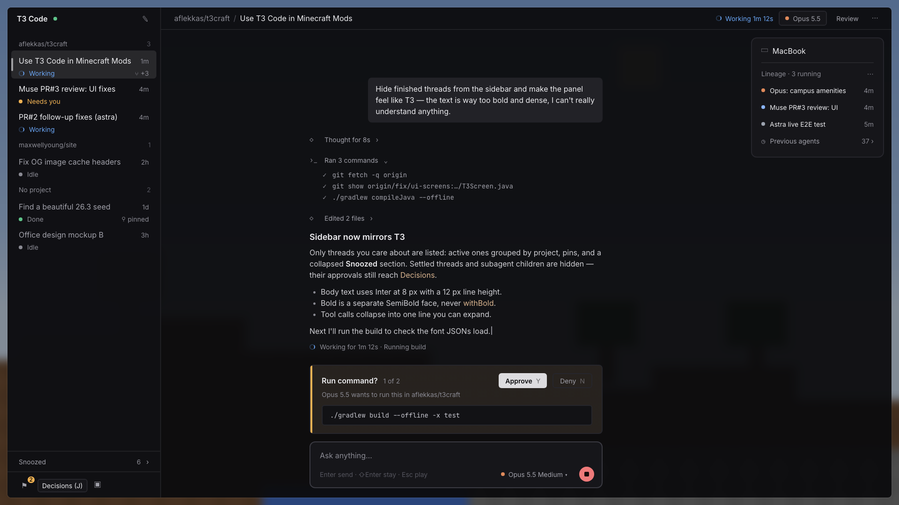
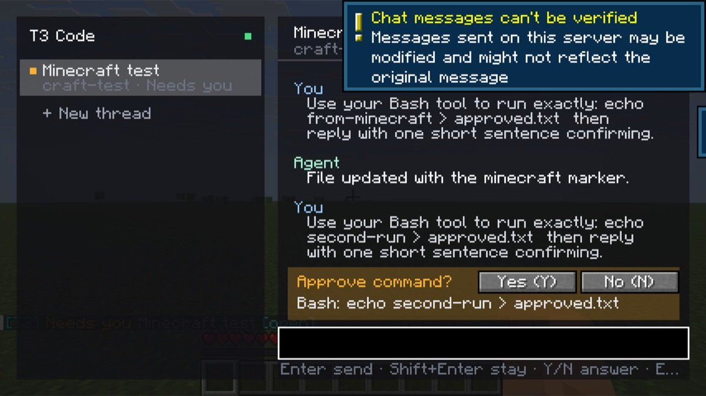
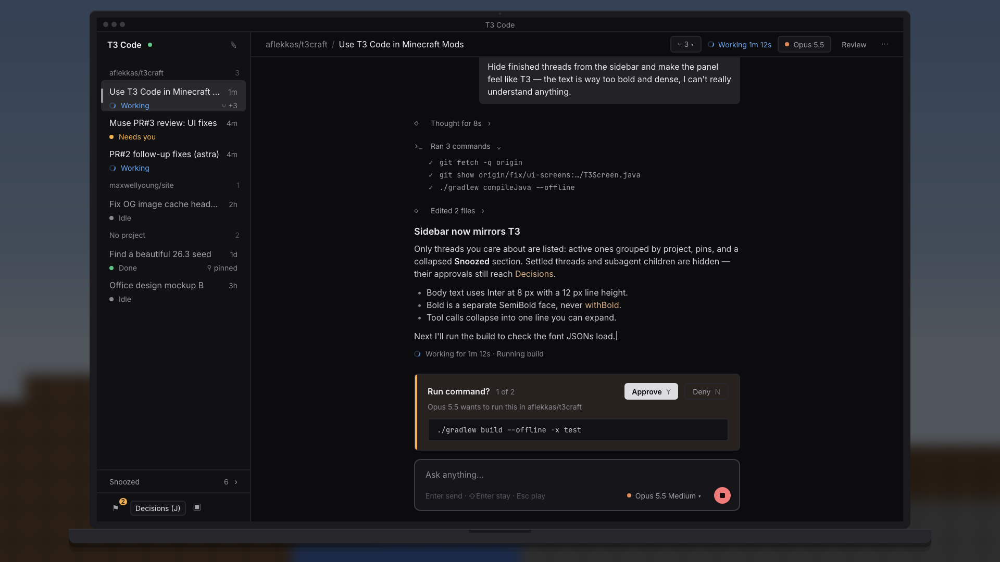
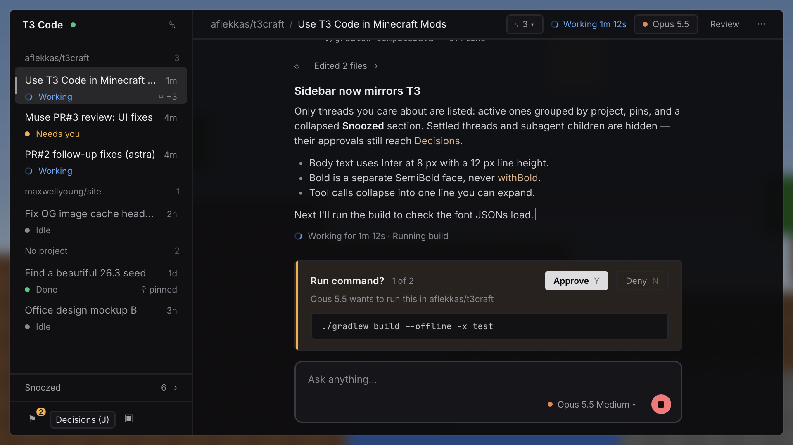

# The real T3 UI in Minecraft

> **Status:** shipped in [#7](https://github.com/alexandros-lekkas/t3craft/pull/7). See [the real T3 UI](real-t3-ui.md) for how it works, with real screenshots. The earlier native redesign below is an exploration, not the primary UI.

The real T3 web app is streamed in-game. Right-click the laptop to open the full app. Click an agent to open its actual T3 thread in a floating window beside it. Conversations, approvals and thread tools use T3's own interface.

The native Minecraft panel remains a fallback when streaming is unavailable. Its earlier mockups and spec are retained for reference; they do not represent the launch experience.

## Earlier native-panel exploration

# Native panel exploration

> **Status:** designed 2026-11-05 · builds on [#3](https://github.com/alexandros-lekkas/t3craft/pull/3) · [full spec](../specs/ui-redesign/spec.md) · [interactive mockup](../specs/ui-redesign/mockup.html) (download and open locally)

The owner found the current panel *"way too bold and dense, can't understand anything"*. The redesign makes it feel like the T3 Code desktop app: quiet, airy, and easy to read while you play.

<!-- TODO(screenshot): replace with the real `ui-panel` shot once the redesign lands (docs/SCREENSHOTS.md) -->

## Before → after

<table>
  <tr>
    <td width="50%"></td>
    <td width="50%"></td>
  </tr>
  <tr>
    <td><b>Today (0.5).</b> Bold bitmap text, everything at the same weight, bright colours.</td>
    <td><b>Earlier exploration.</b> The same panel opened from the <a href="characters-and-laptop.md">T3 laptop</a>, framed by a slim bezel.</td>
  </tr>
</table>

## What changes

| Problem today | Fix |
|:--|:--|
| Heavy, smeared text | **Inter** through Minecraft's TTF font provider. SemiBold is a real face, never the vanilla fake bold. |
| A wall of text | Line height of 1.5×, a centred reading column of about 72 characters, and room between messages |
| Rainbow colours | One neutral grey ramp plus four soft status colours: working, needs you, done, error |
| Everything equally loud | Your messages are right-aligned bubbles. Agent text has no label. Tool calls collapse to one muted line, like *Ran 3 commands ›*. |
| 60+ threads in the sidebar | Mirrors T3: active threads grouped by project, snoozed ones folded at the bottom, settled ones hidden |
| Chunky vanilla buttons | Flat buttons and a small icon footer: Decisions, Review, Activity, Pin |
| Connections screen | **Gone.** A status dot and, only when something's wrong, a one-line strip with one button (*Open T3 Code* / *Try again*). |

## Scales cleanly

Every size is in GUI pixels, so the layout follows your GUI scale like vanilla text does. Shown here at GUI scale 3.

