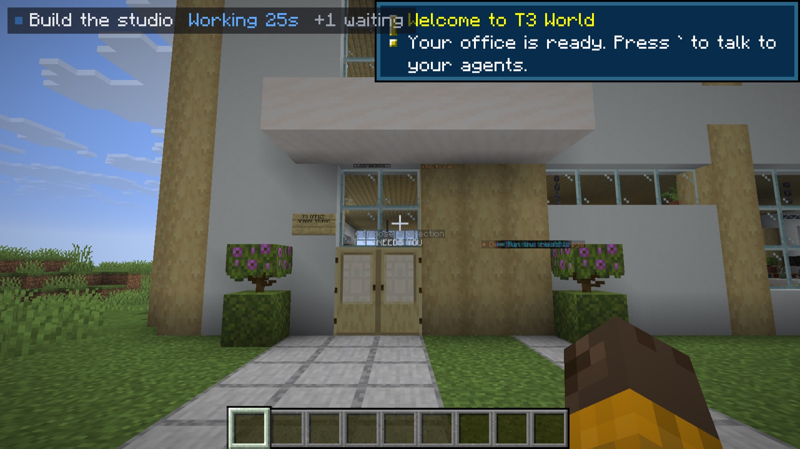
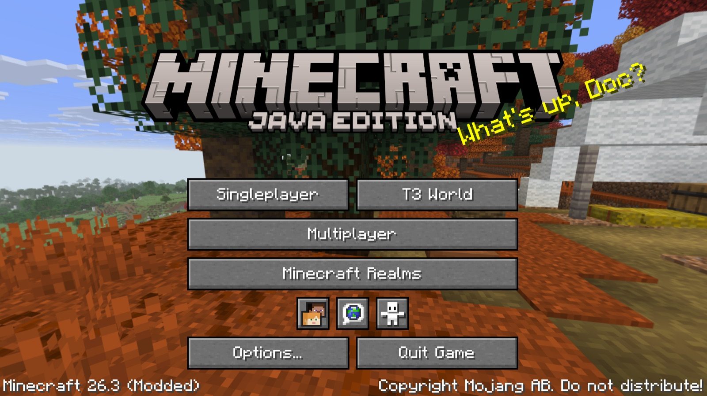
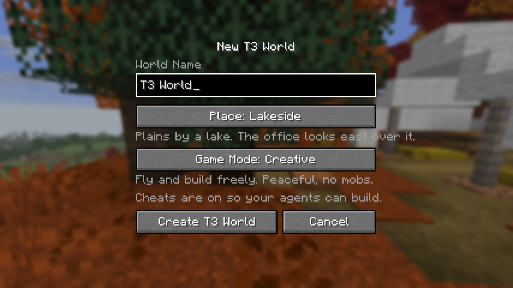
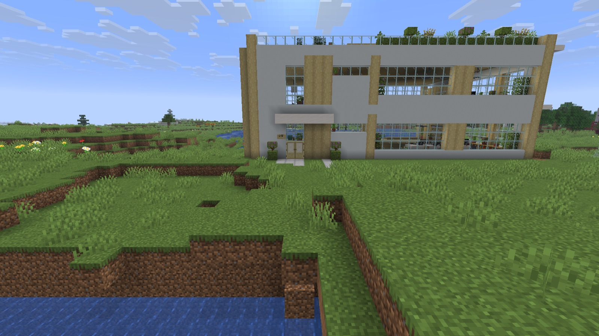
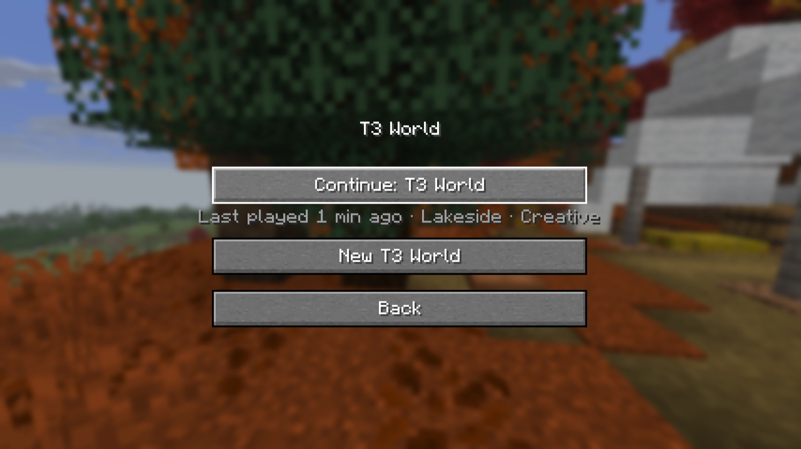
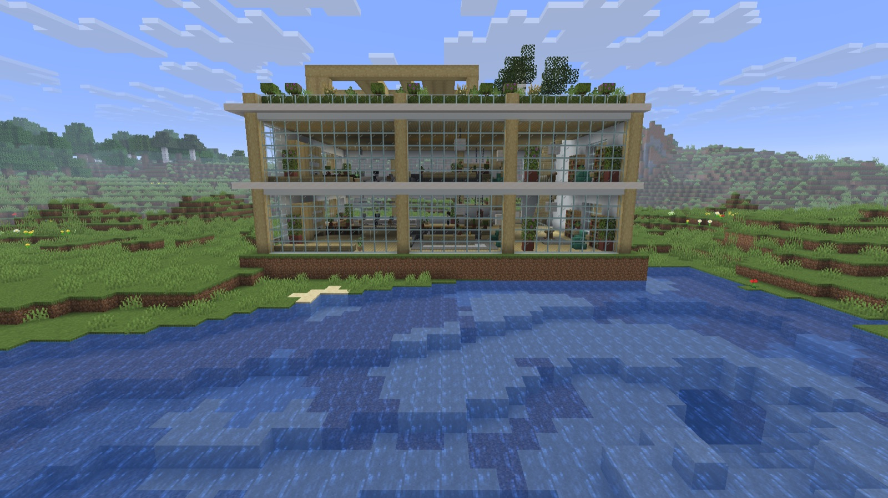
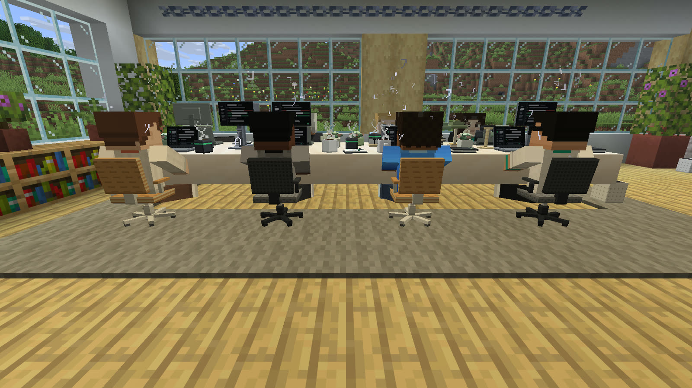
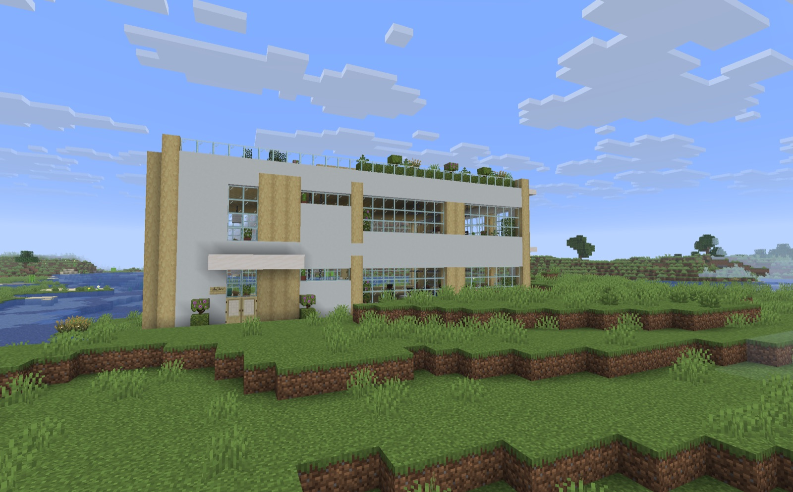
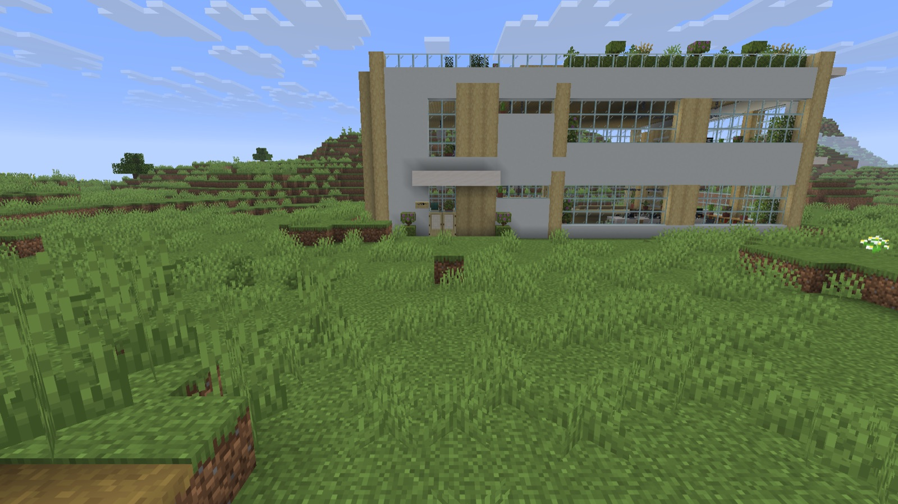
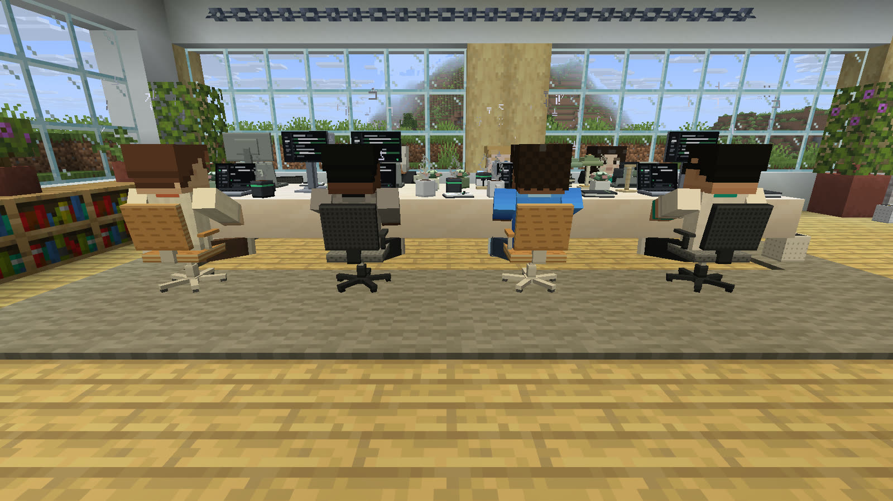

# Create T3 World: one click to your office

> **Status:** shipped in #9 · [full spec](../specs/t3-world-spec.md) · [seed report](../specs/seeds-report.md) · [office design A](office.md)

A T3 World is a Minecraft world made for working with your agents. You name it, pick a place and a game mode, and press one button. You load in on the plaza in front of your agents' office, looking at the door, with cheats on so agents can build, agent build on, and the gamerules you'd set yourself for a long coding session. The office is [design A, the Scandi Studio](office.md), turned so its glazing faces the view.

## The flow

<table>
  <tr>
    <td width="50%"></td>
    <td width="50%"></td>
  </tr>
  <tr>
    <td><b>1. Title screen.</b> The Singleplayer row is split: <i>Singleplayer</i> on the left, <i>T3 World</i> on the right. Nothing else moves.</td>
    <td><b>2. New T3 World.</b> Name, place and game mode, all pre-filled. Press Enter (or Create).</td>
  </tr>
  <tr>
    <td></td>
    <td></td>
  </tr>
  <tr>
    <td><b>3. You arrive</b> on the plaza facing the door. Your agents are already walking to their desks, and one welcome toast appears.</td>
    <td><b>Coming back?</b> <i>T3 World</i> → <i>Continue</i>, and you're in.</td>
  </tr>
</table>

**Two clicks to a playing world.** There's no pairing step and no toggles: cheats on, structures on, bonus chest off, hardcore off. Creative is Peaceful; Survival is Normal. The New T3 World screen is vanilla widgets in a 200-px column, so it fits a GUI scale 5 window:

- **World Name**, default `T3 World` (a taken name becomes `T3 World (2)`, like vanilla).
- **Place**: Lakeside (default), Cherry Plains, River Bend, Surprise me, Custom seed. A grey line under it says what you'll see.
- **Game Mode**: Creative or Survival.
- **Create T3 World** and **Cancel**. Enter creates, unless you've tabbed to Cancel.

## The office in the world

The glazed side faces the view and the agents sit at their desks, whichever way the building had to turn:

On River Bend the same office faces north over the river, a half turn from Lakeside's quarter turn; on Cherry Plains it is a clockwise quarter turn:

## Places

The seed list lives in `src/main/resources/t3craft/seeds.json` (classpath, not a datapack). Each place records the office **origin** and the way its glazing **faces**. The origin is the design's own origin, the inside floor corner of the ground floor, in world coordinates; the building is turned about that cell. These are the coordinates the mod uses, verified in-game with design A's full footprint (34 × 32 blocks with the plaza), and they supersede the 24 × 20 survey boxes in the [seed report](../specs/seeds-report.md#recorded-office-sites), which guided the choice of seeds. Cherry Plains and River Bend were pinned where the placement search put the office when the survey boxes turned out too small for design A.

| Place | Seed | Office origin | Glazing faces | Turn |
| --- | --- | --- | --- | --- |
| Lakeside (default) | `-2085440121970745551` | (8, 65, -2) | east, over the lake | counter-clockwise 90° |
| Cherry Plains | `-4474845086078965121` | (44, 63, 7) | west, toward the cherry trees | clockwise 90° |
| River Bend | `3478701220631481329` | (7, 64, -69) | north, over the river | 180° |

<table>
  <tr>
    <td width="33%" align="center"></td>
    <td width="33%" align="center"></td>
    <td width="33%" align="center"></td>
  </tr>
  <tr>
    <td><b>⭐ Lakeside</b> (default): plains by a broad lake, the office beside spawn.</td>
    <td><b>Cherry Plains</b>: the most uniform patch, cherry trees west, village beyond.</td>
    <td><b>River Bend</b>: plains on a river bend under a cherry hill.</td>
  </tr>
</table>

Survey maps from the seed report: north up, 256 × 256 blocks around spawn. 15 seeds were evaluated; why the others were dropped is in the <a href="../specs/seeds-report.md#other-evaluated-seeds">report</a>.

A recorded site is checked again at placement (flat within four blocks, no water under the footprint, read from the generator's noise heightmaps). If worldgen has drifted, the search below runs around it instead.

**Surprise me** and **Custom seed** have no recorded site, so the server looks for one: rings around spawn out to 160 blocks, four facings each, reading the generator's noise heightmaps without generating chunks (heights are cached on a 4-block grid, so the whole area costs a few thousand samples). A candidate is rejected if any footprint column is under water or the ground varies by more than four blocks; the rest are scored on flatness, distance from spawn and the view in front of the glazing (downhill or water wins). Capped at three seconds; the best so far wins.

## How it works

| Piece | File | What it does |
| --- | --- | --- |
| Marker | `T3WorldData` | Vanilla `SavedData` of the overworld at `<save>/dimensions/minecraft/overworld/data/t3craft/world.dat`: name, seed, mode, floors, then where the office and spawn went. The client writes it before the world starts; the server fills it in; the title screen scans saves for it. |
| Creation | `T3WorldCreator` | `WorldOpenFlows.createFreshLevel` with the seed, game mode, difficulty, cheats on and the normal world preset. All 26.3 world-creation API lives here. |
| Screens | `T3WorldScreen`, `T3WorldHubScreen` | Vanilla widgets in a 200-px column. The title button is added in `ScreenEvents.AFTER_INIT`. |
| First start | `T3WorldSetup` (via the `main` entrypoint `T3CraftCommon`) | On `SERVER_STARTED` of the integrated server: gamerules, office placement, spawn, morning, clear weather, `setupDone`. On the first join the player is put on the plaza (belt and braces). |
| Office | `OfficePlacement.placeAt(level, origin, facing, floors)` | The T3 World entry point: turns design A so its glazing faces `facing`, loads the chunks, grounds the footprint, places the blocks on the server thread and writes the signs. `/t3 office` uses the same `place` with no turn. |
| Frame | `OfficeFrame` | Origin plus turn. Blocks go through vanilla's structure transform and `BlockState.rotate` (facing, axis, pane connections); entity positions, yaws, hit tests and the whiteboard/lamp commands go through the same frame, so the agents, laptops, props, whiteboard and lectern are where the turned building has them. |
| Adoption | `T3CraftClient.adoptOffice` | Entering a T3 World records the server-built office as that save's office (once). Bare `/t3 office` then takes you to the door instead of building a second office; `/t3 office build` still rebuilds by hand. |

Gamerules set on first start: `keep_inventory` on, `respawn_radius` 0, `spawn_phantoms` off, `mob_griefing` off, `spawn_wandering_traders` off, `advance_time` on, `max_block_modifications` 1,000,000 (agents fill whole floors); Creative also turns `spawn_mobs` and `advance_weather` off.

You arrive seven blocks in front of the door, looking at it and a little up, so the canopy sign reads.

## Verifying

- `./gradlew worldCheck`: the seed list, the marker round-trip, spawn/door geometry for all four facings, and the frame: block, entity and yaw transforms, hit-test inverses, block-state rotation (door facing, log axis, pane connections) and turned sign/lamp commands. Part of `check` and `verify-ci.sh`.
- `./gradlew runClient -Pworldtest=<place> -Pconfig=$PWD/run/config/office-fixture.json -PmcpPort=25591` (with `python3 scripts/office/fixture.py` running): drives the real screens from the title screen with real clicks, creates the world, checks the player arrived on the plaza, waits for the fixture's agents to sit down and checks each working agent's Mannequin stands at its desk's world position, and writes `run/screenshots/t3world-<place>-{title,hub,new-world,arrival,plaza,lake,desks}.png`. The screenshots above come from that run for Lakeside and River Bend at GUI scale 5 with `guiScale:5` and `soundCategory_master:0.0` in `run/options.txt`.
