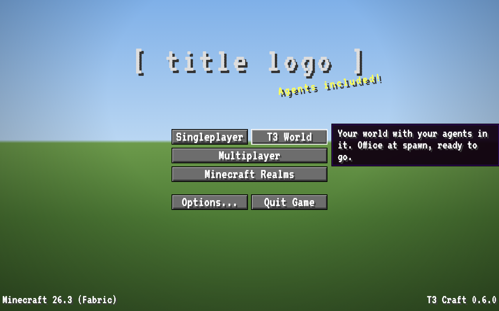
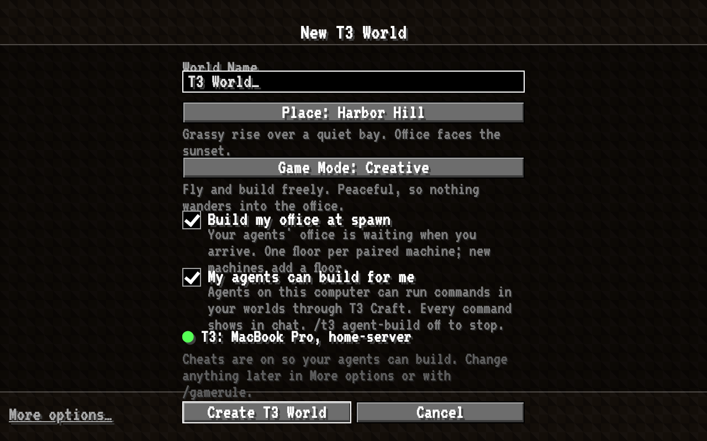
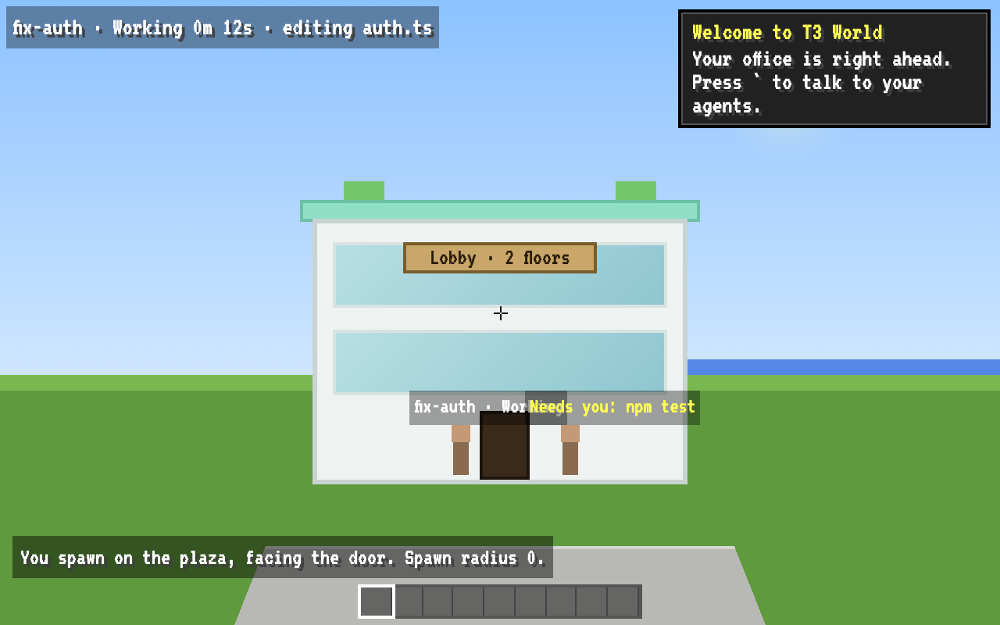
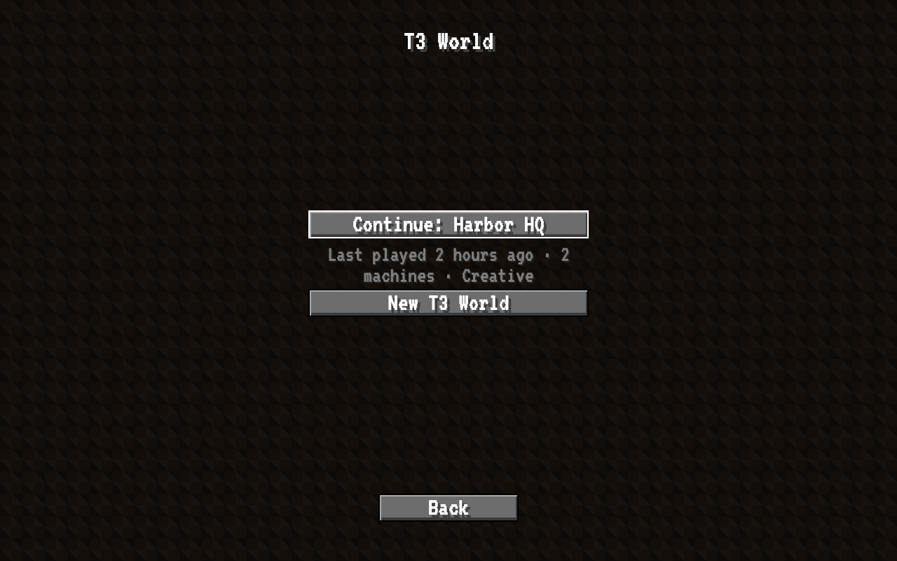
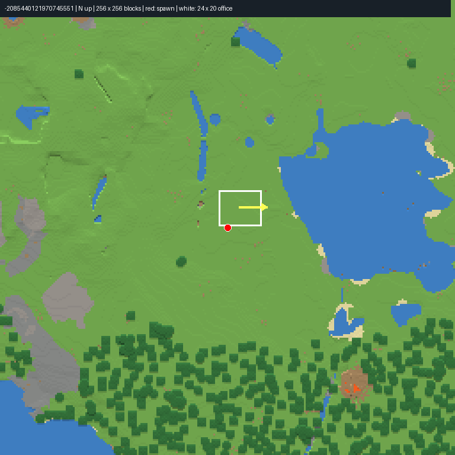
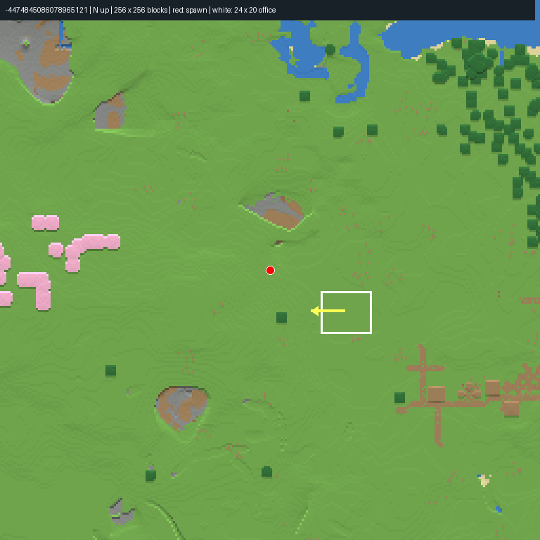
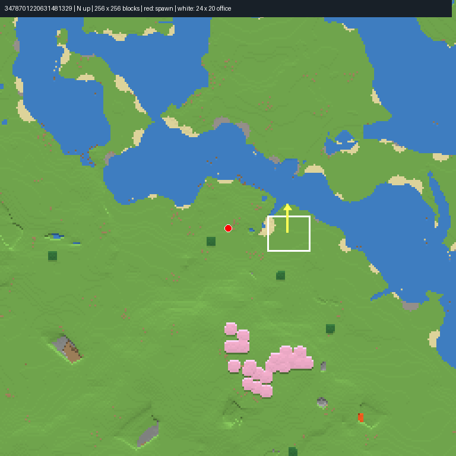

# Create T3 World

> **Status:** designed 2026-11-05 · next up for 0.6 · [full spec](../specs/t3-world-spec.md) · [seed report](../specs/seeds-report.md) · [interactive mockup](../specs/t3-world-mockup.html) (download and open locally)

One button on the title screen gives you a world with your office already standing at spawn and your agents walking in. You load in on the plaza, facing the door.

## The flow

<table>
  <tr>
    <td width="50%"></td>
    <td width="50%"></td>
  </tr>
  <tr>
    <td><b>1. Title screen.</b> <i>T3 World</i> sits next to Singleplayer. No other button moves.</td>
    <td><b>2. New T3 World.</b> Name, place and game mode, all pre-filled. Press Enter.</td>
  </tr>
  <tr>
    <td></td>
    <td></td>
  </tr>
  <tr>
    <td><b>3. You arrive</b> facing the office door. Agents walk in, and one welcome toast appears.</td>
    <td><b>Coming back?</b> <i>T3 World</i> → <i>Continue</i>, and you're in.</td>
  </tr>
</table>

These are mockups, so the seed names in them are placeholders. Real screenshots: <code>world-title</code>, <code>world-create</code>, <code>world-arrival</code> in <a href="../SCREENSHOTS.md">SCREENSHOTS.md</a>.

**Two clicks to a playing world.** There's no pairing step. The mod connects to your local T3 by itself ([decision](../DECISIONS.md#2026-11-05--zero-setup-auto-connect-to-the-local-t3)), so the mockup's old "Connect your agents" page is gone. Cheats are on so agents can build. There are no toggles for it and no confirmation dialogs.

## How it works, briefly

- A custom screen creates the world directly. There's no world preset and no worldgen datapack.
- On first start, the integrated server places the office's lobby, floors and roof from templates, sets spawn in front of the door and clears the weather. All of this happens behind the normal loading screen.
- For any seed without a recorded spot (*Surprise me*, custom seeds), a flat-spot search finds dry, level ground near spawn.
- Connecting another machine later adds one floor. Nothing you built nearby is touched.

## The seeds

Every candidate was generated on the official 26.3 server and measured column by column. The default is lakeside plains.

<table>
  <tr>
    <td width="33%" align="center"></td>
    <td width="33%" align="center"></td>
    <td width="33%" align="center"></td>
  </tr>
  <tr>
    <td><b>⭐ Lakeside plains</b> (default) <code>-2085440121970745551</code> Office at (-5, 65, -21), facing east over a broad lake. 13 blocks from spawn, flat within 1 block.</td>
    <td><b>Cherry plains</b> <code>-4474845086078965121</code> Office at (24, 64, 10), facing west toward a cherry grove. Village 157 blocks away. The most uniform patch.</td>
    <td><b>Riverside plains</b> <code>3478701220631481329</code> Office at (6, 65, 9), facing north over a river bend, with a cherry hill behind it.</td>
  </tr>
</table>

Maps show north up, 256 × 256 blocks. The red dot is spawn, the white box is the 24 × 20 office footprint, and the yellow arrow is the facing. 15 seeds were evaluated. Why the others were dropped is in the <a href="../specs/seeds-report.md#other-evaluated-seeds">seed report</a>.
