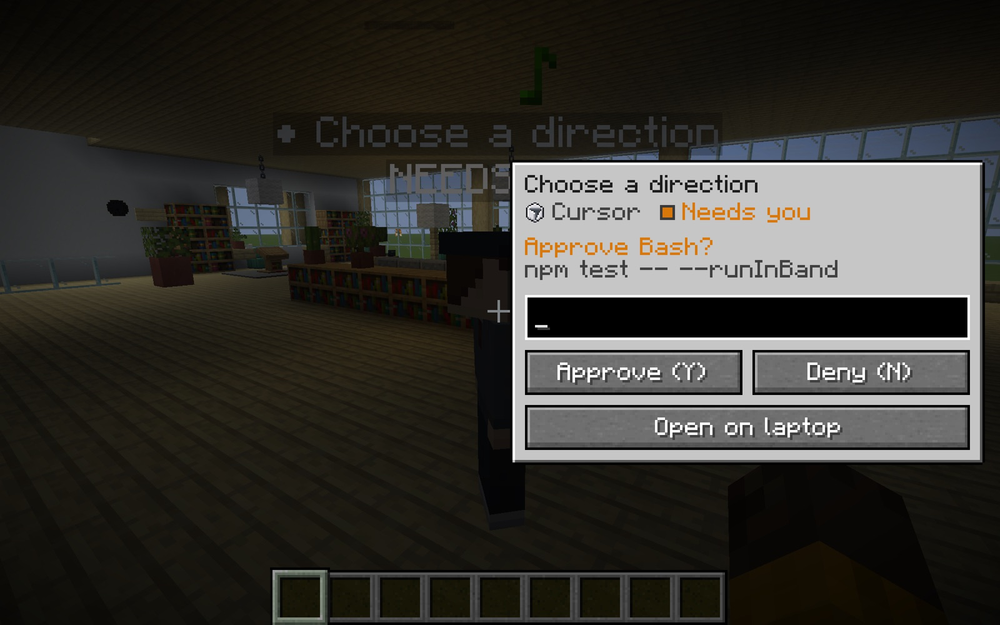

# Modrinth listing (ready to paste)

Draft copy for the T3 Craft project page on Modrinth. Nothing here is published yet. It describes what is on `main`: the office, the native laptop and agent card, and zero setup. Refresh the screenshots and version number before publishing.

## Project settings

| Field | Value |
| --- | --- |
| Name | T3 Craft |
| Slug | `t3craft` |
| Project type | Mod |
| Summary (max 256 chars) | Your T3 Code agents as characters in a Minecraft office. Talk to them from a plain Minecraft laptop screen, keep playing, and get one ping when an agent finishes or needs you. Zero setup. |
| Client side | Required |
| Server side | Optional (only for the shared server office) |
| Loaders | Fabric |
| Game versions | 26.3 |
| License | MIT (`LICENSE` in the repo) |
| Source | https://github.com/alexandros-lekkas/t3craft |
| Issues | https://github.com/alexandros-lekkas/t3craft/issues |
| Primary category | Utility |
| Additional categories | Management, Social |
| Icon | `src/main/resources/assets/t3craft/icon.png` (128x128). Modrinth accepts it; a 512x512 export of `scripts/icon-1024.png` looks sharper. |
| Gallery | `docs/images/shots/native-agent-card.jpg`, `docs/images/shots/native-laptop.png`, `docs/design/office/exterior.png`, `docs/design/office/interior.png`, `docs/images/ingame-agent-build.jpg`, plus the demo GIF below |

### First version

| Field | Value |
| --- | --- |
| Version number | the `version` in `gradle.properties` |
| Version title | T3 Craft <version> |
| Release channel | Beta (the mod relies on T3's undocumented client protocol) |
| Loaders | Fabric |
| Game versions | 26.3 |
| Dependencies | Fabric API: required |
| File | `build/libs/t3craft-<version>.jar` (from `./gradlew build`, or the `t3craft-jar` artifact of the tag workflow) |
| Changelog | Summarize the commits since the last release (see `git log`) |

## Description (Markdown body)

```markdown
**T3 Craft puts [T3 Code](https://t3.codes) inside Minecraft.** Your agents become player-shaped characters in an office. Click one and a small card opens beside it with its last message, an input box and Approve / Deny; press <kbd>`</kbd> for the laptop with all your active threads, in plain Minecraft. Go back to mining, and get one ping when an agent finishes or needs you. Agents can even see and build in your world.



> You need T3 Code running on the same computer. There is nothing to pair: T3 Craft finds it and connects by itself, and says one line in chat when it has. Tested against **T3 Code nightly 0.1.7-nightly.20261103.4119**.

## Features

- **The laptop.** <kbd>`</kbd> or a desk laptop opens a plain Minecraft screen sized for GUI scale 5: your active threads, the selected one, and one input box. No thread to pick first: it talks to the one that needs you, else the latest. (T3 Code's own web app can be streamed in instead with `webUi: true`.)
- **T3 World.** One button on the title screen makes a world with the office already standing at spawn, turned to face the lake. In any other world, `/t3 office` builds it where you stand.
- **The office.** A two-floor Scandinavian studio. Working agents type at their desks, agents that need you wait at the whiteboard, finished ones head to the lounge. Each provider has its own skins.
- **Pings, not spam.** The corner shows `Thread · Working 1m 12s`. When a thread finishes, fails, or needs you, you get one toast and a note-block sound. Press <kbd>`</kbd> within a minute to jump to it.
- **Decisions in game.** <kbd>J</kbd> lists every pending approval and question. <kbd>Y</kbd>/<kbd>N</kbd> and <kbd>1</kbd>-<kbd>9</kbd> answer them on the laptop and the agent card.
- **Report books.** When a thread you started from the game finishes, you get a written book with the agent's reply and the files it changed.
- **Shared server office.** Install on a Fabric server too; an operator runs `/t3office pair <link>` and `/t3office build`, and everyone sees the team's agents.
- **Let agents use Minecraft.** A loopback-only MCP server lets agents on your machine read the world and run commands as you. Every command shows in your chat.

## Setup

1. Install the T3 Craft pack (official Minecraft Launcher), or Fabric Loader 0.19.5+ for Minecraft 26.3 plus Fabric API with T3 Craft in `mods/`.
2. Start T3 Code. Launch Minecraft and click **T3 World**.

That's it. The pairing token is stored in `config/t3craft.json` with owner-only permissions; delete the file to forget it.

## Network and privacy

- Connects only to the T3 Code on your computer (or machines you add to `config/t3craft.json` by hand), over HTTP and WebSocket. Prompts never go through server chat.
- The MCP server listens on `127.0.0.1` only (port 25590, or the next free one) and refuses requests from web pages. The address in use is written to `config/t3craft-mcp.json`. Every command an agent runs shows in your chat.
- On a shared server, everyone can read thread titles on the agents' name tags. Only pair a server you share with people you would show them to.

## Compatibility

| | Version |
| --- | --- |
| Minecraft | 26.3 (Fabric) |
| Java | 25+ |
| T3 Code | current nightlies (protocol 2 and legacy protocol 1; the opt-in streamed UI is T3's own app) |

T3's client protocol is not a public API. When T3 changes it, T3 Craft tells you in game which side to update rather than failing quietly.

---

NOT AN OFFICIAL MINECRAFT PRODUCT. NOT APPROVED BY OR ASSOCIATED WITH MOJANG OR MICROSOFT. T3 Craft is an independent community project, not affiliated with or endorsed by T3 Tools Inc.
```

## Demo GIF shot list

Target: 15 to 25 seconds, 960x540 or larger, under 10 MB (Modrinth gallery limit is generous, but GitHub READMEs render big GIFs slowly). Record in a bright, readable world (a plains village works). Hide the F3 overlay. Use a short, visual prompt so the result fits the clip.

1. **Cold open (2 s).** Player at the office door, agents typing at their desks. Press <kbd>`</kbd>: the laptop opens.
2. **Prompt (3 s).** Click a thread, type `Build a small oak cabin 5 blocks in front of me` and press Enter: it sends and you are back in the game. The corner shows `Thread · Working 0m 03s`.
3. **Keep playing (3 s).** Walk away, mine a block or two while the timer ticks. This is the point of the mod; don't cut it.
4. **Approval (3 s).** Toast plus note-block: `Needs you: minecraft_run_command /fill ...`. Press <kbd>Y</kbd>.
5. **Agent builds (4 s).** Blocks appear in front of the player; each command the agent ran is logged in chat.
6. **Done ping (2 s).** Single "Done" toast. Press <kbd>`</kbd> to open the reply on the laptop.
7. **The office (3 s, optional).** Walk back in: the agent that finished is on the sofa. Click it and its card opens beside it.
8. **End card (1 s).** Freeze on the built cabin with the panel closed.

Setup before recording: add the MCP server to the agent (`claude mcp add --transport http -s user minecraft http://127.0.0.1:25590/mcp`), start a fresh thread so the agent sees the tools, and set the thread to approval-required so step 4 happens.

## Before publishing

- Record the GIF and in-game screenshots against the build being released.
- Change README install step 1 to point at the Modrinth page once it exists.
- Keep the T3 range here, in `README.md`, in `T3Api.SUPPORTED_T3`, and in `fabric.mod.json` in sync.
- Re-check the feature list against [REFERENCE.md](REFERENCE.md) before publishing.
